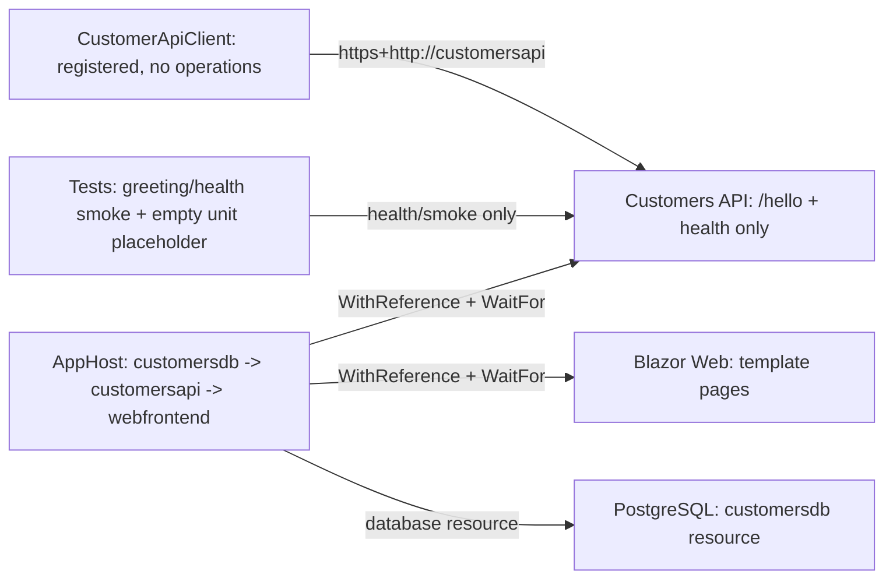
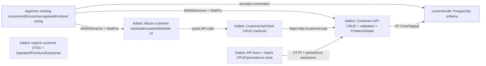
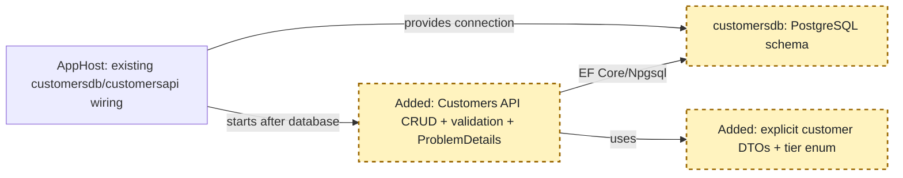
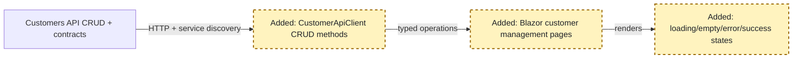
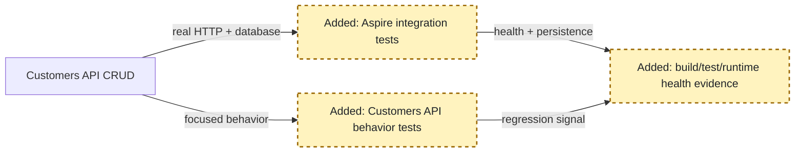

<!-- markdownlint-disable-file -->
# RPI Plan: SupportHub Customer Management

## Task Metadata

* Task ID: `feature-customers`
* Task slug: `feature-customers`
* Plan date: 2026-10-17

## Executive Summary

* Bottom line: Implement Customer Management as a bounded vertical slice across the existing Customers API, `customersdb` PostgreSQL resource, API-backed Blazor Web UI, and existing API/Aspire test projects.
* Why this matters: The repository already wires `customersdb` to `customersapi` and `customersapi` to `webfrontend`; the plan adds the missing domain behavior without introducing new infrastructure or violating service ownership.
* Planning result: Complete and implementation-ready; three standard critique passes completed with all substantive findings resolved.
* Implementation result: Complete; all planned customer-management phases and validation gates have passed.
* Confidence and uncertainty: High confidence in the architecture, resource names, ownership boundary, selected `Standard`/`Premium`/`Enterprise` tier vocabulary, and test seams. Production migration execution remains a downstream deployment decision.

### What You May Not Know

The current Customers API, typed client, customer UI, and customer unit tests are scaffolds. The plan therefore establishes the first concrete CRUD, EF Core, validation, UI state, and integration-test pattern rather than adapting an existing customer feature. The plan does not prescribe a production migration runner because deployment policy is not represented in this repository.

## Phase Checklist

### Before



### After



The existing Aspire graph remains the foundation. The change adds service-owned persistence and contracts, then consumes those contracts from Blazor, and finally proves the vertical slice through focused and distributed tests.

<!-- rpi:phase id=P01 -->
### [x] P01: Establish customer persistence and API contract

Goals:
* Establish a service-owned customer model, PostgreSQL persistence, migrations, validation, and CRUD HTTP behavior so the Customers API is a complete independently testable backend.

Dependencies:
* Existing `customersdb` reference and `customersapi` startup ordering in `src/SupportHub.AppHost/AppHost.cs`.
* Existing EF/Aspire package references in `src/SupportHub.Customers.Api/SupportHub.Customers.Api.csproj`.
* Selected support-tier vocabulary: `Standard`, `Premium`, `Enterprise`.



Highlighted work: service-owned `CustomerDbContext`, migration, customer contract types, validation, and CRUD endpoint behavior.

<!-- rpi:task id=P01-T01 -->
#### [x] P01-T01: Define the customer domain model and persistence mapping

Goals:
* Establish a durable customer record with a stable identifier and explicit mapping for name, email, phone number, and support tier.

Requirements:
* FR-001, FR-002, FR-003, FR-006, NFR-001, NFR-003.
* The persistence contract is service-owned and must include an opaque `Guid` identifier, required customer name and email, optional phone number, and a closed support-tier enum with `Standard`, `Premium`, and `Enterprise`.
* The model must support asynchronous query, insert, update, and delete operations through EF Core without exposing the persistence entity as an API response.

Details:
* Add a feature-oriented customer area under `src/SupportHub.Customers.Api` rather than a cross-service shared project.
* Define the entity and `CustomerDbContext` in the Customers API, including database constraints and length/requiredness rules that are consistent with the API validation contract.
* Keep phone validation permissive enough for international values while bounding storage length; use the selected tier enum so invalid tier values cannot enter the domain through normal request binding.
* Prefer the existing package set and dependency injection; do not introduce a repository abstraction without a concrete need.

References:
* [`src/SupportHub.Customers.Api/SupportHub.Customers.Api.csproj`](../../../src/SupportHub.Customers.Api/SupportHub.Customers.Api.csproj): existing `Aspire.Npgsql.EntityFrameworkCore.PostgreSQL` and EF Design dependencies.
* [`src/SupportHub.AppHost/AppHost.cs`](../../../src/SupportHub.AppHost/AppHost.cs): exact `customersdb` resource and Customers API reference.
* [`.copilot-tracking/research/2026-10-17/feature-customers-research.md`](../../research/2026-10-17/feature-customers-research.md): findings C1-C3, C9-C10 and decision D4.

Dependencies:
* None.

<!-- rpi:task id=P01-T02 -->
#### [x] P01-T02: Register EF Core with Aspire and create the initial migration

Goals:
* Connect the Customers API to the existing `customersdb` resource and create a reproducible schema migration for the customer table.

Requirements:
* FR-006, NFR-001, NFR-002, NFR-005.
* The API must resolve the database through the Aspire-provided `customersdb` connection and expose database health through the existing service-defaults pipeline.
* Add an EF Core migration under the Customers API and verify it creates the customer schema in the PostgreSQL resource.
* Apply the migration automatically only for the local/test execution path through an explicit development/test gate, and leave production migration execution disabled for deployment tooling.

Details:
* Use the version-matched Aspire EF PostgreSQL registration available from the existing package, with the exact connection name `customersdb`.
* Keep migration files in a service-owned migrations path and ensure the design-time context can be created by the existing EF tooling dependency.
* Use one deterministic mechanism: the Customers API applies `Database.MigrateAsync` during startup only when `SUPPORTHUB_APPLY_MIGRATIONS=true`; production leaves the flag disabled. Fail startup visibly if the migration cannot be applied.
* Add an explicit `SUPPORTHUB_TEST_MODE=true` AppHost configuration path that omits PostgreSQL `.WithDataVolume()` and uses a session-scoped/ephemeral PostgreSQL resource for integration tests. The test graph sets both flags before building, waits for `customersapi` health (which depends on successful migration startup), and then performs the first create against the fresh schema before the remaining lifecycle assertions.

References:
* [`src/SupportHub.AppHost/AppHost.cs`](../../../src/SupportHub.AppHost/AppHost.cs): `customersdb` is injected and awaited by `customersapi`.
* [`Directory.Packages.props`](../../../Directory.Packages.props): pinned Aspire `13.6.1` and EF Design package versions.
* [`.copilot-tracking/research/2026-10-17/feature-customers-research.md`](../../research/2026-10-17/feature-customers-research.md): findings C1, C2, C9 and external evidence W1-W2.
* [Applying Migrations - EF Core](https://learn.microsoft.com/en-us/ef/core/managing-schemas/migrations/applying): controlled production migration guidance.

Dependencies:
* P01-T01.

<!-- rpi:task id=P01-T03 -->
#### [x] P01-T03: Implement validated CRUD endpoints and API error contracts

Goals:
* Provide the complete customer HTTP surface with explicit contracts, validation, appropriate status codes, and structured errors.

Requirements:
* FR-001, FR-002, FR-003, FR-004, FR-005, NFR-003, NFR-004.
* The API contract is:

```text
GET    /customers              -> 200 with customer collection
GET    /customers/{id}         -> 200 with customer or 404
POST   /customers              -> 201 with customer and Location header, or 400 validation problem
PUT    /customers/{id}         -> 200 with updated customer, 400 validation problem, or 404
DELETE /customers/{id}         -> 204, or 404
```

  This is the binding HTTP contract for the feature.
* Requests must validate required name/email, email format, bounded field lengths, optional phone format/length, and the selected support-tier values before persistence.
* Preserve the existing Problem Details and exception-handler pipeline; validation and missing-resource errors must be structured and must not expose persistence details.
* All database I/O must be asynchronous and accept/propagate `CancellationToken`.

Details:
* Use Minimal APIs organized under the Customers feature and explicit request/response records. Map persistence entities to response contracts.
* Use `201 Created` with a resource location for successful creation, `200 OK` for retrieval/update, `204 No Content` for deletion, `404 Not Found` for unknown IDs, and structured `400 Bad Request` validation responses.
* Decide exact field length limits locally from database/provider constraints and document them in tests; do not invent business rules beyond the requested fields and selected tier enum.
* Keep list ordering deterministic so the UI and integration tests have stable behavior. Avoid adding pagination or search unless required by implementation evidence.

References:
* [`src/SupportHub.Customers.Api/Program.cs`](../../../src/SupportHub.Customers.Api/Program.cs): existing `AddProblemDetails`, exception handler, OpenAPI, and endpoint mapping.
* [`.github/copilot-instructions.md`](../../../.github/copilot-instructions.md): Minimal API, explicit contract, validation, status-code, and Problem Details conventions.
* [Validation in ASP.NET Core](https://learn.microsoft.com/en-us/aspnet/core/fundamentals/validation?view=aspnetcore-10.0): .NET 10 validation guidance.
* [`.copilot-tracking/research/2026-10-17/feature-customers-research.md`](../../research/2026-10-17/feature-customers-research.md): recommendation and alternatives.

Dependencies:
* P01-T01, P01-T02.

<!-- rpi:phase id=P02 -->
### [x] P02: Add API-backed Blazor customer management

Goals:
* Give support staff complete customer list, detail, create, edit, and delete workflows while keeping all data access behind the Customers API.

Dependencies:
* P01 complete: stable API contracts, endpoint behavior, and migration-backed persistence.
* Existing Interactive Server Blazor and service-discovery registration in `src/SupportHub.Web/Program.cs`.



Highlighted work: typed client methods, customer routes/components, forms, and explicit UI state handling.

<!-- rpi:task id=P02-T01 -->
#### [x] P02-T01: Add typed CustomerApiClient contracts and operations

Goals:
* Provide a strongly typed Web boundary for all customer reads and mutations.

Requirements:
* FR-001, FR-002, FR-003, FR-005, FR-007, NFR-001, NFR-002, NFR-004.
* The client must call only `https+http://customersapi` through the existing `HttpClient` registration and expose asynchronous list, get, create, update, and delete operations.
* The client must preserve meaningful API failures for pages to render, rather than silently returning success-shaped defaults.

Details:
* Add Web-owned request/response types that mirror the API contract without referencing Customers API implementation or EF Core types.
* Use `HttpClient` JSON helpers with cancellation support and explicit handling for `404`, validation `400`, and unexpected non-success responses.
* Keep the existing resilience and service-discovery defaults; do not add hard-coded hostnames, ports, or direct database configuration.

References:
* [`src/SupportHub.Web/Program.cs`](../../../src/SupportHub.Web/Program.cs): existing `CustomerApiClient` registration and `https+http://customersapi` address.
* [`src/SupportHub.Web/CustomerApiClient.cs`](../../../src/SupportHub.Web/CustomerApiClient.cs): current empty client extension point.
* [`.github/copilot-instructions.md`](../../../.github/copilot-instructions.md): typed client and service-boundary conventions.

Dependencies:
* P01-T03.

<!-- rpi:task id=P02-T02 -->
#### [x] P02-T02: Add customer list and detail views

Goals:
* Let staff browse customers and inspect a selected customer's details through API-backed routes.

Requirements:
* FR-002, FR-007, NFR-001.
* Provide distinct list and detail navigation under the existing `Components` structure.
* The list must render customer name, email, phone, and support tier; the detail view must handle a missing customer as a user-visible not-found state.
* Both views must represent loading, empty, success, and error states without direct persistence access.

Details:
* Follow the existing small-component and layout conventions. Add customer navigation without redesigning unrelated template pages.
* Keep route parameters and API identifiers strongly typed. Use deterministic ordering returned by the API.
* Display errors in a safe user-facing form while preserving enough context for support staff to retry or navigate.

References:
* [`src/SupportHub.Web/Components/Pages/Home.razor`](../../../src/SupportHub.Web/Components/Pages/Home.razor): current page baseline.
* [`src/SupportHub.Web/Components/Layout/NavMenu.razor`](../../../src/SupportHub.Web/Components/Layout/NavMenu.razor): existing navigation surface.
* [`.github/copilot-instructions.md`](../../../.github/copilot-instructions.md): Blazor component organization and explicit state conventions.

Dependencies:
* P02-T01.

<!-- rpi:task id=P02-T03 -->
#### [x] P02-T03: Add create, edit, and delete workflows

Goals:
* Let staff manage customer records end to end from Blazor while reflecting API validation and response states.

Requirements:
* FR-001, FR-003, FR-004, FR-005, FR-007, NFR-001, NFR-004.
* Create and edit forms must capture name, email, phone number, and Standard/Premium/Enterprise support tier.
* Invalid submissions must show API validation feedback and must not report success.
* Successful create/update/delete operations must navigate or refresh predictably and display the resulting state; failed or missing-resource operations must remain recoverable.

Details:
* Use Blazor form components and server-interactive event handling consistent with the existing project. Keep client-side hints complementary to server validation, not a duplicate business rule source.
* Provide a delete confirmation appropriate to the existing UI style and handle a concurrent/missing delete as a not-found/error state.
* Avoid adding caching of mutable customer records until correctness is established; preserve existing Redis output-cache wiring for unrelated Web behavior.

References:
* [`src/SupportHub.Web/Program.cs`](../../../src/SupportHub.Web/Program.cs): Interactive Server configuration and output-cache middleware.
* [`.github/copilot-instructions.md`](../../../.github/copilot-instructions.md): explicit UI states and no duplicated backend rules.
* [`.copilot-tracking/research/2026-10-17/feature-customers-research.md`](../../research/2026-10-17/feature-customers-research.md): selected tier vocabulary and API behavior recommendation.

Dependencies:
* P02-T01, P02-T02.

<!-- rpi:phase id=P03 -->
### [x] P03: Prove behavior with automated tests and Aspire runtime verification

Goals:
* Demonstrate that customer CRUD, validation, PostgreSQL persistence, service discovery, health ordering, and the completed solution remain reliable.

Dependencies:
* P01 and P02 complete.
* Existing test project references and Aspire Hosting Testing package.



Highlighted work: focused API tests, real Aspire graph tests, and final build/test/runtime checks.

<!-- rpi:task id=P03-T01 -->
#### [x] P03-T01: Add Customers API behavior and validation tests

Goals:
* Lock down pure customer validation, mapping, and domain behavior with fast, focused tests.

Requirements:
* FR-001, FR-004, FR-006, NFR-003, NFR-004, NFR-005.
* Cover valid and invalid customer value construction/mapping, required/format/tier validation, and all Standard/Premium/Enterprise values.
* Keep HTTP status codes, endpoint routing, structured error payloads, and persistence lifecycle assertions in P03-T02, where a real API host is available.

Details:
* Replace the empty placeholder in `tests/SupportHub.Customers.Api.Tests` with tests for validation/mapping/domain behavior that do not require a running distributed graph.
* Keep test data independent and deterministic. Add cases for Standard, Premium, and Enterprise tiers.
* Do not create brittle endpoint mocks in this project; the real HTTP boundary is covered once in P03-T02.

References:
* [`tests/SupportHub.Customers.Api.Tests/UnitTest1.cs`](../../../tests/SupportHub.Customers.Api.Tests/UnitTest1.cs): placeholder to replace.
* [`tests/SupportHub.Customers.Api.Tests/SupportHub.Customers.Api.Tests.csproj`](../../../tests/SupportHub.Customers.Api.Tests/SupportHub.Customers.Api.Tests.csproj): existing test project boundary.
* [`.copilot-tracking/research/2026-10-17/feature-customers-research.md`](../../research/2026-10-17/feature-customers-research.md): findings C12-C14 and test strategy.

Dependencies:
* P01-T03.

<!-- rpi:task id=P03-T02 -->
#### [x] P03-T02: Extend Aspire integration tests for CRUD and persistence

Goals:
* Prove the actual AppHost graph starts healthy and that HTTP operations persist and retrieve customer data through `customersdb`.

Requirements:
* FR-001, FR-002, FR-003, FR-004, FR-005, FR-006, FR-008, NFR-001, NFR-002, NFR-005.
* Use `DistributedApplicationTestingBuilder`, wait for `customersapi` health, and use `app.CreateHttpClient("customersapi")`.
* Exercise a create/read/list/update/delete lifecycle over HTTP and verify state across separate requests against a clean, isolated database/resource state.
* Configure the test graph with `SUPPORTHUB_TEST_MODE=true` and `SUPPORTHUB_APPLY_MIGRATIONS=true` before startup; the clean-state first create must succeed only after the gated migration path runs and `customersapi` becomes healthy. This is the schema-applied assertion.
* The same suite must verify validation responses, not-found responses, and the existing health coverage.
* Assert all required status codes and structured response/error contracts in this task: `201`, `200`, `204`, `400`, and `404`.

Details:
* Extend `CustomerApiTests` rather than creating a second distributed test harness.
* Keep assertions on response status, body fields, and persistence-visible behavior. Ensure test cleanup/disposal follows the current `await using` pattern.
* Make the test graph set `SUPPORTHUB_TEST_MODE=true` and `SUPPORTHUB_APPLY_MIGRATIONS=true` through its AppHost test configuration before startup. Tests must be serialized or fixture-scoped so the process-level test-mode configuration cannot leak between graphs. Do not rely on the normal developer data volume.

References:
* [`tests/SupportHub.AppHost.Tests/CustomerApiTests.cs`](../../../tests/SupportHub.AppHost.Tests/CustomerApiTests.cs): existing builder, health wait, and named HTTP-client pattern.
* [`tests/SupportHub.AppHost.Tests/SupportHub.AppHost.Tests.csproj`](../../../tests/SupportHub.AppHost.Tests/SupportHub.AppHost.Tests.csproj): Aspire Hosting Testing dependency.
* [`src/SupportHub.AppHost/AppHost.cs`](../../../src/SupportHub.AppHost/AppHost.cs): resource names and dependencies under test.

Dependencies:
* P01-T02, P01-T03.

<!-- rpi:task id=P03-T03 -->
#### [x] P03-T03: Run solution validation and Aspire runtime verification

Goals:
* Produce implementation evidence that the planned customer slice builds, tests, starts through Aspire, and has healthy affected resources.

Requirements:
* FR-007, FR-008, NFR-002, NFR-005.
* Run `dotnet restore SupportHub.slnx`, `dotnet build SupportHub.slnx`, the relevant Customers API and AppHost test projects, and the full solution test suite when targeted checks pass.
* Start or inspect the actual Aspire AppHost and verify `customersdb`, `customersapi`, and `webfrontend` reach expected health/readiness states.
* Inspect affected logs/traces for unexpected startup, migration, HTTP, or database errors and record the evidence in the implementation changes record.
* Verify the Blazor workflows through the existing Playwright CLI/runtime seam: list, detail, create, edit, delete, validation failure, not-found, loading, empty, and error states. If browser automation is unavailable, execute the same checklist manually against the Aspire endpoint and record the environment limitation and evidence.

Details:
* Use the repository Aspire orchestration and monitoring skills for lifecycle and runtime inspection; do not substitute ad-hoc hostnames or manual readiness polling.
* Use the repository Playwright CLI skill for browser-level verification without adding a new committed browser-test project unless implementation evidence demonstrates that runtime verification is insufficient.
* This task owns validation evidence, not source changes. Any failure should return to the affected implementation task rather than being papered over with test weakening.

References:
* [`SupportHub.slnx`](../../../SupportHub.slnx): solution build/test scope.
* [`src/SupportHub.AppHost/AppHost.cs`](../../../src/SupportHub.AppHost/AppHost.cs): affected runtime topology.
* [`.github/copilot-instructions.md`](../../../.github/copilot-instructions.md): required build, test, Aspire, health, logs, and traces checks.
* [`.agents/skills/playwright-cli/SKILL.md`](../../../.agents/skills/playwright-cli/SKILL.md): browser-level verification guidance.

Dependencies:
* P03-T01, P03-T02, P02-T03.

## User Decisions and Requirements

### Confirmed User Direction

* Scope is strictly `feature/customers`; do not implement tickets or other future features.
* Plan Customer creation, retrieval, update, and deletion with customer name, email, phone number, and support tier.
* Include customer listing and detail views in the Blazor UI.
* Use input validation, appropriate HTTP responses, PostgreSQL persistence through EF Core and `customersdb`, and automated API/integration tests.
* Preserve Customers API data ownership; Blazor accesses customer data through the API and never PostgreSQL directly.
* Implement the approved plan on `feature/customers`; do not create or submit a pull request.
* Use the completed research artifact as the primary evidence baseline.
* Support-tier values are the closed set `Standard`, `Premium`, and `Enterprise`.

### Planning Decisions and Feedback

| Group | Decision or feedback item | Status | Owner | Rationale or input needed | Evidence | Planning impact |
|-------|---------------------------|--------|-------|--------------------------|----------|-----------------|
| D1 | Use the existing AppHost graph and exact resources `customersdb`, `customersapi`, and `webfrontend` | confirmed | constraint/evidence | Existing wiring is sufficient; new infrastructure would add scope without need | research C1, C2, C5, C6 | Plan changes only source and test behavior within existing projects |
| D2 | Use an API-owned EF Core context/entity and explicit API DTOs | confirmed | evidence | Prevents persistence models crossing service boundaries and aligns with repository instructions | research C3, C9; `.github/copilot-instructions.md` | API contract and persistence tasks remain separate |
| D3 | Use `Standard`, `Premium`, `Enterprise` as the support-tier enum | confirmed | user | Resolved during research; affects validation, storage, and UI choices | research D4; user input | Include the values in the contract and UI requirements |
| D4 | Choose production migration application policy | deferred | downstream/deployment | Repository does not define deployment migration execution | research W2 | Commit migrations and verify local/test application; record production execution as a risk, not an implementation blocker |
| D5 | Verify the completed Blazor workflows through the existing Playwright CLI/runtime seam without adding a browser test project | confirmed | planner/evidence | The UI is a required behavior, while the repository has no browser test project; runtime browser verification proves the workflow without expanding committed test infrastructure | research C5-C8; `.agents/skills/playwright-cli` | P03-T03 owns a concrete browser verification checklist for list/detail/create/edit/delete and key states |

## Planning Readiness and Next Step

| Field | Record |
|-------|--------|
| Planning execution and readiness | Complete; implementation completed. Final standard critique passed with no open findings |
| Decision participation | user-owned; standalone planning invocation; confirmed direction is applied directly and no unresolved decision currently blocks phase design |
| Blockers | none |
| Latest critique | [`../../reviews/plans/2026-10-17/feature-customers-plan-critique-3.md`](../../reviews/plans/2026-10-17/feature-customers-plan-critique-3.md) with Pass |
| Relevant research | [`.copilot-tracking/research/2026-10-17/feature-customers-research.md`](../../research/2026-10-17/feature-customers-research.md) |
| Plan | `.copilot-tracking/plans/2026-10-17/feature-customers-plan.md` |
| Changes-record role | `.copilot-tracking/changes/2026-10-17/feature-customers-changes.md` is implementation evidence |
| Continuation owner | user |
| Required gates or confirmations | PC-001, PC-002, and PC-003 resolved; preserve the `feature/customers` boundary during implementation |
| Next action | Optional `/rpi-review` against the completed implementation and validation evidence |

## Goals

* Add complete customer CRUD behavior owned by `SupportHub.Customers.Api`.
* Persist customers in PostgreSQL through EF Core using the existing `customersdb` Aspire resource.
* Provide explicit, validated HTTP contracts and appropriate success/error responses.
* Provide API-backed Blazor list, detail, create, edit, and delete experiences.
* Prove behavior through focused API tests, Aspire integration tests, and runtime health/persistence verification.

## Scope and Non-Goals

### In Scope

* `src/SupportHub.Customers.Api`
* `src/SupportHub.Web`
* `tests/SupportHub.Customers.Api.Tests`
* `tests/SupportHub.AppHost.Tests`
* EF Core migration files owned by the Customers API
* Source-level verification of existing `src/SupportHub.AppHost/AppHost.cs` wiring; local/test migration configuration may be added without changing service ownership
* Aspire runtime verification for `customersapi`, `customersdb`, and `webfrontend`

### Non-Goals

* Ticket management, ticket/customer relationship behavior, Activity Worker, SLA services, or dashboard features beyond customer navigation
* Direct Web-to-PostgreSQL access
* New infrastructure resources, shared domain/repository projects, or service-boundary changes
* Production deployment automation or selection of a migration runner
* Pull-request creation, stack submission, or implementation in this phase

## Functional Requirements

* FR-001: Staff can create a customer with name, email, phone number, and support tier.
* FR-002: Staff can list customers and retrieve one customer by identifier.
* FR-003: Staff can update an existing customer and delete an existing customer.
* FR-004: The API validates external customer input and returns structured validation errors without persisting invalid data.
* FR-005: The API returns appropriate HTTP results for creation, reads, updates, deletion, validation failures, and missing customers.
* FR-006: Customer records persist in PostgreSQL through EF Core and the existing `customersdb` resource.
* FR-007: Blazor provides API-backed list, detail, create, edit, and delete flows with explicit loading, empty, success, and error states.
* FR-008: Automated tests cover API behavior, validation, distributed health, HTTP access, and persistence across requests.

## Non-Functional Requirements

* NFR-001: Customers API remains the sole owner of customer persistence; Web has no PostgreSQL, EF Core, or `customersdb` dependency.
  * Objective threshold or evaluation condition: no Web project reference or runtime configuration directly accesses the customer database; all customer operations use the typed API client.
* NFR-002: Service discovery and startup ordering use the exact existing Aspire resource names and `https+http://customersapi` URI pattern.
  * Objective threshold or evaluation condition: AppHost integration tests create an HTTP client for `customersapi` and wait for resource health before exercising behavior.
* NFR-003: API contracts remain separate from EF Core persistence entities.
  * Objective threshold or evaluation condition: request/response types are explicit and persistence entities are not returned directly.
* NFR-004: I/O is asynchronous and cancellation is propagated through API and client calls.
  * Objective threshold or evaluation condition: database and HTTP operations use asynchronous APIs with available cancellation tokens.
* NFR-005: The solution builds and relevant automated tests pass before implementation handoff.
  * Objective threshold or evaluation condition: `dotnet build SupportHub.slnx`, relevant `dotnet test` projects, and Aspire runtime checks complete successfully.

## Risks and Open Questions

| Priority | Type | Risk, question, or planning item | Affected work | Impact | Smallest action or evidence needed | Owner |
|----------|------|----------------------------------|---------------|--------|------------------------------------|-------|
| H | risk | No existing customer DbContext, migration, contract, or validation pattern exists | P01-T01, P01-T02, P01-T03 | First implementation establishes conventions and can expose EF/Aspire API mismatches | Verify the exact .NET 10/Aspire package API while implementing and keep the context service-owned | implementer |
| H | risk | Production migration execution policy is not in the repository | P01-T02, P03-T03 | An incorrect startup migration choice could create deployment contention or downtime | Confirm deployment policy before production use; keep local/test migration application controlled | downstream |
| H | risk | Web UI and API contract are both new | P02-T01, P02-T02, P02-T03 | Contract drift or incomplete state handling can break staff workflows | Define DTO/client methods before pages and exercise all response states | implementer |
| M | risk | Existing tests are greeting/health smoke tests and an empty unit placeholder | P03-T01, P03-T02 | CRUD and persistence regressions could pass unnoticed | Replace/add behavior and distributed persistence coverage | implementer |
| M | risk | Playwright/browser runtime access may be unavailable in a given environment | P03-T03 | UI evidence could be delayed even when API tests pass | Use the existing Playwright CLI when available; otherwise record the concrete manual checklist and environment limitation in the changes record | implementer |

## Dependencies

* `Aspire.Npgsql.EntityFrameworkCore.PostgreSQL` and `Microsoft.EntityFrameworkCore.Design` already referenced by `SupportHub.Customers.Api`: required for EF Core/Npgsql registration and migration authoring.
* AppHost resource names `customersdb`, `customersapi`, and `webfrontend`: required for service discovery, health ordering, and integration tests.
* Existing `Aspire.Hosting.Testing` test project: required for distributed AppHost verification.
* Completed research evidence: required baseline for ownership, endpoint shape, selected support tiers, migration risk, and test strategy.

## Sources

* [`.github/copilot-instructions.md`](../../../.github/copilot-instructions.md): repository architecture, service ownership, API, Web, Aspire, and testing constraints.
* [`src/SupportHub.AppHost/AppHost.cs`](../../../src/SupportHub.AppHost/AppHost.cs): exact PostgreSQL, Customers API, Web, reference, and startup-order resources.
* [`src/SupportHub.Customers.Api/Program.cs`](../../../src/SupportHub.Customers.Api/Program.cs): current API pipeline and scaffold endpoints.
* [`src/SupportHub.Customers.Api/SupportHub.Customers.Api.csproj`](../../../src/SupportHub.Customers.Api/SupportHub.Customers.Api.csproj): existing EF/Aspire package dependencies.
* [`src/SupportHub.Web/Program.cs`](../../../src/SupportHub.Web/Program.cs): typed client, service discovery, interactive server, and Redis configuration.
* [`src/SupportHub.Web/CustomerApiClient.cs`](../../../src/SupportHub.Web/CustomerApiClient.cs): current typed-client extension point.
* [`tests/SupportHub.AppHost.Tests/CustomerApiTests.cs`](../../../tests/SupportHub.AppHost.Tests/CustomerApiTests.cs): existing Aspire testing pattern.
* [`tests/SupportHub.Customers.Api.Tests/UnitTest1.cs`](../../../tests/SupportHub.Customers.Api.Tests/UnitTest1.cs): current unit-test gap.
* [`.copilot-tracking/research/2026-10-17/feature-customers-research.md`](../../research/2026-10-17/feature-customers-research.md): completed research findings C1-C14, W1-W3, and decisions D1-D5.
* Business sources: no BRD, PRD, or ADR was found in the workspace; no relevant business source was available beyond the caller requirements and completed research.

## Critique Disposition

* Critique setting and provenance: standard; default required by `rpi-plan`
* Critique status: Complete
* Latest critique and verdict: [`../../reviews/plans/2026-10-17/feature-customers-plan-critique-3.md`](../../reviews/plans/2026-10-17/feature-customers-plan-critique-3.md) with Pass
* Earlier critiques: initial standard critique at `../../reviews/plans/2026-10-17/feature-customers-plan-critique.md`; first follow-up at `../../reviews/plans/2026-10-17/feature-customers-plan-critique-2.md`
* Limitations: none; the final critique assessed the revised migration configuration and resource isolation

| Critique run and finding | Disposition | Action owner | Exact resolving evidence | Decision route | Plan response or residual risk |
| PC-001 | resolved | planning parent | P03-T03 now requires Playwright/runtime verification or a concrete manual checklist for all customer workflows and states | direct planner correction | FR-007 verification is explicit; browser tooling remains an execution-environment risk |
| PC-002 | resolved | planning parent | P01-T02 and P03-T02 now require `SUPPORTHUB_TEST_MODE=true`, `SUPPORTHUB_APPLY_MIGRATIONS=true`, omission of `.WithDataVolume()`, session-scoped database state, serialized fixture setup, and first-create-after-health assertion | direct planner correction | Production migration policy remains deferred |
| PC-003 | resolved | planning parent | P03-T01 now covers only pure validation/mapping/domain behavior; P03-T02 owns all HTTP status/error-contract assertions | direct planner correction | Unit and distributed test responsibilities are distinct |
| PC-002-FU | resolved | independent critique | `../../reviews/plans/2026-10-17/feature-customers-plan-critique-3.md` reconciles the explicit test flags, session-scoped database, serialized fixture, and schema assertion | direct critique assessment | No residual critique finding |

## Artifact Self-Check

* [x] Executive Summary, What You May Not Know, and the Phase Checklist are complete and precede supporting sections.
* [x] Confirmed direction, planning decisions, readiness, goals, scope, requirements, risks, and dependencies are consistent with the phase checklist.
* [x] Every `FR-nnn` and `NFR-nnn` is cited by at least one task.
* [x] Every phase and task has the required Goals, Requirements, Details, References, and Dependencies blocks.
* [x] Overall and phase Mermaid diagrams use stable IDs and required theme initialization.
* [x] Critique runs on the implementation-ready plan and every finding receives a disposition.
* Checked sections: task identity, executive summary, user direction, readiness, goals, scope, requirements, risks, dependencies, sources, phases, tasks, diagrams, initial critique, follow-up critique 2, final critique 3
* Missing or limited sections: none

## Follow-Up Items

* None

## Handoff

* Authoritative implementation handoff: Planning Readiness and Next Step
