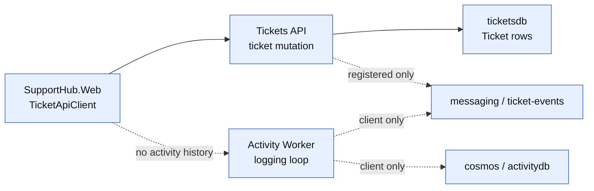
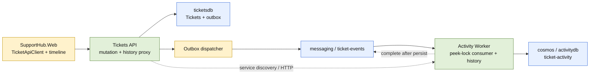
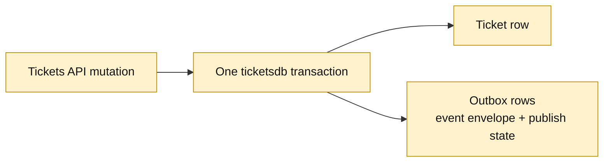
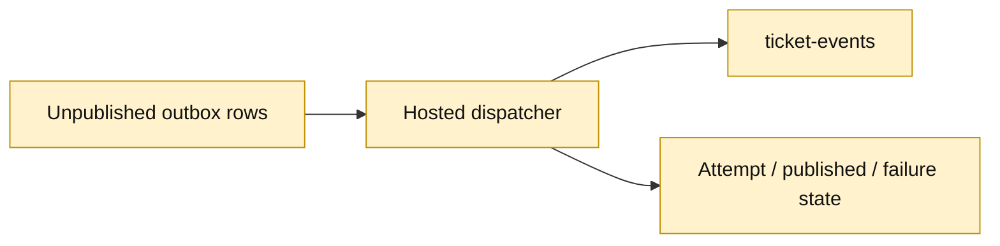
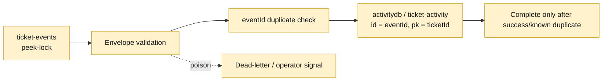
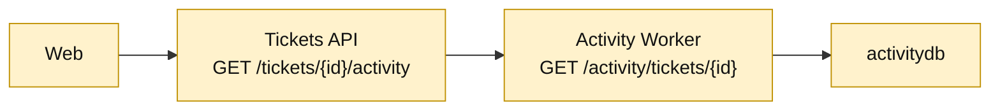
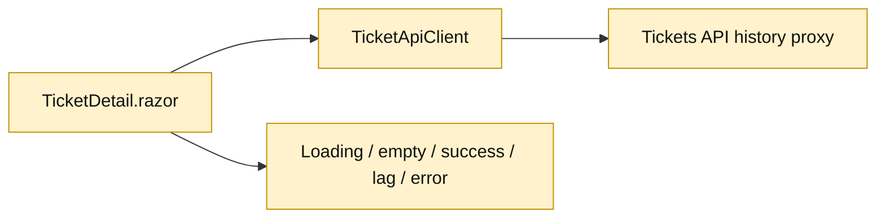
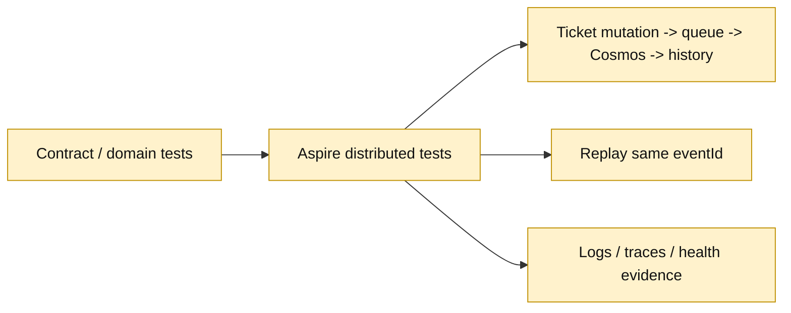

<!-- markdownlint-disable-file -->
# RPI Plan: SupportHub Activity and Audit

## Task Metadata

* Task ID: `supporthub-activity-and-audit`
* Task slug: `activity-and-audit`
* Plan date: 2026-10-18

## Executive Summary

* Bottom line: Add reliable ticket lifecycle events, an idempotent Activity Worker, Cosmos-backed ticket history, a backend history route, and a Blazor activity timeline while preserving SupportHub ownership boundaries.
* Why this matters: Tickets currently persist only to PostgreSQL and the Activity Worker is a logging stub. A transactional outbox closes the database-commit/message-send crash window; at-least-once delivery plus event-keyed Cosmos writes makes redelivery safe.
* Delivery shape: six ordered phases establish contracts/outbox, publish events, consume and persist activity, expose history, render the timeline, and verify the distributed behavior.
* Important consequence: The feature does not need new infrastructure resources because `messaging`, `ticket-events`, `cosmos`, and `activitydb` already exist. The Activity Worker must additionally expose a small internal read surface if the selected backend-proxy design is retained.
* Confidence and uncertainty: High confidence in the architecture and test seams. Exact Aspire 13.6.1 SDK signatures for the Service Bus processor, Cosmos container operations, and Worker HTTP hosting remain implementation-time validation gates.

## Phase Checklist

### Before



### After



| Phase | Outcome | Status |
|-------|---------|--------|
| P01 | Versioned event contracts and transactional outbox foundation are defined and persisted with ticket changes. | [x] |
| P02 | Outbox rows are dispatched to `ticket-events` with retry state and observable at-least-once publication. | [x] |
| P03 | Activity Worker consumes, validates, deduplicates, and persists immutable activity documents in Cosmos. | [x] |
| P04 | Activity history is exposed through backend APIs with exact Aspire service wiring. | [x] |
| P05 | Web loads and renders the activity timeline through `TicketApiClient`. | [x] |
| P06 | Unit, integration, end-to-end, and Aspire runtime evidence prove behavior and failure handling. | [x] |

### Implementation Task Status

| Marker | Status | Evidence |
|--------|--------|----------|
| `P01-T01` | [x] | Shared versioned contracts and serialized-shape tests |
| `P01-T02` | [x] | EF outbox model and generated migration |
| `P01-T03` | [x] | Atomic create/update outbox enlistment and integration flow |
| `P02-T01` | [x] | Tickets API hosted dispatcher and broker metadata |
| `P02-T02` | [x] | Bounded retry, terminal state, exponential backoff |
| `P02-T03` | [x] | Claim recovery, published retention cleanup, terminal/replay routes |
| `P03-T01` | [x] | Cosmos `ticket-activity` container and Activity Worker document model |
| `P03-T02` | [x] | Peek-lock processor, completion, abandon, and dead-letter paths |
| `P03-T03` | [x] | Conflict-safe create and bounded partition history query |
| `P04-T00` | [x] | Hybrid `WebApplication` host validated through build and Aspire health |
| `P04-T01` | [x] | Activity Worker `/internal/activity/{ticketId}` endpoint |
| `P04-T02` | [x] | Tickets API proxy, service discovery reference, existence check |
| `P05-T01` | [x] | Typed `TicketApiClient` activity contracts |
| `P05-T02` | [x] | Ticket detail loading, empty/error/loading states, timeline rendering |
| `P06-T01` | [x] | Contract unit tests and replay/idempotency integration coverage |
| `P06-T02` | [x] | Aspire event-to-history and duplicate replay test |
| `P06-T03` | [x] | Full build, targeted tests, Aspire health/log evidence, browser snapshot |

### P01 Highlighted After



### P02 Highlighted After



### P03 Highlighted After



### P04 Highlighted After



### P05 Highlighted After



### P06 Highlighted After



## User Decisions and Requirements

### Confirmed User Direction

* Implement only Activity and Audit on `feature/activity`, whose parent is `feature/attachments`.
* Publish `ticket-created`, `ticket-updated`, `status-changed`, and `assignment-changed` events from the Tickets API.
* Use the existing Service Bus `ticket-events` queue and Cosmos Linux emulator database `activitydb`.
* Define delivery guarantees, retries, idempotency, failure handling, explicit contracts, and observability.
* Expose ticket history through a backend endpoint; Web must not access Cosmos directly.
* Add a Blazor activity timeline and end-to-end event-processing tests.
* Keep this phase planning-only: do not modify application code or create a pull request.

### Planning Decisions and Feedback

| Group | Decision | Status | Owner | Evidence and rationale | Impact |
|-------|----------|--------|-------|-----------------------|--------|
| D1 | Use a transactional outbox in `ticketsdb`, not direct post-commit sends. | Settled recommendation | Planner from research | Direct send has a commit/send crash window; an outbox preserves durable event intent. | P01/P02 add schema, dispatcher, retry state, and tests. |
| D2 | Use versioned event envelopes; `eventId` is Service Bus `MessageId` and Cosmos document `id`. | Settled recommendation | Planner from research | Stable identity supports at-least-once redelivery and idempotent writes without shared persistence models. | P01/P03 define and enforce the contract. |
| D3 | Activity Worker owns Cosmos and exposes history; Tickets API proxies it; Web calls Tickets API. | Settled recommendation | Planner from research | Preserves service ownership without introducing a new Activity API project. | P03/P04/P05 add the read surface and service-discovery dependency. |
| D4 | Promise at-least-once delivery and idempotent processing, not exactly-once or strict ordering. | Settled constraint | User/research | Peek-lock delivery and crash recovery permit duplicates. | P02/P03/P06 test and document this behavior. |
| D5 | Run one standard critique after the plan is implementation-ready. | Settled default | Planning contract | No request to skip or use deep mode. | Readiness stays Not ready until critique findings are disposed. |

## Functional Requirements

* FR-001: A successful ticket creation creates one `ticket.created` event envelope containing ticket identity, initial state, event identity, schema version, and UTC occurrence time.
* FR-002: A successful ticket update creates one `ticket.updated` event; status changes also create `ticket.status-changed`; assignee changes also create `ticket.assignment-changed`, including transitions to or from `null`.
* FR-003: Ticket mutation and its outbox event rows commit atomically in `ticketsdb`; unpublished rows remain available for retry.
* FR-004: The dispatcher sends JSON events to `ticket-events`, awaits send outcomes, sets stable broker metadata, and records publish/retry state.
* FR-005: Activity Worker consumes with peek-lock semantics and completes only after successful or duplicate-safe Cosmos persistence.
* FR-006: Activity documents are stored in `activitydb` in a ticket-partitioned, event-keyed container; duplicate deliveries do not create duplicate records.
* FR-007: Invalid events and non-recoverable processing failures are explicitly logged and dead-lettered or retained for operator action; transient failures retry or redeliver.
* FR-008: Ticket history is exposed through a backend endpoint with deterministic ordering, bounded query behavior, and explicit empty/not-found/error responses.
* FR-009: Web retrieves history through `TicketApiClient` and renders loading, empty, success, eventual-consistency, retryable-error, and not-found states.
* FR-010: Tests prove event classification, outbox behavior, event consumption, duplicate handling, history reads, and end-to-end processing through Aspire.
* FR-011: Logs/traces expose event IDs, ticket IDs, attempts/delivery outcomes, duplicate detection, and failures without secrets or full sensitive payloads.

## Non-Functional Requirements

* NFR-001: Preserve ownership: Tickets API owns ticket/outbox data; Activity Worker owns activity documents; Web accesses backend APIs only.
* NFR-002: Use exact existing Aspire resource names and service discovery; do not add hard-coded hostnames or ports.
* NFR-003: State at-least-once delivery and idempotent processing honestly; do not claim exactly-once or strict ordering.
* NFR-004: Propagate cancellation and surface failures explicitly; do not use broad catches or success-shaped fallbacks.
* NFR-005: Preserve C#-first conventions and independently deployable services; do not share service-owned persistence models.
* NFR-006: Bound and communicate eventual consistency; use bounded polling/timeouts and capture diagnostics on timeout.
* NFR-007: Make failure and duplicate outcomes observable without exposing sensitive payloads.
* NFR-008: Keep the feature testable at unit, service, and distributed boundaries, with unsupported emulator cases identified.
* NFR-009: Bound background work and resource use through finite polling, backoff, concurrency, history limits, and UI refresh attempts.
* NFR-010: Preserve existing ticket, attachment, and client behavior; new activity behavior is additive and requires no pre-feature backfill.
* NFR-011: Make recovery and retention operationally safe: claim expiry, retry-to-terminal transition, operator-visible replay/query, and cleanup never remove unresolved intent.

### Requirement-to-Task Traceability

| Requirement IDs | Owning tasks | Acceptance evidence |
|-----------------|--------------|---------------------|
| `FR-001`-`FR-004` | `P01-T01`-`P01-T03`, `P02-T01`-`P02-T02`, `P06-T01` | Exact event JSON, atomic mutation tests, broker metadata, retry/publish state |
| `FR-005`-`FR-007` | `P03-T01`-`P03-T03`, `P06-T01`-`P06-T03` | Settlement, duplicate/conflict, failure-matrix, and diagnostic evidence |
| `FR-008`-`FR-009` | `P04-T00`-`P05-T02`, `P06-T02` | Hosting/API contract, service-discovery test, UI state evidence |
| `FR-010`-`FR-011` | `P06-T01`-`P06-T03` | Unit/distributed suite and correlated Aspire logs/traces |
| `NFR-001`-`NFR-003` | `P01-T02`, `P02-T01`-`P03-T03`, `P04-T02`, `P06-T02` | Ownership inspection, at-least-once/idempotency replay, no direct Cosmos access |
| `NFR-004`-`NFR-006` | `P01-T03`, `P02-T02`, `P03-T02`-`P05-T02`, `P06-T02`-`P06-T03` | Cancellation/error tests, bounded retries/polling, runtime health and timeout diagnostics |
| `NFR-007`-`NFR-009` | `P02-T01`-`P03-T03`, `P05-T02`, `P06-T01`-`P06-T03` | Correlated diagnostics, finite bounds, controlled failure matrix |
| `NFR-010`-`NFR-011` | `P01-T02`-`P02-T03`, `P04-T02`, `P06-T01`-`P06-T03` | Regression suite, recovery/cleanup tests, safe replay and retention evidence |

### Canonical Wire Contracts

The following shapes are binding for publisher, consumer, Activity Worker HTTP, Tickets API proxy, Web client, and contract tests. JSON property names use lower camel case; enum values are serialized as their names; UTC timestamps use ISO-8601 round-trip format; nullable fields are present with JSON `null`.

Common event envelope (the `actor` wire type is `string | null`):

```json
{
  "eventId": "00000000-0000-0000-0000-000000000001",
  "eventType": "ticket.created",
  "schemaVersion": 1,
  "ticketId": "00000000-0000-0000-0000-000000000010",
  "occurredAtUtc": "2026-10-18T12:00:00.0000000+00:00",
  "actor": null,
  "details": {
    "snapshot": {
      "title": "Unable to sign in",
      "description": "Support request",
      "status": "New",
      "priority": "High",
      "assignee": null,
      "customerId": "00000000-0000-0000-0000-000000000011",
      "createdAtUtc": "2026-10-18T12:00:00.0000000+00:00",
      "updatedAtUtc": "2026-10-18T12:00:00.0000000+00:00"
    }
  }
}
```

The `details` shapes are:

* `ticket.created`: the complete `snapshot` shown in the common envelope; `customerId` is a GUID string and all timestamps are exact ISO-8601 strings.
* `ticket.updated`: `{ "changes": [ { "field": "title", "before": "Old title", "after": "New title" }, { "field": "priority", "before": "Low", "after": "High" } ] }`. Allowed fields are exactly `title`, `description`, `status`, `priority`, `assignee`, and `customerId`; values are JSON strings, GUID strings, or `null` according to the field.
* `ticket.status-changed`: `{ "before": "Open", "after": "InProgress" }`.
* `ticket.assignment-changed`: `{ "before": null, "after": "agent@example" }`.

History response:

```json
{
  "ticketId": "00000000-0000-0000-0000-000000000010",
  "items": [
    {
      "id": "00000000-0000-0000-0000-000000000001",
      "eventType": "ticket.created",
      "schemaVersion": 1,
      "ticketId": "00000000-0000-0000-0000-000000000010",
      "occurredAtUtc": "2026-10-18T12:00:00.0000000+00:00",
      "actor": null,
      "details": {
        "snapshot": {
          "title": "Unable to sign in",
          "description": "Support request",
          "status": "New",
          "priority": "High",
          "assignee": null,
          "customerId": "00000000-0000-0000-0000-000000000011",
          "createdAtUtc": "2026-10-18T12:00:00.0000000+00:00",
          "updatedAtUtc": "2026-10-18T12:00:00.0000000+00:00"
        }
      }
    }
  ],
  "limit": 100
}
```

Items are the latest `limit` entries for the ticket, ordered ascending by `occurredAtUtc`, then `id`; `limit` is a finite positive value capped by configuration. The response intentionally has no `hasMore` flag or pagination claim; continuation/pagination is outside this feature and the UI presents the bounded latest window. Error responses use these exact ASP.NET Problem Details values: `400` `{ "type": "https://supporthub/errors/invalid-ticket-id", "title": "Invalid ticket ID", "status": 400, "detail": "The ticket ID is not a valid GUID." }`; `404` `{ "type": "https://supporthub/errors/ticket-not-found", "title": "Ticket not found", "status": 404, "detail": "The requested ticket does not exist." }`; `503` `{ "type": "https://supporthub/errors/activity-unavailable", "title": "Activity unavailable", "status": 503, "detail": "Ticket activity is temporarily unavailable." }`; and `502` `{ "type": "https://supporthub/errors/activity-contract-invalid", "title": "Activity contract invalid", "status": 502, "detail": "The activity service returned an invalid response." }`. These status/body mappings are asserted by proxy tests.

### Business Sources

No BRD, PRD, or ADR was supplied or found for this feature. The binding sources are the user requirements, repository instructions, feature prompt, and completed research artifact.

## Planning Readiness

| Field | Record |
|-------|--------|
| Execution status | Complete; standard critique sequence passed |
| Readiness | Ready for implementation planning handoff, with P04-T00 and P06-T03 remaining hard implementation gates |
| Decision participation | `user-owned`, standalone/manual RPI provenance; evidence-backed recommendations are applied directly because no unresolved material choice currently requires input |
| Blockers | None at planning intake |
| Implementation-time gates | Validate exact Aspire 13.6.1 APIs; settle outbox concurrency/retention thresholds; verify Worker HTTP hosting shape; run Aspire runtime diagnostics |
| Changes record | `.copilot-tracking/changes/2026-10-18/activity-and-audit-changes.md` |
| Next eligible stage | `/rpi-implement` only after readiness becomes Ready |

## Phase Details

### P01 — Establish event contracts and atomic outbox intent

Goals: Define explicit, versioned lifecycle events and make event intent commit atomically with ticket mutations. This phase establishes the durable source of truth that later publication and consumption can safely retry.

#### P01-T01 — Define lifecycle event contracts and classification

Goals: Provide serializable contracts for `ticket.created`, `ticket.updated`, `ticket.status-changed`, and `ticket.assignment-changed`, including stable identity, schema version, ticket identity, UTC occurrence time, optional actor metadata, and immutable event-specific details.

Requirements:

* `FR-001`, `FR-002`, `FR-004`, `NFR-003`, `NFR-005`
* Use a shared envelope shape without exposing EF entities or Web request contracts.
* Preserve null-to-value and value-to-null assignment transitions.
* Keep event names, JSON casing, and versioning explicit and testable.

Details:

The contract is binding for publisher, consumer, and tests:

```json
{
  "eventId": "uuid",
  "eventType": "ticket.status-changed",
  "schemaVersion": 1,
  "ticketId": "uuid",
  "occurredAtUtc": "2026-10-18T12:00:00Z",
  "actor": null,
  "details": {
    "before": "open",
    "after": "in-progress"
  }
}
```

Event-specific details are binding typed shapes: `ticket.created` uses `snapshot`; `ticket.updated` uses `changes`, an ordered array of `{ field, before, after }` entries; `ticket.status-changed` uses `{ before, after }` status values; and `ticket.assignment-changed` uses `{ before, after }` nullable assignee values. Field names and JSON casing are explicit, null transitions are represented as JSON `null`, and unsupported future versions are rejected explicitly by the consumer. Tests must assert the exact shape for create, ordinary update, status-only, assignment-only, combined, and null-assignment transitions.

References:

* [src/SupportHub.Tickets.Api/Features/Tickets/TicketContracts.cs](../../../src/SupportHub.Tickets.Api/Features/Tickets/TicketContracts.cs) — existing HTTP contract conventions; do not reuse as broker contracts.
* [src/SupportHub.Tickets.Api/Features/Tickets/Ticket.cs](../../../src/SupportHub.Tickets.Api/Features/Tickets/Ticket.cs) — source fields for event details.
* [.copilot-tracking/research/2026-10-18/activity-and-audit-research.md](../../research/2026-10-18/activity-and-audit-research.md) — selected event envelope and identity decisions.

Dependencies:

* None.

#### P01-T02 — Add outbox persistence model and migration

Goals: Store serialized event envelopes, publish state, attempt metadata, and timestamps in `ticketsdb` so publication can resume after process failure.

Requirements:

* `FR-003`, `FR-004`, `NFR-001`, `NFR-004`
* Add the outbox entity and EF configuration to the Tickets API persistence model.
* Add an index that supports selecting unpublished/retryable rows in occurrence/order order.
* Add a migration and update the model snapshot without changing existing ticket or attachment ownership.
* Record enough state to distinguish pending, in-progress, published, and terminal failure without silently dropping rows.

Details:

Use a persisted event envelope payload rather than reconstructing events from mutable ticket rows. The implementer may choose exact status/attempt column names after checking the current EF conventions. The plan assumes retry backoff and retention are bounded by configuration; implementation must record the chosen values in code/configuration and tests.

References:

* [src/SupportHub.Tickets.Api/Features/Tickets/TicketDbContext.cs](../../../src/SupportHub.Tickets.Api/Features/Tickets/TicketDbContext.cs) — current EF model seam.
* [src/SupportHub.Tickets.Api/Migrations/20261018040659_AddTicketAttachments.cs](../../../src/SupportHub.Tickets.Api/Migrations/20261018040659_AddTicketAttachments.cs) — migration style.
* [Directory.Packages.props](../../../Directory.Packages.props) — pinned package versions.

Dependencies:

* Depends on `P01-T01`.

#### P01-T03 — Enlist event creation in ticket mutations

Goals: Ensure successful ticket create/update operations write the correct outbox rows in the same database transaction as the ticket change, while failed mutations write neither a misleading ticket state nor a publishable event.

Requirements:

* `FR-001`, `FR-002`, `FR-003`, `NFR-001`, `NFR-004`
* Create produces `ticket.created`.
* Every successful update produces `ticket.updated`; status and assignment transitions produce their corresponding specialized events.
* Compare pre-update and post-update values before the tracked entity state is overwritten.
* Preserve current HTTP behavior and validation/error handling.
* Propagate cancellation through EF operations.

Details:

The update path already has the old entity values before validation applies new values. Use that seam, and ensure all event rows and the ticket mutation share one `SaveChangesAsync` unit of work. The implementation may use a domain/event factory or feature-local helper; it must not create a repository abstraction solely for this feature.

References:

* [src/SupportHub.Tickets.Api/Features/Tickets/TicketEndpoints.cs](../../../src/SupportHub.Tickets.Api/Features/Tickets/TicketEndpoints.cs) — create/update behavior.
* [src/SupportHub.Tickets.Api/Features/Tickets/TicketDbContext.cs](../../../src/SupportHub.Tickets.Api/Features/Tickets/TicketDbContext.cs) — transaction/model seam.
* [tests/SupportHub.AppHost.Tests/TicketsApiTests.cs](../../../tests/SupportHub.AppHost.Tests/TicketsApiTests.cs) — existing mutation behavior.

Dependencies:

* Depends on `P01-T01` and `P01-T02`.

### P02 — Publish outbox events with observable retries

Goals: Deliver committed outbox intent to `ticket-events` with stable broker metadata, retryable failures, and no false published state. This phase establishes the publisher side of the at-least-once contract.

#### P02-T01 — Implement the outbox dispatcher

Goals: Run a bounded, cancellation-aware dispatcher that selects eligible outbox rows, sends JSON messages, and marks rows published only after Service Bus accepts them.

Requirements:

* `FR-004`, `NFR-002`, `NFR-003`, `NFR-004`, `NFR-011`
* Use the existing `messaging` client/resource and exact queue `ticket-events`.
* Set `MessageId = eventId`, `Subject = eventType`, `ContentType = application/json`, and `CorrelationId = ticketId`.
* Do not delete or mark an event published before a successful send.
* Prevent concurrent dispatchers from repeatedly claiming the same row beyond the chosen safe strategy.
* Log event ID, ticket ID, attempt, outcome, and exception category without logging secrets.

Details:

Validate the exact Aspire 13.6.1 registration and Azure SDK send APIs during implementation. A hosted service in Tickets API is the default shape because the AppHost already owns the API process; if the runtime model makes a separate dispatcher necessary, keep it within the Tickets API ownership boundary and record the deviation. The dispatcher must tolerate a crash after send and before marking published; the consumer’s idempotency is the safety net.

References:

* [src/SupportHub.Tickets.Api/Program.cs](../../../src/SupportHub.Tickets.Api/Program.cs) — existing `AddAzureServiceBusClient("messaging")` registration.
* [src/SupportHub.AppHost/AppHost.cs](../../../src/SupportHub.AppHost/AppHost.cs) — exact resource and queue names.
* [.github/copilot-instructions.md](../../../.github/copilot-instructions.md) — service discovery and Aspire boundaries.

Dependencies:

* Depends on `P01-T02` and `P01-T03`.

#### P02-T02 — Define retry, terminal failure, and retention policy

Goals: Make outbox retry behavior deterministic, bounded, and diagnosable without silently losing committed event intent.

Requirements:

* `FR-004`, `FR-007`, `FR-011`, `NFR-003`, `NFR-006`
* Classify transient send failures for retry and non-retryable serialization/configuration failures for terminal operator action.
* Persist attempt count and last failure details sufficient for diagnosis.
* Bound polling/backoff and avoid unbounded hot loops.
* Define a retention/cleanup rule that does not remove unpublished or terminally unresolved rows.

Details:

The exact thresholds are an implementation decision to be recorded in configuration and tests. Favor exponential backoff with a cap and a visible terminal state; do not invent a second durable queue. If terminal failures require manual replay, preserve the original `eventId` so replay remains idempotent downstream.

The minimum lifecycle is binding: `Pending` becomes `InProgress` with a lease/claim expiry; a crashed or expired claim returns to `Pending`; retryable failures increment attempts and set `NextAttemptAtUtc`; exceeding the configured retry ceiling becomes `TerminalFailure` with the serialized event retained; successful send becomes `Published` with `PublishedAtUtc`. Published rows may be cleaned only after a configured retention period and only when no unresolved state remains. Operator recovery must be able to query terminal rows and replay the original payload/`eventId`; cleanup must never delete pending, in-progress, or terminal rows.

References:

* [src/SupportHub.ServiceDefaults/Extensions.cs](../../../src/SupportHub.ServiceDefaults/Extensions.cs) — shared resilience/telemetry conventions.
* [.copilot-tracking/research/2026-10-18/activity-and-audit-research.md](../../research/2026-10-18/activity-and-audit-research.md) — at-least-once and failure-handling evidence.

Dependencies:

* Depends on `P02-T01`.

#### P02-T03 — Add executable outbox recovery and retention maintenance

Goals: Give operators a bounded, observable way to recover expired claims, replay selected terminal events without changing identity, and clean only safely retained published rows.

Requirements:

* `FR-004`, `FR-007`, `FR-011`, `NFR-009`, `NFR-011`
* Add an `OutboxMaintenanceService` owned by Tickets API that runs on a finite configured interval.
* Recover expired `InProgress` claims and return them to retryable `Pending` state.
* Support an internal Tickets API maintenance surface that enumerates terminal rows and replays selected event IDs, resetting only those rows to `Pending` while preserving the original serialized payload and `eventId`.
* Emit an operator-visible health/log signal for terminal rows and maintenance actions; do not map the maintenance surface through Web.
* Delete only `Published` rows older than configured retention; never delete pending, in-progress, or terminal-unresolved rows.

Details:

This is the smallest operational surface that does not add a new project or Web dependency. Add internal-only `GET /internal/outbox/terminal` and `POST /internal/outbox/{eventId}/replay` operations on Tickets API, keep them outside public Web routes, and require the configured internal maintenance key before serving either route; an absent or mismatched key must not reveal route or event existence. The maintenance service remains the owner of claim recovery and cleanup. The operator response includes event ID, ticket ID, state, attempt count, last error category, and timestamps without the full payload; replay preserves the original payload and identity. Deterministic unit and endpoint tests verify access denial, authorized enumeration/replay, claim recovery, and cleanup exclusion rules.

References:

* [src/SupportHub.Tickets.Api/Program.cs](../../../src/SupportHub.Tickets.Api/Program.cs) — hosted-service registration seam.
* [src/SupportHub.ServiceDefaults/Extensions.cs](../../../src/SupportHub.ServiceDefaults/Extensions.cs) — health/observability conventions.
* [src/SupportHub.Sla.Console/Program.cs](../../../src/SupportHub.Sla.Console/Program.cs) — existing operational-client boundary; no Web route or direct database access is added.
* [.copilot-tracking/research/2026-10-18/activity-and-audit-research.md](../../research/2026-10-18/activity-and-audit-research.md) — outbox recovery and cleanup risk.

Dependencies:

* Depends on `P02-T02`.

### P03 — Consume and persist idempotent activity

Goals: Replace the Worker stub with a validated, retry-safe Service Bus consumer that owns immutable activity documents in Cosmos and exposes a read seam for later phases.

#### P03-T01 — Register Cosmos container and activity document model

Goals: Represent immutable ticket activity in `activitydb` using an event-keyed document ID and ticket-scoped partitioning.

Requirements:

* `FR-006`, `NFR-001`, `NFR-002`, `NFR-005`
* Use the existing `cosmos` resource and `activitydb` database.
* Use a `ticket-activity` container or the exact implementation name recorded during API validation, with partition key `/ticketId`.
* Store `id = eventId`, event type, ticket ID, occurrence time, schema version, actor/details, and processing metadata needed by the read model.
* Keep Cosmos models owned by Activity Worker; do not share persistence types with Tickets API or Web.

Details:

Validate whether the emulator requires explicit container creation in AppHost or application startup. Prefer point-read conflict handling and partition-scoped history queries. A conflict for the same `eventId` with different immutable payload should be surfaced as a data-integrity error and routed to operator handling, not overwritten silently.

References:

* [src/SupportHub.Activity.Worker/Program.cs](../../../src/SupportHub.Activity.Worker/Program.cs) — current Cosmos registration seam.
* [src/SupportHub.AppHost/AppHost.cs](../../../src/SupportHub.AppHost/AppHost.cs) — `activitydb` resource reference.
* [src/SupportHub.Activity.Worker/Worker.cs](../../../src/SupportHub.Activity.Worker/Worker.cs) — current Worker stub to replace.

Dependencies:

* Depends on `P01-T01`.

#### P03-T02 — Implement Service Bus processor and settlement

Goals: Receive `ticket-events` messages with peek-lock semantics, validate contracts, persist activity, and settle messages according to outcome.

Requirements:

* `FR-005`, `FR-007`, `FR-011`, `NFR-003`, `NFR-004`
* Complete only after Cosmos persistence succeeds or the same `eventId` is positively recognized as an equivalent existing document.
* Abandon/redeliver transient Cosmos or dependency failures.
* Dead-letter malformed JSON, unsupported schema versions, missing required fields, and conflicting duplicate payloads with a useful reason.
* Configure processor cancellation, concurrency, lock renewal, and retry behavior through supported SDK APIs.
* Include event ID/ticket ID in structured logs and correlation context.

Details:

The processor may use the Azure SDK’s hosted processing callbacks or an equivalent long-running service, subject to exact package API validation. Do not acknowledge messages merely because deserialization succeeded. The implementation must distinguish a duplicate-safe success from a transient write failure and a poison message. Emulator limitations must be documented in tests/runtime notes.

References:

* [src/SupportHub.Activity.Worker/Program.cs](../../../src/SupportHub.Activity.Worker/Program.cs) — existing Service Bus client registration.
* [src/SupportHub.Activity.Worker/Worker.cs](../../../src/SupportHub.Activity.Worker/Worker.cs) — worker lifecycle seam.
* [.copilot-tracking/research/2026-10-18/activity-and-audit-research.md](../../research/2026-10-18/activity-and-audit-research.md) — settlement and duplicate decisions.

Dependencies:

* Depends on `P03-T01` and `P02-T01`.

#### P03-T03 — Implement idempotent activity persistence and history query

Goals: Persist each event exactly once by stable identity from the consumer’s perspective and provide a hosting-independent, deterministic, bounded ticket history query service owned by Activity Worker.

Requirements:

* `FR-006`, `FR-008`, `FR-011`, `NFR-001`, `NFR-003`, `NFR-006`
* A replay with the same `eventId` and equivalent payload produces one document.
* History is partition-scoped by ticket ID, ordered by occurrence time with a stable tie-breaker, and bounded by a documented limit.
* Cancellation and Cosmos errors are propagated to the processor/read endpoint.
* Empty history is a valid result distinct from not-found and dependency failure.

Details:

Use create-if-absent or equivalent conflict-safe semantics; do not implement a read-then-create race as the only duplicate guard. A same-ID delivery is duplicate-safe only when every persisted immutable envelope field (`eventType`, `schemaVersion`, `ticketId`, `occurredAtUtc`, `actor`, and `details`) is equivalent; otherwise surface a data-integrity error for dead-letter handling. The query service returns an explicit activity DTO rather than a Cosmos SDK type, but exposes no HTTP endpoint in this task. If equal timestamps occur, order by `eventId` or another deterministic stable key. The endpoint shape is finalized only after `P04-T00` verifies Worker hosting.

References:

* [src/SupportHub.Activity.Worker/Worker.cs](../../../src/SupportHub.Activity.Worker/Worker.cs) — current replacement seam.
* [src/SupportHub.Web/TicketApiClient.cs](../../../src/SupportHub.Web/TicketApiClient.cs) — downstream typed-client contract style.
* [tests/SupportHub.AppHost.Tests/PersistentResourceCollection.cs](../../../tests/SupportHub.AppHost.Tests/PersistentResourceCollection.cs) — persistent-resource test conventions.

Dependencies:

* Depends on `P03-T01` and `P03-T02`.

### P04 — Expose history through backend APIs and Aspire wiring

Goals: Make activity history retrievable without violating ownership or hard-coding endpoints. The backend path must be testable independently from the UI and observable through Aspire.

#### P04-T00 — Validate the Activity Worker hosting and read-surface shape

Goals: Resolve the decision-critical hosting seam before implementing proxy routes, Web contracts, or AppHost dependency wiring.

Requirements:

* `FR-008`, `NFR-001`, `NFR-002`, `NFR-005`, `NFR-008`
* Prove whether the existing Worker project can host both its background consumer and a minimal HTTP endpoint under the pinned .NET/Aspire packages.
* Record the supported binding, health endpoint, service-discovery URI, AppHost reference, and test-client path.
* If hybrid hosting is not viable, stop P04/P05 implementation and record the smallest ownership-preserving alternative for user decision before changing project topology.

Details:

This is a blocking spike, not a production feature implementation. Use the installed SDK/package metadata and the repository-local Aspire guidance. The result must be a buildable host-shape decision in the changes record or an explicit planner decision before `P04-T01`, `P04-T02`, `P05-T01`, or `P06-T02` proceed. It depends only on the Worker project/package/persistence seam, not on an HTTP endpoint task.

References:

* [src/SupportHub.Activity.Worker/Program.cs](../../../src/SupportHub.Activity.Worker/Program.cs) — current generic-host seam.
* [src/SupportHub.AppHost/AppHost.cs](../../../src/SupportHub.AppHost/AppHost.cs) — service resource and reference topology.
* [src/SupportHub.ServiceDefaults/Extensions.cs](../../../src/SupportHub.ServiceDefaults/Extensions.cs) — shared HTTP/health conventions.

Dependencies:

* Depends on `P03-T03`.

#### P04-T01 — Add Activity Worker history HTTP surface

Goals: Expose a small internal HTTP endpoint that reads activity documents by ticket ID and uses ServiceDefaults conventions.

Requirements:

* `FR-008`, `NFR-001`, `NFR-002`, `NFR-004`
* Add `AddServiceDefaults()` and `MapDefaultEndpoints()` if the Worker becomes HTTP-capable, preserving existing background processing.
* Use explicit route/response contracts and appropriate status codes for empty, invalid, and dependency-failure cases.
* Use service discovery-compatible binding and no fixed host/port assumptions.
* Keep Cosmos access inside Activity Worker.

Details:

The Worker project currently behaves as a generic host. Validate the least invasive .NET 10 hosting shape that supports both hosted consumption and HTTP reads. If a hybrid host is not viable with the current project setup, record the smallest ownership-preserving alternative before implementation; do not silently create a new project during implementation.

References:

* [src/SupportHub.Activity.Worker/Program.cs](../../../src/SupportHub.Activity.Worker/Program.cs) — hosting/client registration.
* [src/SupportHub.ServiceDefaults/Extensions.cs](../../../src/SupportHub.ServiceDefaults/Extensions.cs) — shared hosting conventions.
* [src/SupportHub.AppHost/AppHost.cs](../../../src/SupportHub.AppHost/AppHost.cs) — resource registration and service name.

Dependencies:

* Depends on `P04-T00` and `P03-T03`.

#### P04-T02 — Add Tickets API history proxy and AppHost dependency

Goals: Provide the stable backend endpoint used by Web while keeping the Activity Worker’s storage private.

Requirements:

* `FR-008`, `NFR-001`, `NFR-002`, `NFR-006`
* Add `GET /tickets/{ticketId}/activity` or the repository-consistent equivalent.
* Call Activity Worker through `https+http://activity-worker` service discovery using a typed/internal client.
* Map downstream not-found, empty, transient, and malformed responses explicitly; do not return a success-shaped empty result on dependency failure.
* Add the AppHost `WithReference`/`WaitFor` relationship required for readiness and preserve existing resource names.
* Propagate cancellation and use standard HTTP resilience.

Details:

The backend contract is binding: an invalid ticket ID returns `400`; an unknown ticket returns `404 ProblemDetails`; an existing ticket returns `200` with `{ "ticketId": "...", "items": [] }` when no activity has been processed; an Activity Worker/Cosmos dependency failure returns `503 ProblemDetails`; and malformed downstream data is a surfaced `502` rather than an empty success. The endpoint does not invent a server-side lag status. After a successful create/update, Web marks activity as expected and performs bounded reads; an empty `200` during those attempts is treated as processing lag, while an empty `200` outside that mutation context is a valid empty history. The Web client must depend only on `ticketsapi`.

References:

* [src/SupportHub.Tickets.Api/Program.cs](../../../src/SupportHub.Tickets.Api/Program.cs) — endpoint/client registration.
* [src/SupportHub.AppHost/AppHost.cs](../../../src/SupportHub.AppHost/AppHost.cs) — exact service references.
* [src/SupportHub.Web/TicketApiClient.cs](../../../src/SupportHub.Web/TicketApiClient.cs) — typed HTTP client pattern.

Dependencies:

* Depends on `P04-T00`, `P04-T01`, and `P03-T03`.

### P05 — Render activity timeline in Blazor

Goals: Give support staff a clear ticket history view through the existing Web-to-Tickets API path while representing eventual consistency and failures explicitly.

#### P05-T01 — Add typed activity history client contracts

Goals: Let Web retrieve strongly typed activity DTOs from Tickets API without importing Activity Worker persistence types.

Requirements:

* `FR-008`, `FR-009`, `NFR-001`, `NFR-005`, `NFR-006`
* Add request/result models appropriate for the Web client boundary.
* Use the existing `https+http://ticketsapi` service-discovery client.
* Preserve existing HTTP error handling and cancellation patterns.
* Do not add Cosmos or Service Bus dependencies to Web.

Details:

The client method should expose enough information to format event type, occurrence time, actor/assignee transitions, and details. It may return a result wrapper if current client conventions support it; otherwise preserve the established exception/status handling and make UI states explicit.

References:

* [src/SupportHub.Web/TicketApiClient.cs](../../../src/SupportHub.Web/TicketApiClient.cs) — typed client.
* [src/SupportHub.Web/Components/Pages/TicketDetail.razor](../../../src/SupportHub.Web/Components/Pages/TicketDetail.razor) — consumer.

Dependencies:

* Depends on `P04-T02`.

#### P05-T02 — Add timeline UI and eventual-consistency behavior

Goals: Display activity entries on the ticket detail page with loading, empty, success, lag, retryable-error, and not-found states consistent with existing UI conventions.

Requirements:

* `FR-009`, `NFR-006`
* Render deterministic chronological activity entries with human-readable event labels and before/after details where present.
* Avoid direct database access and avoid duplicating backend state-transition rules.
* After a successful ticket mutation, support a bounded refresh or retry path so a newly committed ticket can show history after asynchronous processing.
* Do not block ordinary ticket detail rendering indefinitely on activity availability.

Details:

Use the existing TicketDetail insertion point and component patterns. The UI state mapping is binding: `404` is not-found, `503`/`502` is retryable error, `200` with entries is success, `200` with no entries on initial load is empty, and `200` with no entries after a successful mutation is lag. Retry only a finite number of times or for a finite duration, then show “Activity is still processing” with an explicit refresh action rather than claiming the history is empty. Verify these states through the repository-local Playwright CLI/browser skill because the repository has no dedicated Web test project; do not add a fourth test project. Do not add later dashboard or SLA UI.

The browser evidence matrix is binding and is recorded in `.copilot-tracking/changes/2026-10-18/activity-and-audit-changes.md`: `UI-01` loads a known ticket with no activity and asserts the empty state; `UI-02` creates/updates a ticket through the UI and asserts populated timeline entries; `UI-03` navigates to an unknown ticket and asserts not-found; `UI-04` temporarily stops or makes `activity-worker` unavailable through Aspire and asserts the retryable-error state; `UI-05` pauses event processing after a successful mutation and asserts bounded lag copy plus manual refresh; `UI-06` captures loading semantics during the first request. The `502` malformed-contract path is proven by the P04/P06 backend contract test rather than a browser fixture. Each scenario records the setup command/resource state, expected text/ARIA state, screenshot/trace path, and owner in the changes record.

References:

* [src/SupportHub.Web/Components/Pages/TicketDetail.razor](../../../src/SupportHub.Web/Components/Pages/TicketDetail.razor) — page and state patterns.
* [.github/copilot-instructions.md](../../../.github/copilot-instructions.md) — loading/empty/error UX requirements.

Dependencies:

* Depends on `P05-T01`.

### P06 — Prove behavior, reliability, and runtime observability

Goals: Establish evidence that the feature works across service boundaries, remains safe under duplicate/failure conditions, and is diagnosable in Aspire.

#### P06-T01 — Add contract, classification, outbox, maintenance, and consumer unit tests

Goals: Cover deterministic event creation, change detection, serialization, retry classification, and duplicate/conflict handling without requiring a running distributed app.

Requirements:

* `FR-001`, `FR-002`, `FR-003`, `FR-005`, `FR-006`, `FR-007`, `NFR-003`
* Test create, ordinary update, status-only, assignment-only, combined, null assignment, and failed-update paths.
* Test stable event IDs/metadata and unsupported/malformed event handling.
* Test duplicate same-payload success and conflicting-payload failure.
* Assertions must verify semantic content and state transitions, not only object presence.

Details:

Place all automated tests under `tests/` and use only the three existing projects required by repository instructions: Tickets API contract/outbox unit tests belong in `tests/SupportHub.Tickets.Api.Tests`; Activity Worker consumer/Cosmos unit tests and distributed activity tests belong in `tests/SupportHub.AppHost.Tests`; customer tests remain unchanged. Add project references to existing test projects if needed, but do not create a fourth test project.

The failure matrix is binding for test design: (1) serialization/configuration failure leaves the outbox row terminal and operator-visible; (2) transient Service Bus send failure increments attempts and leaves the row retryable; (3) transient Cosmos failure abandons/redelivers the message without completing it; (4) malformed/unsupported/conflicting event is dead-lettered with an explicit reason; and (5) equivalent duplicate is completed without a second document. Unit tests may use narrow injected sender/store/settlement seams; distributed tests must cover the outcomes that the emulator can deterministically exercise and record unsupported cases as unverified.

Contract tests must serialize every canonical event and the history/error responses from the `Canonical Wire Contracts` section and compare property names, enum strings, nullability, ordering/limit fields, and Problem Details status/body shape. This is the compatibility proof across the Tickets API, Activity Worker, proxy, and Web client.

References:

* [tests/SupportHub.Customers.Api.Tests](../../../tests/SupportHub.Customers.Api.Tests) — test organization.
* [tests/SupportHub.Tickets.Api.Tests](../../../tests/SupportHub.Tickets.Api.Tests) — ticket/domain test project.
* [tests/SupportHub.AppHost.Tests/TicketsApiTests.cs](../../../tests/SupportHub.AppHost.Tests/TicketsApiTests.cs) — distributed test style.

Dependencies:

* Depends on `P01-T03`, `P02-T03`, and `P03-T03`.

#### P06-T02 — Add Aspire end-to-end activity processing tests

Goals: Verify ticket mutation publishes through the actual AppHost graph, the Worker persists history, duplicate delivery remains idempotent, and the backend route retrieves the result.

Requirements:

* `FR-010`, `NFR-001`, `NFR-002`, `NFR-003`, `NFR-006`
* Use `DistributedApplicationTestingBuilder`, exact resource names, health waits, and `CreateHttpClient`.
* Exercise create and update transitions, then poll the Tickets API history route with a bounded timeout.
* Verify all expected event types and no duplicate `eventId` entries after replay/redelivery.
* Assert `400` invalid ID, `404` unknown ticket, `200` valid empty history, `200` populated history, and `503`/`502` dependency/data failures at the proxy boundary where deterministic injection is supported.
* Assert the UI/client lag contract separately from backend empty-history semantics: after a successful mutation, bounded empty responses lead to a lag state rather than a false empty-history assertion.
* Capture useful diagnostics when eventual consistency or resource startup fails.
* Keep emulator limitations explicit; do not treat a local restart as proof of cloud durability.

Details:

Extend the existing AppHost test patterns rather than constructing ad hoc clients. If the emulator cannot deterministically force a duplicate through the public path, inject/replay the same serialized message at the narrowest supported test seam and document why. Use the backend history route for assertions so the test proves ownership boundaries as well as storage.

References:

* [tests/SupportHub.AppHost.Tests/TicketsApiTests.cs](../../../tests/SupportHub.AppHost.Tests/TicketsApiTests.cs) — AppHost lifecycle and HTTP client pattern.
* [tests/SupportHub.AppHost.Tests/PersistentResourceCollection.cs](../../../tests/SupportHub.AppHost.Tests/PersistentResourceCollection.cs) — emulator/persistent resource handling.
* [src/SupportHub.AppHost/AppHost.cs](../../../src/SupportHub.AppHost/AppHost.cs) — resource names.

Dependencies:

* Depends on `P04-T02`, `P05-T02`, and `P06-T01`.

#### P06-T03 — Run build, tests, and Aspire runtime diagnostics

Goals: Produce implementation evidence for compilation, relevant automated tests, resource health, event flow, and failure observability.

Requirements:

* `FR-010`, `FR-011`, `NFR-002`, `NFR-004`, `NFR-006`
* Run restore/build/test commands required by repository instructions after manifest changes or as validation.
* Start/inspect the AppHost and verify `ticketsapi`, `activity-worker`, `messaging`, and `cosmos` reach expected states.
* Inspect logs/traces for successful publication, consumption, duplicate detection, and a representative failure/retry path.
* Record validation results and unresolved emulator/cloud differences in the changes record.

Details:

Use repository-local Aspire orchestration/monitoring skills and exact CLI/runtime commands available in the pinned environment. Runtime startup and the required end-to-end flow are unconditional readiness gates. If either is blocked, keep `Planning Readiness = Not ready`, record the blocker and missing evidence, preserve unit/integration evidence, and do not hand off to `/rpi-implement` or mark the plan Ready. A user-approved exception may defer or change the feature scope, but it cannot mark this feature complete or permit stack handoff while required Aspire evidence is absent. Do not expand scope to later SLA/dashboard layers.

References:

* [.github/copilot-instructions.md](../../../.github/copilot-instructions.md) — definition of done and runtime evidence.
* [src/SupportHub.AppHost/AppHost.cs](../../../src/SupportHub.AppHost/AppHost.cs) — topology.
* [src/SupportHub.ServiceDefaults/Extensions.cs](../../../src/SupportHub.ServiceDefaults/Extensions.cs) — observability defaults.
* Repository-local `playwright-cli`/browser verification skill — UI state evidence without adding a fourth test project.

Dependencies:

* Depends on all prior phases and `P06-T02`.

## Acceptance Criteria

* A successful ticket create produces one retrievable activity entry for `ticket.created`.
* A successful ordinary update produces `ticket.updated`; status and assignment transitions produce their specialized entries without false positives.
* Ticket mutation and outbox intent are atomic; a publisher crash/retry does not lose a committed event.
* Duplicate delivery of an event with the same `eventId` does not create a second activity document.
* Conflicting reuse of an `eventId` is observable and not silently overwritten.
* Transient publisher/consumer failures retry or redeliver; poison messages are explicitly dead-lettered or retained for operator action.
* History is available through the backend route and never through direct Web-to-Cosmos access.
* The Blazor timeline renders loading, empty, success, eventual-consistency, retryable-error, and not-found states.
* Aspire end-to-end tests verify the ticket-to-queue-to-Cosmos-to-history path.
* Aspire logs/traces expose event ID, ticket ID, publish/consume outcomes, retries, and duplicate handling.

## Dependencies and Integration Points

| Dependency | Why it matters | Plan handling |
|------------|----------------|---------------|
| Existing AppHost resources `messaging`, `ticket-events`, `cosmos`, `activitydb` | Infrastructure already exists and must not be renamed. | Reuse exact references in P02-P04; validate health in P06. |
| `AddAzureServiceBusClient("messaging")` and Cosmos registrations | SDK clients are already registered but unused for this feature. | Extend existing registrations; validate pinned API signatures during implementation. |
| Tickets API EF model/migrations | Atomic outbox requires schema evolution. | P01 adds migration and preserves attachment/ticket behavior. |
| Activity Worker generic host | Consumer exists only as a stub; HTTP history may require host-shape work. | P03/P04 validate hybrid hosting before implementation. |
| Web typed client and TicketDetail page | Existing seams minimize UI and boundary changes. | P05 uses these surfaces only. |
| Aspire integration test harness | Needed for eventual consistency and ownership-boundary proof. | P06 extends existing lifecycle/resource patterns. |

## Risks and Mitigations

| Risk | Affected tasks | Mitigation |
|------|----------------|------------|
| Crash after Service Bus send before outbox mark-published creates duplicates. | `P02-T01`, `P03-T03` | Preserve event ID and make Cosmos create idempotent; test replay. |
| Exact Aspire 13.6.1 Service Bus/Cosmos APIs differ from assumptions. | `P02-T01`, `P03-T01`, `P03-T02`, `P04-T01` | Validate against installed packages and repository-local Aspire skills before coding; keep fallback shape local and explicit. |
| Worker HTTP hosting conflicts with current generic host. | `P04-T01` | Validate hybrid hosting first; if blocked, record smallest ownership-preserving alternative rather than silently adding scope. |
| Outbox row contention or hot polling causes duplicate sends or load. | `P02-T01`, `P02-T02` | Use safe claim/lease strategy, bounded polling/backoff, and tests for concurrent dispatch. |
| Eventual consistency makes UI/tests flaky. | `P05-T02`, `P06-T02` | Bounded polling, deterministic ordering, explicit lag state, diagnostic capture on timeout. |
| Emulator behavior is mistaken for production durability. | `P03-T01`, `P06-T03` | Document emulator scope and retain cloud-semantics assumptions in contracts/tests. |
| Activity payload leaks sensitive data through logs. | `P02-T01`, `P03-T02`, `P06-T03` | Log identifiers and outcomes, not full payloads or credentials. |

## Test Ownership and Validation Contract

| Concern | Owner/project | Maximum additions | Evidence |
|---------|---------------|-------------------|----------|
| Event contracts, change classification, outbox transaction | Tickets API tests | Add focused tests only; no removals | Semantic assertions for event type/details and atomic failure behavior |
| Consumer, Cosmos idempotency, malformed/conflicting messages | `tests/SupportHub.AppHost.Tests` with a project reference to Activity Worker if needed | Extend existing project only; no fourth project | Duplicate/conflict/settlement assertions |
| Backend history routes and service discovery | Tickets API/AppHost tests | Extend existing suites | HTTP status/body and ownership-boundary assertions |
| Blazor timeline states | Browser-level verification using the repository-local Playwright CLI, with backend/client contract tests in `tests/SupportHub.AppHost.Tests` | No new test project; no new UI framework | Browser evidence for loading/empty/success/error/lag/not-found states and bounded refresh |
| Distributed flow and diagnostics | `tests/SupportHub.AppHost.Tests` | Extend existing AppHost tests | Ticket mutation -> queue -> Cosmos -> history, resource health, logs/traces |
| Removals | None planned | `none` | Existing behavior remains covered |
| Generated/canonical targets | EF migration/model snapshot are generated/canonical artifacts; event contracts and API DTOs are canonical source | No generated file hand-editing outside normal migration tooling | Build and migration/model validation |

### Accountability Matrix

| Plan items | Accountable owner | Completion artifact or decision |
|------------|-------------------|--------------------------------|
| `P01-T01`-`P01-T03`, `P02-T01`-`P02-T03` | Tickets API owner | Contract tests, migration, outbox lifecycle/publisher/maintenance tests, and configured recovery policy |
| `P03-T01`-`P03-T03`, `P04-T00`-`P04-T01` | Activity Worker owner | Cosmos/consumer tests, hosting spike result, health/read endpoint evidence |
| `P04-T02` | Tickets API + AppHost owner | Proxy contract and resource dependency test |
| `P05-T01`-`P05-T02` | Web owner | Typed-client/UI state evidence and existing frontend validation |
| `P06-T01` | Tickets API/Activity Worker test owner | Unit/contract failure matrix |
| `P06-T02`-`P06-T03` | AppHost test/runtime owner | Distributed flow, duplicate replay, health/log/trace evidence |
| Any topology change from `P04-T00` | User/plan owner | Explicit decision before implementation continues |

## Implementation Notes and Compatibility

* Existing ticket and attachment endpoints remain source-compatible; new outbox writes are additive to the persistence model.
* Existing AppHost resource names and service discovery URI conventions are immutable for this feature.
* Existing clients that do not request activity remain unaffected.
* The event schema must be versioned from its first release so future event evolution does not require silently accepting incompatible payloads.
* No data backfill is required for pre-feature tickets unless implementation discovers a concrete requirement; historical rows do not have corresponding event identity and should not be fabricated during this feature.
* Cosmos container/database creation should be handled through the existing AppHost/integration conventions, with application startup validation only where required by the emulator.

## Open Questions and Follow-Up Items

| Item | Affected tasks | Status and handling |
|------|----------------|---------------------|
| Exact outbox claim/lease and retention thresholds | `P02-T01`-`P02-T03` | Implementation-time numeric configuration choice; lifecycle, operator replay, cleanup exclusions, and tests are binding. |
| Exact Worker hybrid HTTP hosting shape | `P04-T00`-`P04-T01` | Required API validation gate; do not add a new project without recording the decision. |
| Exact Service Bus processor dead-letter/retry options exposed by pinned SDK | `P03-T02` | Implementation-time API validation; preserve required outcome semantics. |
| History response semantics | `P04-T02`, `P05-T01`-`P05-T02`, `P06-T02` | Settled: invalid ID `400`, unknown ticket `404`, valid ticket empty/populated `200`, downstream/data failure `503`/`502`; lag is a bounded UI state after a successful mutation, not a backend status. |
| Actor identity source | `P01-T01`, `P05-T02` | No auth exists; keep optional/null and do not expand scope. |

## Sources and Evidence

| Source | Use |
|--------|-----|
| [.copilot-tracking/research/2026-10-18/activity-and-audit-research.md](../../research/2026-10-18/activity-and-audit-research.md) | Completed research, selected architecture, risks, and evidence log |
| [.github/copilot-instructions.md](../../../.github/copilot-instructions.md) | Repository architecture, service ownership, Aspire, tests, and definition of done |
| [notes/prompts/4-feature-activity.md](../../../notes/prompts/4-feature-activity.md) | Feature prompt and acceptance direction |
| [notes/stacks.md](../../../notes/stacks.md) | Stack position and parent/child scope |
| [src/SupportHub.AppHost/AppHost.cs](../../../src/SupportHub.AppHost/AppHost.cs) | Resource names and service graph |
| [src/SupportHub.Tickets.Api/Features/Tickets/TicketEndpoints.cs](../../../src/SupportHub.Tickets.Api/Features/Tickets/TicketEndpoints.cs) | Ticket lifecycle mutation seams |
| [src/SupportHub.Activity.Worker/Program.cs](../../../src/SupportHub.Activity.Worker/Program.cs) | Existing client/hosting seam |
| [src/SupportHub.Web/Components/Pages/TicketDetail.razor](../../../src/SupportHub.Web/Components/Pages/TicketDetail.razor) | Timeline insertion point and UI state conventions |
| [tests/SupportHub.AppHost.Tests/TicketsApiTests.cs](../../../tests/SupportHub.AppHost.Tests/TicketsApiTests.cs) | Distributed testing pattern |
| BRD/PRD/ADR | None found for this feature |

## Critique Disposition

* Critique setting and provenance: `standard`; default from the planning contract because the user did not request `deep` or `skip`.
* Critique status: `complete`; the initial critique and four follow-ups were resolved through direct planner corrections.
* Latest critique and verdict: [.copilot-tracking/critiques/2026-10-18/activity-and-audit-plan-critique-6.md](../../critiques/2026-10-18/activity-and-audit-plan-critique-6.md) — `Pass`, no new findings; `PC-001` through `PC-014` resolved.
* Follow-up critique: Complete; no further critique is required before implementation handoff.

| Critique run and finding | Disposition | Action owner | Exact resolving evidence | Decision route | Plan response or residual risk |
|--------------------------|--------------|--------------|--------------------------|---------------|--------------------------------|
| `PC-001` High — undefined FR/NFR traceability | resolved in plan | Planner | Requirement catalog and traceability table define FR-001..FR-011 and NFR-001..NFR-011 | Direct planner correction | Every task requirement now resolves to a defined catalog entry and acceptance evidence |
| `PC-002` High — Worker hosting was not a hard gate | resolved in plan | Planner | New `P04-T00` hosting spike blocks P04/P05/P06 API work and routes topology changes for user decision | Direct planner correction; user decision only for topology change | Hosting shape, binding, health, service URI, and test path must be recorded before proceeding |
| `PC-003` Medium — event payload semantics open | resolved in plan | Planner | `P01-T01` now binds exact typed details for created/updated/status/assignment events and required transition tests | Direct planner correction | Publisher, consumer, API, UI, and tests share one details contract |
| `PC-004` Medium — failure observability not deterministic | resolved in plan | Planner/test owner | `P06-T01` failure matrix names injectable seams, expected state/settlement, and unsupported emulator cases | Direct planner correction | Runtime/unit evidence must prove supported failure classes and correlated diagnostics |
| `PC-005` Medium — incomplete accountability | resolved in plan | Planner | Accountability matrix assigns every phase/task group, risk gate, and runtime evidence owner | Direct planner correction | Each gate has an accountable owner and completion artifact |
| `PC-006` Medium — outbox recovery/retention open | resolved in plan | Planner/Tickets API owner | `P02-T03` now names internal terminal-row enumeration/replay routes, maintenance ownership, cleanup exclusions, and tests | Direct planner correction | Operators can discover and replay retained terminal intent without a new project or Web route |
| `PC-007` Medium — history empty/not-found/lag contract open | resolved in plan | Planner/Tickets API/Web owners | `P04-T02`, `P05-T02`, and `P06-T02` bind HTTP status/body mappings and client-side lag retry semantics | Direct planner correction | Backend empty history, unknown ticket, dependency failure, and UI lag are distinct and tested |
| `PC-008` High — P03/P04 dependency cycle | resolved in plan | Planner | `P03-T03` is now hosting-independent query/persistence logic; `P04-T00` precedes all HTTP-shape tasks and depends only on that seam | Direct planner correction | The hosting gate has an acyclic dependency path |
| `PC-009` Medium — unknown-ticket existence check unassigned | resolved in plan | Planner/Tickets API owner | `P04-T02` explicitly checks Tickets API `ticketsdb` before calling Activity Worker and tests `400`/`404`/empty/`503`/`502` distinctions | Direct planner correction | Known empty history cannot be confused with unknown ticket |
| `PC-010` Medium — conditional fourth test project | resolved in plan | Planner/test owner | `P06-T01` and test-ownership matrix assign all tests to the three existing test projects and prohibit a fourth | Direct planner correction; user decision only for a repository exception | Test layout conforms to repository instructions |
| `PC-011` High — canonical event/history schemas incomplete | resolved in plan | Planner/Tickets API/Activity Worker owners | `Canonical Wire Contracts` now uses exact GUID/timestamp values, full snapshot/item fields, actor type, casing/nullability, and exact Problem Details bodies; `P06-T01` requires serialized assertions | Direct planner correction | Independent services have one executable wire contract |
| `PC-012` Medium — UI-state test ownership not executable | resolved in plan | Planner/Web/runtime owner | `P05-T02` defines UI-01..UI-06 browser scenarios, deterministic Aspire setup, expected states, and durable changes-record artifacts; backend 502 remains contract-tested | Direct planner correction | Required UI states have reproducible evidence ownership |
| `PC-013` High — runtime failure did not block readiness | resolved in plan | Planner/AppHost runtime owner | `P06-T03` now keeps readiness Not ready and prohibits handoff whenever required Aspire evidence is absent; exceptions can only defer/change scope | Direct planner correction; user decision only to defer/change scope | Distributed acceptance cannot be replaced by isolated tests |
| `PC-014` Medium — `hasMore` lacked continuation | resolved in plan | Planner/Tickets API/Web owners | Canonical history response removes `hasMore` and explicitly defines a bounded latest-window response; UI makes no pagination claim | Direct planner correction | No incomplete response advertises unsupported continuation |

## Follow-Up Items

* `RV-003` validation follow-up: Deterministic malformed/unsupported-event validation and the full solution test suite are complete. Transient Service Bus/Cosmos redelivery remains unverified because the pinned emulator test setup does not provide a reliable failure-injection seam. Owner: implementation/test owner; clear when a deterministic dependency-failure harness is available.

## Relevant Artifacts

| Artifact | Description |
|----------|-------------|
| [.copilot-tracking/plans/2026-10-18/activity-and-audit-plan.md](../../plans/2026-10-18/activity-and-audit-plan.md) | Ready implementation plan |
| [.copilot-tracking/research/2026-10-18/activity-and-audit-research.md](../../research/2026-10-18/activity-and-audit-research.md) | Completed research and architecture recommendation |
| [.copilot-tracking/critiques/2026-10-18/activity-and-audit-plan-critique-6.md](../../critiques/2026-10-18/activity-and-audit-plan-critique-6.md) | Passing final standard critique |
| [.github/copilot-instructions.md](../../../.github/copilot-instructions.md) | Repository architecture and validation authority |
| [notes/prompts/4-feature-activity.md](../../../notes/prompts/4-feature-activity.md) | Feature requirements |
| [notes/stacks.md](../../../notes/stacks.md) | Stack scope and parent relationship |

## Next Steps

1. In this standalone/manual RPI flow, run `/rpi-implement` with changes record `.copilot-tracking/changes/2026-10-18/activity-and-audit-changes.md`.
2. Preserve the unconditional `P04-T00` hosting validation and `P06-T03` Aspire runtime evidence gates during implementation.
