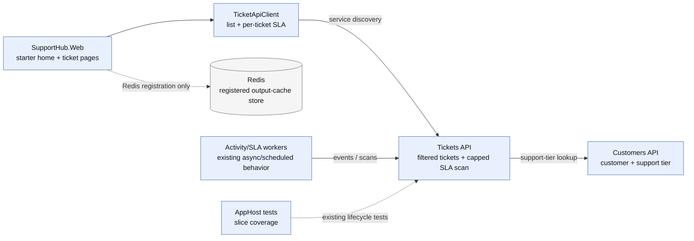
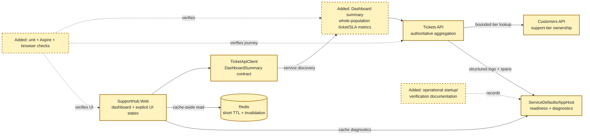
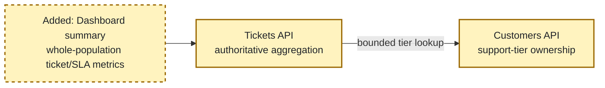
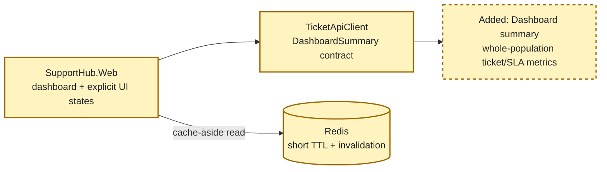
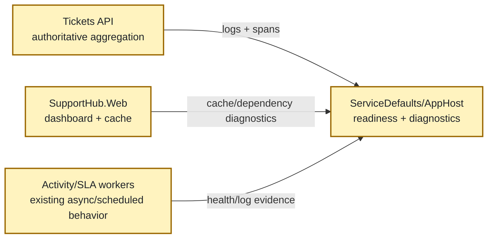
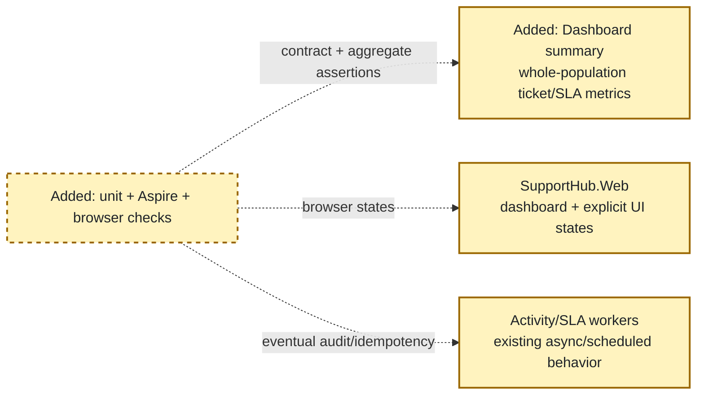
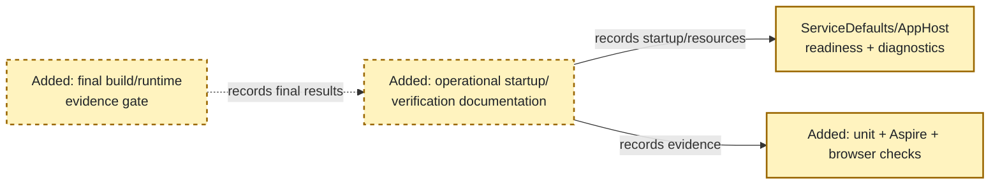

<!-- markdownlint-disable-file -->

# RPI Plan: Support Dashboard and Operational Polish

## Task Metadata

* Task ID: `support-dashboard-operational-polish`
* Task slug: `support-dashboard-and-operational-polish`
* Plan date: 2026-10-18
* Branch: `feature/dashboard`
* Parent branch: `feature/sla`

## Executive Summary

* Bottom line: Implement an authoritative dashboard summary in `SupportHub.Tickets.Api`, expose it through a typed `SupportHub.Web` client, render it as an operational dashboard, and add bounded Redis caching with explicit freshness and invalidation behavior. Then harden operational diagnostics and verify the complete distributed journey through Aspire integration tests and focused browser checks.
* Why this matters: The existing frontend can list tickets and request individual or capped SLA scans, but it cannot safely derive whole-system at-risk or breached counts. The plan keeps ticket/SLA ownership in the Tickets API, customer-tier ownership in Customers API, and avoids introducing a new dashboard database without scale evidence.
* Planning result: Complete and implementation-ready after the standard independent critique; all five planner-owned findings were resolved in this revision. The implementation scope is limited to the current stacked PR and does not include later stack layers.
* Confidence and uncertainty: High confidence in the architecture, affected projects, existing resource names, and test seams. The plan now fixes a 30-second cache maximum age, a bounded batch customer-tier lookup, fail-closed dependency semantics, and a final runtime validation gate; endpoint naming and local code shape remain implementation choices.

### What You May Not Know

* `feature/dashboard` currently has no diff from `feature/sla`; the dashboard page and summary contract do not exist yet.
* The existing SLA scan is intentionally capped at 50 items. Reusing it from the browser would make dashboard figures incomplete for larger datasets.
* Redis is already wired to `SupportHub.Web`, but no dashboard cache policy, key scheme, TTL, or invalidation path exists. This plan fixes a 30-second maximum cache age and invalidates Web-originated ticket/customer mutations.
* SLA state changes as time passes even when tickets do not change. The dashboard must expose an evaluation timestamp and use a short freshness bound.
* Activity/audit processing is asynchronous through Service Bus and Cosmos DB. The full journey test must poll with a bounded timeout and assert idempotency rather than assume immediate consistency.

## Phase Checklist

### Before



### After



The plan changes the existing per-ticket/capped-scan shape into one authoritative dashboard snapshot, adds explicit Redis freshness behavior, and turns existing distributed test seams into full-journey and UI evidence.

<!-- rpi:phase id=P01 -->
### [ ] P01: Establish the authoritative dashboard summary contract

Goals:
* Define an additive Tickets API contract that represents complete ticket counts and SLA risk at one evaluation timestamp without exposing persistence entities or moving customer ownership.

Dependencies:
* None.



Highlighted work: add the dashboard summary contract and its Tickets API aggregation boundary while retaining Customers API support-tier ownership.

<!-- rpi:task id=P01-T01 -->
#### [ ] P01-T01: Define dashboard summary contracts and metric semantics

Goals:
* Make the dashboard wire contract explicit enough that Web, tests, and future operational clients agree on open, status, priority, at-risk, breached, failure, and freshness semantics; partial API snapshots are not permitted.

Requirements:
* Satisfy `FR-001`, `FR-002`, `FR-003`, `FR-004`, `FR-005`, and `NFR-001`.
* Add an additive dashboard summary response under the Tickets feature; do not expose `Ticket` persistence entities.
* Treat `New`, `Open`, and `InProgress` as open/non-terminal; treat `Resolved` and `Closed` as terminal.
* Return total count, open count, status breakdown, priority breakdown, at-risk count, breached count, `EvaluatedAtUtc`, and a `DataQuality` value of `Complete` for successful snapshots; dependency/population failures use the standard retryable problem contract instead of an incomplete snapshot.
* Preserve string enum serialization and use one evaluation timestamp for all SLA counts.
* Keep the contract compatible with existing ticket and SLA wire values.

  ```text
  DashboardSummary {
      EvaluatedAtUtc,
      TotalTickets,
      OpenTickets,
      StatusBreakdown[],
      PriorityBreakdown[],
      AtRiskSlaTickets,
      BreachedSlaTickets,
      DataQuality
  }
  ```

  This block is a contract shape; exact property names may be refined locally while preserving the listed semantics.

Details:
* Place contracts beside `TicketContracts.cs` and `SlaContracts.cs` under the Tickets feature.
* Use additive routing such as `/tickets/dashboard-summary` or an equivalent feature-oriented route; the exact route is an implementation choice, but it must not overload the capped `/tickets/sla/scan` contract.
* Keep the current `SlaState` and `SlaEvaluator` semantics. `Completed` tickets are not counted as active at-risk or breached tickets.
* Do not shortcut customer-tier lookup merely because current `SlaPolicy` values are equal for all tiers; the evaluator still requires a tier and future policy versions may differ.

References:
* [src/SupportHub.Tickets.Api/Features/Tickets/TicketContracts.cs](../../../src/SupportHub.Tickets.Api/Features/Tickets/TicketContracts.cs): existing ticket response conventions.
* [src/SupportHub.Tickets.Api/Features/Tickets/SlaContracts.cs](../../../src/SupportHub.Tickets.Api/Features/Tickets/SlaContracts.cs): existing SLA wire contracts and enum values.
* [src/SupportHub.Tickets.Api/Features/Tickets/Ticket.cs](../../../src/SupportHub.Tickets.Api/Features/Tickets/Ticket.cs): authoritative ticket status and priority values.
* [.copilot-tracking/research/2026-10-18/support-dashboard-and-operational-polish-research.md](../../research/2026-10-18/support-dashboard-and-operational-polish-research.md): findings “The dashboard needs a Tickets-owned summary contract” and “Recommended implementation surfaces and acceptance criteria”.

Dependencies:
* None.

<!-- rpi:task id=P01-T02 -->
#### [ ] P01-T02: Implement whole-population ticket and SLA aggregation

Goals:
* Return authoritative dashboard metrics for the complete ticket population while preserving bounded downstream customer lookups and explicit failure behavior.

Requirements:
* Satisfy `FR-001`, `FR-002`, `FR-003`, `FR-004`, `FR-005`, `FR-006`, and `NFR-002`.
* Aggregate status and priority counts from `TicketDbContext` with no inherited 50-item SLA scan cap.
* Evaluate active tickets using the existing `SlaEvaluator` at one captured `DateTimeOffset`.
* Preserve customer ownership by using an additive Customers API batch support-tier contract with a maximum of 500 customer IDs per request, at most four concurrent batches, a two-second per-batch timeout, and a 10,000-ticket supported dashboard population limit.
* Do not convert unavailable or missing customer data into zero counts or fabricated support tiers. If any required batch fails, a customer is missing, or the population limit is exceeded, return a retryable problem response with a stable error code; do not return a partial snapshot.
* Keep the endpoint asynchronous, cancellation-aware, and compatible with standard HTTP resilience/service discovery.

Details:
* Reuse `SlaEvaluationService`/`SlaEvaluator` behavior where practical rather than duplicating SLA thresholds.
* Add the batch contract only for support-tier lookup; do not expose customer persistence models. Tickets API should deduplicate customer IDs, issue batches of no more than 500, limit concurrency to four, cancel each batch after two seconds, and fail the complete summary rather than silently undercount.
* The 10,000-ticket limit is an explicit supported operating bound, not a truncation rule. The endpoint must reject larger populations with a clear problem response so figures are never presented as authoritative when evaluation cannot complete within the designed bound.
* The implementation may use a single database query for raw counts plus a bounded projection for SLA evaluation. Avoid introducing a dashboard table or migration in this feature.
* Add structured logs containing evaluation timestamp, ticket count, at-risk/breached counts, dependency failure count, and duration without logging sensitive customer data.

References:
* [src/SupportHub.Tickets.Api/Features/Tickets/SlaEvaluationService.cs](../../../src/SupportHub.Tickets.Api/Features/Tickets/SlaEvaluationService.cs): current bounded SLA scan and customer lookup behavior.
* [src/SupportHub.Tickets.Api/Features/Tickets/SlaEvaluator.cs](../../../src/SupportHub.Tickets.Api/Features/Tickets/SlaEvaluator.cs): authoritative state calculation.
* [src/SupportHub.Tickets.Api/Features/Tickets/TicketDbContext.cs](../../../src/SupportHub.Tickets.Api/Features/Tickets/TicketDbContext.cs): ticket indexes and persistence boundary.
* [src/SupportHub.Customers.Api/Features/Customers/CustomerEndpoints.cs](../../../src/SupportHub.Customers.Api/Features/Customers/CustomerEndpoints.cs): existing customer API ownership and contract style.
* [.copilot-tracking/research/2026-10-18/support-dashboard-and-operational-polish-research.md](../../research/2026-10-18/support-dashboard-and-operational-polish-research.md): evidence `C3`, `C4`, `C7`, and risks around customer fan-out and time-based SLA state.

Dependencies:
* P01-T01.

<!-- rpi:phase id=P02 -->
### [ ] P02: Deliver the dashboard UI and bounded Redis caching

Goals:
* Give support staff a usable dashboard with explicit loading, empty, success, stale/refreshing, and error states, while using Redis only for justified short-lived reads; a stale/refreshing presentation is never treated as an authoritative partial API snapshot.

Dependencies:
* P01-T01.
* P01-T02.



Highlighted work: add the typed summary client, dashboard page/components, and Redis cache policy at the Web read boundary.

<!-- rpi:task id=P02-T01 -->
#### [ ] P02-T01: Add the typed dashboard client and support dashboard page

Goals:
* Render a support dashboard that presents authoritative metrics and helps staff understand the freshness and quality of the snapshot.

Requirements:
* Satisfy `FR-001`, `FR-002`, `FR-003`, `FR-004`, `FR-005`, `FR-007`, and `NFR-003`.
* Add typed models and a `TicketApiClient` method for the dashboard summary using the existing `https+http://ticketsapi` service-discovery pattern.
* Add or repurpose the home route as a dashboard and add navigation with clear labels for open tickets, status/priority breakdowns, at-risk SLAs, and breached SLAs.
* Represent loading, empty, successful, stale/refreshing, retryable error, and unavailable dependency states explicitly; map dependency failures to the retryable/error state rather than displaying partial counts as authoritative.
* Use accessible headings, labels, status announcements, semantic tables/lists, and keyboard-operable links/buttons.
* Do not duplicate SLA calculations in Razor or code-behind; display the returned summary and evaluation timestamp.

Details:
* Keep page/component code under the existing `Components` structure and retain typed API access behind `TicketApiClient`.
* Small reusable metric/breakdown components are preferred over a monolithic page. Exact visual styling is local implementation judgment, but the dashboard must remain consistent with existing Bootstrap usage.
* Customer and ticket management pages remain in scope only where their mutation paths need to invalidate the dashboard cache; do not redesign unrelated pages.
* Browser verification can use the repository's Playwright CLI guidance and Aspire-discovered endpoints; no JavaScript/TypeScript application project is required.

References:
* [src/SupportHub.Web/Components/Pages/Home.razor](../../../src/SupportHub.Web/Components/Pages/Home.razor): current starter home route to replace with dashboard behavior.
* [src/SupportHub.Web/TicketApiClient.cs](../../../src/SupportHub.Web/TicketApiClient.cs): typed ticket client and existing model conventions.
* [src/SupportHub.Web/Components/Pages/Tickets.razor](../../../src/SupportHub.Web/Components/Pages/Tickets.razor): existing loading/error/empty UI patterns.
* [src/SupportHub.Web/Components/Layout/NavMenu.razor](../../../src/SupportHub.Web/Components/Layout/NavMenu.razor): navigation surface.
* [.copilot-tracking/research/2026-10-18/support-dashboard-and-operational-polish-research.md](../../research/2026-10-18/support-dashboard-and-operational-polish-research.md): finding “Existing tests cover slices, not the requested full journey or UI”.

Dependencies:
* P01-T01.
* P01-T02.

<!-- rpi:task id=P02-T02 -->
#### [ ] P02-T02: Establish Redis TTL, freshness, and invalidation behavior

Goals:
* Make cached dashboard reads fast without allowing materially stale operational results to appear authoritative.

Requirements:
* Satisfy `FR-006`, `FR-007`, `NFR-003`, and `NFR-004`.
* Use the existing `cache` resource and Redis registration; do not add a second cache resource.
* Cache only the dashboard summary with an absolute maximum age of 30 seconds; retain `EvaluatedAtUtc` and expose the resulting freshness.
* Include cache freshness/evaluation metadata in the UI or response presentation.
* Invalidate after Web-originated ticket create/update/delete and customer support-tier mutations that can change the summary.
* Ensure cache failures degrade to an authoritative uncached request or a clear error; never return a success-shaped zero/default snapshot.
* Document the freshness bound for writers outside Web, including `supporthub-cli` and direct API calls, if invalidation is not centralized at the authoritative mutation boundary.

Details:
* Existing `AddRedisOutputCache`/`UseOutputCache` registration is not itself a policy. Use an explicit cache-aside service in `SupportHub.Web` with the versioned key `dashboard-summary:v1`; retain the existing resource and service discovery.
* Invalidate the key after every Web-originated ticket create/update/delete and customer support-tier mutation. Direct API and `supporthub-cli` writers cannot synchronously invalidate this Web-local cache, so their maximum documented staleness is the same 30-second bound.
* Cache only complete successful summaries. Never cache problem responses, missing-customer results, population-limit failures, or partial data. Attachment and audit mutations do not change requested counts and should not invalidate the key.
* Add logs/metrics for cache hit, miss, bypass, expiry, invalidation, and backend failure without logging payloads.

References:
* [src/SupportHub.Web/Program.cs](../../../src/SupportHub.Web/Program.cs): existing Redis client/output-cache registration and middleware.
* [src/SupportHub.AppHost/AppHost.cs](../../../src/SupportHub.AppHost/AppHost.cs): exact `cache` resource name and Web reference/wait.
* [src/SupportHub.Web/TicketApiClient.cs](../../../src/SupportHub.Web/TicketApiClient.cs): mutation methods that can trigger Web-side invalidation.
* [src/SupportHub.Web/CustomerApiClient.cs](../../../src/SupportHub.Web/CustomerApiClient.cs): customer mutation methods affecting support-tier-dependent SLA results.
* [.copilot-tracking/research/2026-10-18/support-dashboard-and-operational-polish-research.md](../../research/2026-10-18/support-dashboard-and-operational-polish-research.md): findings “Redis is available but not yet a cache policy” and risks around external writers/time-based state.

Dependencies:
* P02-T01.

<!-- rpi:phase id=P03 -->
### [ ] P03: Improve operational readiness and distributed diagnostics

Goals:
* Make dashboard dependencies and cross-service behavior diagnosable through Aspire health, structured logs, resilience signals, and distributed traces without coupling liveness to downstream availability.

Dependencies:
* P01-T02.
* P02-T02.



Highlighted work: improve readiness and telemetry surfaces around the dashboard path while retaining the existing ServiceDefaults conventions.

<!-- rpi:task id=P03-T01 -->
#### [ ] P03-T01: Strengthen dependency readiness and AppHost health wiring

Goals:
* Make resource readiness and dependency failures visible to Aspire and callers while preserving separate liveness semantics.

Requirements:
* Satisfy `NFR-005` and `NFR-006`.
* Preserve exact AppHost resource names and `WithReference(...)`/`WaitFor(...)` relationships.
* Keep `/alive` suitable for process liveness and avoid making it fail solely because a downstream dependency is unavailable.
* Add or refine readiness checks for dependencies that materially affect the dashboard path, using repository-supported client health checks or explicit checks rather than ad hoc polling.
* Add the same repository-supported HTTP health/readiness endpoint pattern used by the Activity Worker to `sla-worker`, and wire an explicit AppHost health check for it.
* Keep health endpoints protected/limited according to existing development-environment conventions.

Details:
* Start from `SupportHub.ServiceDefaults.Extensions` and `SupportHub.AppHost.AppHost`; do not introduce a second readiness mechanism.
* Health behavior should distinguish application responsiveness from ability to serve authoritative dashboard data. If a dependency is unavailable, the dashboard API/UI must return the selected retryable problem response rather than relying only on resource color.
* Do not add infrastructure or migrations. Any new client registration must use the existing Aspire-generated references.

References:
* [src/SupportHub.ServiceDefaults/Extensions.cs](../../../src/SupportHub.ServiceDefaults/Extensions.cs): shared resilience, health, service discovery, and OTel conventions.
* [src/SupportHub.AppHost/AppHost.cs](../../../src/SupportHub.AppHost/AppHost.cs): resource graph, exact names, waits, and health checks.
* [src/SupportHub.Sla.Worker/Program.cs](../../../src/SupportHub.Sla.Worker/Program.cs): current worker host and absence of mapped HTTP health endpoints.
* [src/SupportHub.Activity.Worker/Program.cs](../../../src/SupportHub.Activity.Worker/Program.cs): existing worker health endpoint pattern.

Dependencies:
* P01-T02.

<!-- rpi:task id=P03-T02 -->
#### [ ] P03-T02: Add structured dashboard diagnostics and trace correlation

Goals:
* Make one dashboard request explainable across Web, Redis, Tickets API, Customers API, and any SLA evaluation dependency.

Requirements:
* Satisfy `NFR-005`, `NFR-006`, and `NFR-007`.
* Preserve OTLP configuration through `OTEL_EXPORTER_OTLP_ENDPOINT` and existing OpenTelemetry instrumentation.
* Add structured logs for summary evaluation, cache behavior, dependency failures, failed evaluations, and request duration using stable property names.
* Add a dashboard-specific `ActivitySource`/span or equivalent only where it improves correlation; do not duplicate built-in HTTP spans.
* Preserve standard HTTP resilience and cancellation propagation; surface non-success responses explicitly.
* Avoid logging secrets, full customer records, attachment content, or unbounded ticket ID arrays.

Details:
* `ServiceDefaults` already instruments ASP.NET Core, HttpClient, runtime metrics, and OTLP export. Extend the relevant service rather than creating an independent telemetry pipeline.
* Use application/service names and correlation IDs supplied by ASP.NET/OpenTelemetry. Custom spans should identify summary aggregation, customer-tier dependency, cache hit/miss, and data-quality outcome.
* Structured logs should support Aspire Dashboard filtering and be useful when Redis, Customers API, Service Bus/Cosmos, or PostgreSQL is degraded.

References:
* [src/SupportHub.ServiceDefaults/Extensions.cs](../../../src/SupportHub.ServiceDefaults/Extensions.cs): existing instrumentation and exporter configuration.
* [src/SupportHub.Tickets.Api/Features/Tickets/SlaEndpoints.cs](../../../src/SupportHub.Tickets.Api/Features/Tickets/SlaEndpoints.cs): existing structured SLA logging style.
* [src/SupportHub.Sla.Worker/Worker.cs](../../../src/SupportHub.Sla.Worker/Worker.cs): existing structured worker logging and error handling.
* [src/SupportHub.Tickets.Api/Features/Activity/OutboxDispatcher.cs](../../../src/SupportHub.Tickets.Api/Features/Activity/OutboxDispatcher.cs): existing retry/error logging pattern.

Dependencies:
* P03-T01.
* P02-T02.

<!-- rpi:phase id=P04 -->
### [ ] P04: Add automated distributed and browser verification

Goals:
* Prove the summary contract, cache correctness, failure behavior, full customer-to-ticket journey, asynchronous audit behavior, attachment isolation, SLA evaluation, and dashboard UI states.

Dependencies:
* P01-T02.
* P02-T01.
* P02-T02.
* P03-T01.
* P03-T02.



Highlighted work: add focused tests to existing projects and use Aspire resource notifications plus browser automation where practical.

<!-- rpi:task id=P04-T01 -->
#### [ ] P04-T01: Add dashboard contract, aggregation, cache, and failure tests

Goals:
* Make the dashboard behavior regression-resistant at unit and service-contract level before relying on a full distributed journey.

Requirements:
* Satisfy `FR-001` through `FR-007` and `NFR-001` through `NFR-004`.
* Cover all ticket statuses and priorities, terminal versus active SLA states, exact at-risk/breach boundaries, one evaluation timestamp, and customer lookup failure.
* Verify the dashboard summary is not limited by the existing 50-item SLA scan cap, while rejecting populations above 10,000 with the stable population-limit error.
* Verify customer-tier batches are capped at 500 IDs, concurrency at four, and each batch timeout at two seconds; any failed/missing batch produces a retryable non-cacheable problem response.
* Verify the 30-second cache maximum age, hit/miss/expiry/invalidation behavior, backend failure, and uncached fallback; only complete successful summaries may be cached.
* Verify response and UI-facing models reject empty/default success-shaped data when the API returns an invalid or empty contract, and map dependency failures to the retryable/error UI state.

Details:
* Put pure evaluator/contract tests in `tests/SupportHub.Tickets.Api.Tests` when behavior can be isolated; put distributed contract/cache tests in `tests/SupportHub.AppHost.Tests`.
* Use deterministic time providers/fakes for SLA boundaries rather than sleeps.
* Reuse existing JSON enum options and `SlaScanClientTests` patterns for typed-client contract failures.
* Do not remove existing tests; additions should remain focused on dashboard semantics and regressions.

References:
* [tests/SupportHub.Tickets.Api.Tests/SlaEvaluatorTests.cs](../../../tests/SupportHub.Tickets.Api.Tests/SlaEvaluatorTests.cs): deterministic SLA boundary test patterns.
* [tests/SupportHub.Tickets.Api.Tests/SlaEvaluationServiceTests.cs](../../../tests/SupportHub.Tickets.Api.Tests/SlaEvaluationServiceTests.cs): service-level SLA test patterns.
* [tests/SupportHub.AppHost.Tests/SlaScanClientTests.cs](../../../tests/SupportHub.AppHost.Tests/SlaScanClientTests.cs): typed client success/failure contract patterns.
* [tests/SupportHub.AppHost.Tests/TicketsApiTests.cs](../../../tests/SupportHub.AppHost.Tests/TicketsApiTests.cs): Aspire resource wait and HTTP integration patterns.

Dependencies:
* P01-T02.
* P02-T02.

<!-- rpi:task id=P04-T02 -->
#### [ ] P04-T02: Add one bounded Aspire full-journey integration test

Goals:
* Demonstrate that the distributed application supports the requested customer-to-ticket-to-attachment-to-audit-to-SLA workflow and that the dashboard summary reflects the resulting state.

Requirements:
* Satisfy `FR-001` through `FR-007`, `NFR-005`, and `NFR-006`.
* Start the actual `SupportHub.AppHost` graph with `DistributedApplicationTestingBuilder`.
* Wait for exact resources before interaction, including healthy `customersapi`, `ticketsapi`, `blobs`, `activity-worker`, `sla-worker`, `cache`, and `webfrontend` where UI-level checks are run.
* Create a customer, create/update a ticket, upload/download and isolate an attachment, wait for activity/audit processing, query SLA state, and assert dashboard metrics.
* Assert duplicate event/replay behavior remains idempotent and asynchronous activity is polled with a bounded timeout.
* Cover at least one at-risk or breached and one terminal/completed case using deterministic or controllable timestamps where the runtime permits.

Details:
* Extend `tests/SupportHub.AppHost.Tests` rather than creating a new test project.
* Use `app.CreateHttpClient("<resource-name>")` with AppHost names; never hard-code ports or hostnames.
* Keep the journey test bounded and diagnostic: include useful assertion context for resource failures, dependency failure responses, activity timeout, and dashboard data quality.
* If browser prerequisites are unavailable, keep the API journey authoritative and record the browser limitation in the changes evidence; do not silently skip required API/resource health assertions.

References:
* [tests/SupportHub.AppHost.Tests/TicketsApiTests.cs](../../../tests/SupportHub.AppHost.Tests/TicketsApiTests.cs): existing lifecycle, attachment, SLA, and activity integration tests.
* [tests/SupportHub.AppHost.Tests/PersistentResourceCollection.cs](../../../tests/SupportHub.AppHost.Tests/PersistentResourceCollection.cs): test collection serialization for persistent resources.
* [src/SupportHub.AppHost/AppHost.cs](../../../src/SupportHub.AppHost/AppHost.cs): exact resource names and startup relationships.
* [.copilot-tracking/research/2026-10-18/support-dashboard-and-operational-polish-research.md](../../research/2026-10-18/support-dashboard-and-operational-polish-research.md): acceptance criterion for the complete journey and evidence `C8`/`C10`.

Dependencies:
* P04-T01.
* P03-T01.

<!-- rpi:task id=P04-T03 -->
#### [ ] P04-T03: Add focused browser-level dashboard verification

Goals:
* Verify the support dashboard is usable in a real browser against the Aspire-discovered Web endpoint.

Requirements:
* Satisfy `FR-007`, `NFR-003`, and `NFR-006`.
* Verify dashboard navigation, metric headings/values, status/priority breakdown rendering, SLA warning labels, loading/empty/error/retry states where they can be deterministically induced, and accessible interaction semantics.
* Use the repository Playwright CLI guidance; do not introduce a JavaScript/TypeScript application project.
* Capture only non-sensitive verification evidence and clean up browser sessions/artifacts not required by the changes record.

Details:
* Prefer endpoint discovery through Aspire monitoring/orchestration guidance and wait for the `webfrontend` resource before navigation.
* If runtime/browser prerequisites are unavailable, record the exact limitation and preserve API/Aspire test coverage as the authoritative fallback.
* Keep the browser scope limited to the dashboard and one representative navigation into an existing ticket page; do not expand into unrelated UI redesign.

References:
* [src/SupportHub.Web/Components/Pages/Home.razor](../../../src/SupportHub.Web/Components/Pages/Home.razor): dashboard route.
* [src/SupportHub.Web/Components/Pages/TicketDetail.razor](../../../src/SupportHub.Web/Components/Pages/TicketDetail.razor): representative existing ticket journey.
* [.agents/skills/playwright-cli/references/playwright-tests.md](../../../.agents/skills/playwright-cli/references/playwright-tests.md): repository browser test guidance.
* [.copilot-tracking/research/2026-10-18/support-dashboard-and-operational-polish-research.md](../../research/2026-10-18/support-dashboard-and-operational-polish-research.md): UI and browser evidence boundary.

Dependencies:
* P02-T01.
* P04-T02.

<!-- rpi:phase id=P05 -->
### [ ] P05: Document startup, limitations, and verification evidence

Goals:
* Leave maintainers with a reproducible operational startup/checklist and an honest record of cache freshness, runtime diagnostics, known limitations, and completed verification.

Dependencies:
* P03-T01.
* P03-T02.
* P04-T02.
* P04-T03.



Highlighted work: document the exact operational path and evidence without creating a separate undocumented support process.

<!-- rpi:task id=P05-T01 -->
#### [ ] P05-T01: Document operational startup and known limitations

Goals:
* Make local startup and diagnosis reproducible for contributors and reviewers of the stacked PR.

Requirements:
* Satisfy `FR-008`, `NFR-005`, `NFR-006`, and `NFR-007`.
* Document `dotnet restore SupportHub.slnx`, `dotnet build SupportHub.slnx`, relevant test commands, and Aspire startup/inspection commands using exact resource names.
* Document Redis dashboard TTL/freshness and mutation invalidation behavior, including any known limitation for direct API/console writers.
* Document asynchronous activity/audit timing, emulator prerequisites, health endpoint behavior, and browser verification prerequisites.
* Record known limitations without claiming runtime or browser checks that were not executed.

Details:
* Update the repository's existing operational documentation surface rather than adding an isolated plan-only note. The exact target can be selected during implementation based on repository conventions; likely candidates are `README.md` or a focused operational section.
* Keep documentation limited to this feature: dashboard behavior, operational polish, startup, diagnosis, limitations, and verification evidence.
* Include a compact evidence table naming build/test/Aspire/browser checks and their result or limitation.

References:
* [README.md](../../../README.md): current architecture documentation and intended dashboard scope.
* [src/SupportHub.AppHost/AppHost.cs](../../../src/SupportHub.AppHost/AppHost.cs): exact resource names and waits.
* [.github/copilot-instructions.md](../../../.github/copilot-instructions.md): repository build/test and Aspire verification requirements.
* [.copilot-tracking/research/2026-10-18/support-dashboard-and-operational-polish-research.md](../../research/2026-10-18/support-dashboard-and-operational-polish-research.md): risks, acceptance criteria, and runtime/browser evidence limitations.

Dependencies:
* P03-T01.
* P03-T02.
* P04-T02.
* P04-T03.

<!-- rpi:task id=P05-T02 -->
#### [ ] P05-T02: Execute the final build, runtime, and observability gate

Goals:
* Prevent handoff with an unverified distributed change by requiring reproducible build/test results and runtime evidence for the affected Aspire graph.

Requirements:
* Satisfy `NFR-005`, `NFR-006`, and `FR-008`.
* Execute `dotnet restore SupportHub.slnx`, `dotnet build SupportHub.slnx`, and the relevant test projects, escalating to `dotnet test SupportHub.slnx` when targeted tests pass or when cross-project changes require it.
* Start the actual Aspire application, wait for healthy `cache`, `customersapi`, `ticketsapi`, `activity-worker`, `sla-worker`, and `webfrontend` resources, and record any explicitly accepted environment limitation.
* Inspect Aspire health/resource state, relevant structured logs, and distributed traces for a dashboard request and the full journey; verify cache and customer-tier dependency spans/logs are correlated.
* Execute the browser check when prerequisites are available, or record the exact prerequisite limitation without converting an unexecuted check into a pass.
* Record command outcomes, resource health, diagnostic evidence, browser status, and unresolved limitations in the implementation changes record and the operational documentation.

Details:
* Use repository-local Aspire orchestration and monitoring guidance for startup, readiness, logs, and traces; do not substitute hard-coded ports or ad hoc process checks.
* Treat failed build/tests, unhealthy required resources, missing expected trace/log evidence, or an unexplained browser failure as handoff blockers.
* This is an execution gate for implementation, not a promise that planning has already run these commands.

References:
* [.github/copilot-instructions.md](../../../.github/copilot-instructions.md): definition of done and required build/test/runtime verification.
* [src/SupportHub.AppHost/AppHost.cs](../../../src/SupportHub.AppHost/AppHost.cs): exact resources and startup dependencies.
* [src/SupportHub.ServiceDefaults/Extensions.cs](../../../src/SupportHub.ServiceDefaults/Extensions.cs): health and telemetry configuration.
* `.copilot-tracking/changes/2026-10-18/support-dashboard-and-operational-polish-changes.md`: implementation-owned evidence record.

Dependencies:
* P03-T01.
* P03-T02.
* P04-T01.
* P04-T02.
* P04-T03.

## User Decisions and Requirements

### Confirmed User Direction

* Implement only **SupportHub Support Dashboard and Operational Polish** on `feature/dashboard`, whose parent is `feature/sla`.
* Keep the work limited to dashboard metrics, justified Redis caching, resilience/health/logging/tracing improvements, full customer-to-ticket-to-attachment-to-audit-to-SLA verification, Aspire integration tests, browser verification where practical, and operational documentation.
* Preserve service data ownership and use Aspire service discovery/resource names rather than hard-coded endpoints.
* Plan only; do not modify application code or create a pull request.
* Required outcomes are authoritative dashboard figures, cache invalidation that prevents materially stale critical results, and passing distributed/end-to-end tests.

### Planning Decisions and Feedback

| Group | Decision or feedback item | Status | Owner | Rationale or input needed | Evidence | Planning impact |
|-------|---------------------------|--------|-------|---------------------------|----------|------------------|
| D1 | Use a Tickets API-owned dashboard summary rather than frontend aggregation | Confirmed | Agent/evidence | Existing SLA scan is capped at 50 and Tickets API owns SLA evaluation | Research C3-C5 | Drives P01 and rejects composing capped endpoints |
| D2 | Preserve Customers API support-tier ownership through an additive batch lookup | Confirmed | Agent/evidence | SLA evaluator requires tier while customer data must remain service-owned; bounded batches avoid per-ticket fan-out | Research C3-C4 | P01-T02 uses 500-ID batches, four-way concurrency, two-second batch timeout, and a 10,000-ticket operating bound |
| D3 | Use an explicit Redis cache-aside policy with a 30-second maximum age and mutation invalidation | Confirmed | Agent/evidence | Redis is already wired, but no cache policy exists and SLA changes with time | Research C6, C9; PC-001 | Drives P02-T02, NFR-003/NFR-004, and exact cache tests |
| D4 | Do not add a durable dashboard read model or migration in this PR | Confirmed | Agent/evidence | Current evidence does not justify projection infrastructure; request-time aggregation is the bounded design | Research recommendation | Keeps scope within current stack layer; revisit only with scale evidence |
| D5 | Use standard independent critique | Confirmed | Planning default | User did not skip critique or request deep mode | Planning instructions | Completed; findings PC-001 through PC-005 were resolved by direct planner corrections |

## Planning Readiness and Next Step

| Field | Record |
|-------|--------|
| Planning execution and readiness | Complete; Ready for implementation after standard critique and planner-owned corrections |
| Decision participation | Agent-owned; the supplied brief and completed research resolve ordinary planning choices without a user walkthrough |
| Blockers | None known; implementation must still satisfy the explicit validation gate in P05-T02 |
| Latest critique | [.copilot-tracking/reviews/plans/2026-10-18/support-dashboard-and-operational-polish-plan-critique.md](../../reviews/plans/2026-10-18/support-dashboard-and-operational-polish-plan-critique.md), initial standard critique verdict `Revise`; all findings resolved below |
| Relevant research | [.copilot-tracking/research/2026-10-18/support-dashboard-and-operational-polish-research.md](../../research/2026-10-18/support-dashboard-and-operational-polish-research.md) |
| Plan | `.copilot-tracking/plans/2026-10-18/support-dashboard-and-operational-polish-plan.md` |
| Changes-record role | `.copilot-tracking/changes/2026-10-18/support-dashboard-and-operational-polish-changes.md` will be implementation evidence |
| Continuation owner | user/manual RPI |
| Required gates or confirmations | Artifact self-check is complete; implementation must execute P05-T02 and produce the changes record |
| Next action | Run `/rpi-implement` with this plan and `.copilot-tracking/changes/2026-10-18/support-dashboard-and-operational-polish-changes.md` |

## Goals

* Give support staff one authoritative view of ticket volume, status/priority distribution, and SLA risk.
* Preserve customer, ticket, attachment, activity, and SLA service boundaries while adding only the contracts and operational wiring required by this feature.
* Make cache freshness, invalidation, dependency failures, health, logs, and traces understandable to operators.
* Prove the distributed workflow with deterministic tests, bounded eventual-consistency polling, Aspire resource health waits, and focused browser verification.
* Leave reproducible startup and verification documentation for the stacked PR.

## Scope and Non-Goals

### In Scope

* Tickets API dashboard summary contract and whole-population aggregation.
* Customer support-tier lookup needed for authoritative SLA counts.
* Blazor dashboard page, typed API client, navigation, accessibility, and explicit UI states.
* Redis cache policy, TTL, freshness metadata, mutation invalidation, fallback, and diagnostics.
* Relevant readiness/health, structured logs, resilience, and distributed tracing improvements.
* Unit, contract, Aspire integration, full-journey, and practical browser verification.
* Operational startup, limitations, and verification documentation.

### Non-Goals

* New durable dashboard database, projection worker, or migration.
* Reworking existing customer, ticket, attachment, activity, or SLA features beyond the seams required for this dashboard.
* Replacing Aspire service discovery, ServiceDefaults, or the existing named `cache` resource.
* Production deployment, authentication/authorization redesign, or unrelated UI redesign.
* Later stacked PR features or changes outside `feature/dashboard`.

## Functional Requirements

* FR-001: Provide an authoritative dashboard snapshot for the complete ticket population.
* FR-002: Report total and open ticket counts with explicit non-terminal status semantics.
* FR-003: Report ticket counts grouped by every supported status and priority.
* FR-004: Report at-risk and breached SLA counts using the existing Tickets API SLA evaluator.
* FR-005: Evaluate all dashboard SLA counts at one timestamp and expose freshness/evaluation metadata.
* FR-006: Surface customer-tier or other dependency failures without silently returning zero/default metrics.
* FR-007: Render accessible dashboard loading, empty, success, partial/stale, error, and retry states.
* FR-008: Document operational startup, resource names, known limitations, cache freshness, and verification evidence.

## Non-Functional Requirements

* NFR-001: Preserve service data ownership; no frontend or cross-service database access.
  * Objective threshold or evaluation condition: Tickets API owns ticket/SLA aggregation; Customers API remains the support-tier authority; Web accesses APIs through typed service-discovery clients.
* NFR-002: Preserve correctness and compatibility of existing ticket/SLA contracts.
  * Objective threshold or evaluation condition: Dashboard additions are additive; existing per-ticket SLA, scan, ticket, attachment, and activity behavior remains covered by existing tests.
* NFR-003: Bound dashboard cache staleness.
  * Objective threshold or evaluation condition: The explicit cache-aside entry `dashboard-summary:v1` has a maximum age of 30 seconds, retains `EvaluatedAtUtc`, and expires without requiring a write.
* NFR-004: Invalidate relevant cached reads.
  * Objective threshold or evaluation condition: Every Web-originated ticket create/update/delete and customer support-tier mutation invalidates `dashboard-summary:v1`; direct API/console writers are documented as having at most the same 30-second stale window.
* NFR-005: Preserve resilient, observable distributed operation.
  * Objective threshold or evaluation condition: Existing standard HTTP resilience, service discovery, health endpoints, structured logs, and OTLP instrumentation remain active; dashboard dependency outcomes are diagnosable.
* NFR-006: Verify distributed behavior through Aspire and browser evidence where practical.
  * Objective threshold or evaluation condition: Tests wait for exact resource names and assert functional behavior; browser checks cover the dashboard when prerequisites permit.
* NFR-007: Avoid sensitive or unbounded operational telemetry.
  * Objective threshold or evaluation condition: Logs/traces contain stable counts, durations, states, and failure categories without secrets, attachment content, customer records, or unbounded payload dumps.

## Risks and Open Questions

| Priority | Type | Risk, question, or planning item | Affected work | Impact | Smallest action or evidence needed | Owner |
|----------|------|----------------------------------|---------------|--------|------------------------------------|-------|
| H | Risk | Request-time SLA aggregation can create customer-service fan-out and latency | P01-T02, P03-T02 | Dashboard may overload Customers API or become slow | Use 500-ID batches, four concurrent batches, two-second batch timeouts, a 10,000-ticket operating bound, and duration telemetry | Implementer |
| H | Risk | Cache invalidation may miss direct API/console writers | P02-T02, P05-T01 | Operational figures may remain stale within the TTL | Web mutations invalidate immediately; direct API/console writers have a documented maximum 30-second stale window | Implementer |
| H | Risk | SLA state changes with time | P01-T02, P02-T02, P04-T01 | Long TTL can mislead staff about at-risk/breached work | Enforce the 30-second maximum age, one evaluation timestamp, expiry tests, and visible freshness metadata | Implementer |
| H | Decision | Dependency failure must fail closed rather than return a partial snapshot | P01-T01, P01-T02, P02-T01, P04-T01 | Incomplete counts must never appear authoritative | Use one stable retryable problem response for missing/failed customer-tier batches and population-limit failures; never cache it | Implementer |
| M | Risk | Activity/audit is eventually consistent | P04-T02 | Full-journey tests can be flaky | Poll with bounded timeout and assert idempotency, following existing test patterns | Implementer |
| M | Decision | SLA worker readiness is acceptance-bound | P03-T01, P04-T02, P05-T02 | Aspire readiness must not silently skip the scheduled worker | Add the Activity Worker-style HTTP health/readiness endpoint and assert it healthy; document any environment-specific limitation explicitly | Implementer |
| M | Open question | Browser runtime or endpoint discovery may be unavailable in a given environment | P04-T03, P05-T01 | UI evidence may be incomplete | Preserve API/Aspire verification and record the exact unavailable prerequisite | Implementer |
| L | Follow-up candidate | A durable dashboard projection may be needed at materially larger scale | Plan-wide | Request-time aggregation may not remain suitable | Defer until measured scale/latency evidence exists; do not add in this PR | Future planning |

## Dependencies

* .NET 10 SDK, existing solution restore/build/test toolchain, and Aspire 13.6.1 package set.
* Existing AppHost resource names: `cache`, `customersapi`, `ticketsapi`, `activity-worker`, `sla-worker`, `blobs`, `messaging`, `cosmos`, `activitydb`, and `webfrontend`.
* Existing service discovery URI pattern `https+http://<resource-name>`.
* PostgreSQL ticket/customer persistence, Redis, Azurite Blob Storage, Service Bus emulator, and Cosmos emulator for distributed verification.
* Existing `Aspire.Hosting.Testing` harness and serialized persistent-resource test collection.
* Repository Playwright CLI guidance and a running Aspire Web endpoint for browser verification.
* No database migration or new durable infrastructure is planned.

## Sources

* [.copilot-tracking/research/2026-10-18/support-dashboard-and-operational-polish-research.md](../../research/2026-10-18/support-dashboard-and-operational-polish-research.md): completed balanced research cycle, evidence `C1`-`C10`, selected summary/cache direction, risks, and acceptance criteria.
* [.github/copilot-instructions.md](../../../.github/copilot-instructions.md): repository architecture, data ownership, Aspire, testing, and definition-of-done constraints.
* [notes/prompts/6-feature-dashboard.md](../../../notes/prompts/6-feature-dashboard.md): supplied feature brief, stacked branch scope, and acceptance criteria.
* [src/SupportHub.AppHost/AppHost.cs](../../../src/SupportHub.AppHost/AppHost.cs): authoritative resource names, references, waits, and health wiring.
* [src/SupportHub.ServiceDefaults/Extensions.cs](../../../src/SupportHub.ServiceDefaults/Extensions.cs): standard resilience, service discovery, health, metrics, tracing, and OTLP conventions.
* [tests/SupportHub.AppHost.Tests/TicketsApiTests.cs](../../../tests/SupportHub.AppHost.Tests/TicketsApiTests.cs): existing distributed lifecycle, attachment, activity, and SLA test patterns.
* Business source search: no relevant committed BRD, PRD, or ADR with current identifiers was found in the repository; the user brief and completed research are the applicable planning sources.

## Critique Disposition

* Critique setting and provenance: `standard`; planning default because the user did not request `deep` or skip.
* Critique status: `complete`
* Latest critique and verdict: [.copilot-tracking/reviews/plans/2026-10-18/support-dashboard-and-operational-polish-plan-critique.md](../../reviews/plans/2026-10-18/support-dashboard-and-operational-polish-plan-critique.md), initial standard critique `Revise`; all findings resolved by direct planner corrections.
* Earlier critiques: none.
* Limitations: The critique was supplied-input-only; runtime, browser, and Aspire execution evidence remains an implementation responsibility covered by P05-T02.

| Critique run and finding | Disposition | Action owner | Exact resolving evidence | Decision route | Plan response or residual risk |
|--------------------------|-------------|--------------|--------------------------|---------------|--------------------------------|
| PC-001 | resolved | planning parent | P02-T02/NFR-003/NFR-004 now specify explicit cache-aside key `dashboard-summary:v1`, 30-second maximum age, Web mutation invalidation, external-writer stale bound, and exact tests | direct planner correction | Resolved; P04-T01 and P05-T01/P05-T02 make the policy testable and documented |
| PC-002 | resolved | planning parent | P01-T02/P04-T01/P04-T02 now specify 500-ID batches, four concurrent batches, two-second timeouts, 10,000-ticket operating bound, fail-closed behavior, and coverage | direct planner correction | Resolved; no unbounded per-ticket fan-out is permitted |
| PC-003 | resolved | planning parent | P01-T01/P01-T02/P02-T01/P04-T01 now use one retryable problem contract for dependency failures, population limits, and invalid/default responses; failures are non-cacheable and map to retry/error UI | direct planner correction | Resolved; incomplete figures cannot appear authoritative |
| PC-004 | resolved | planning parent | P05-T02 now requires restore/build/tests, Aspire health waits, health/log/trace inspection, browser status, and evidence recording before handoff | direct planner correction | Resolved; runtime evidence is an explicit implementation gate |
| PC-005 | resolved | planning parent | P03-T01/P04-T02/P05-T02 now require Activity Worker-style SLA worker health/readiness and deterministic assertions or explicit recorded limitation | direct planner correction | Resolved; required worker health is no longer a conditional silent skip |

## Artifact Self-Check

* [x] Executive Summary, What You May Not Know, and Phase Checklist come first and describe the intended result.
* [x] Confirmed direction, grouped decisions, readiness, goals, scope, requirements, risks, and dependencies are consistent with the phases.
* [x] Agent-owned planning decisions have evidence-backed rationales; no user walkthrough was required.
* [x] Functional and non-functional requirements are numbered and cited by task Requirements blocks.
* [x] Every phase has Goals, Dependencies, and a phase diagram; every task has Goals, Requirements, Details, References, and Dependencies.
* [x] Existing files are linked relative to the plan; not-yet-created files remain in backticks.
* [x] Before reflects the current branch; After reflects the intended final result; diagrams use stable IDs and prescribed theme values.
* [x] Risks, open questions, blockers, and next actions have owners.
* [x] Critique result and finding dispositions are complete; PC-001 through PC-005 were resolved by direct planner corrections.
* [x] Planning execution, readiness, continuation owner, gates, next action, and implementation paths are recorded.
* [x] Follow-Up Items remain outside active phase/task completion claims.
* Checked sections: metadata, executive summary, checklist, all phases/tasks, decisions, readiness, goals, scope, requirements, risks, dependencies, sources, self-check.
* Missing or limited sections: dual-theme Mermaid rendering was not executed in this planning pass; runtime/browser evidence belongs to implementation task P05-T02.

## Follow-Up Items

* None.

## Handoff

* Authoritative implementation handoff: Planning Readiness and Next Step.
* Implementation changes record: `.copilot-tracking/changes/2026-10-18/support-dashboard-and-operational-polish-changes.md`.
* The plan is ready for `/rpi-implement`; implementation must create the changes record and complete the explicit P05-T02 validation gate.
