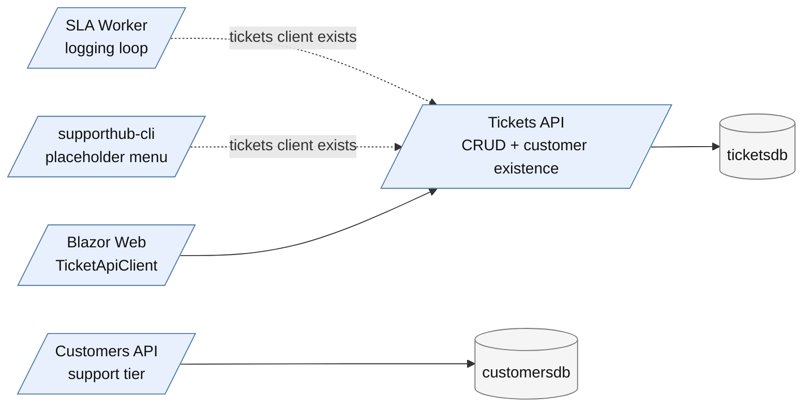
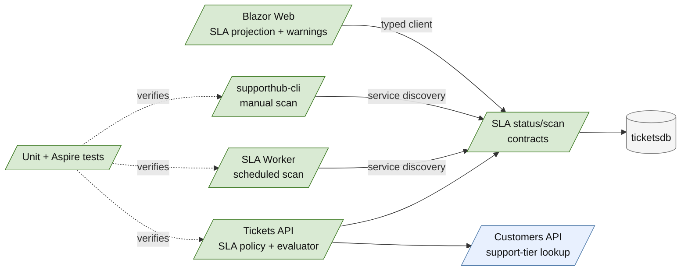
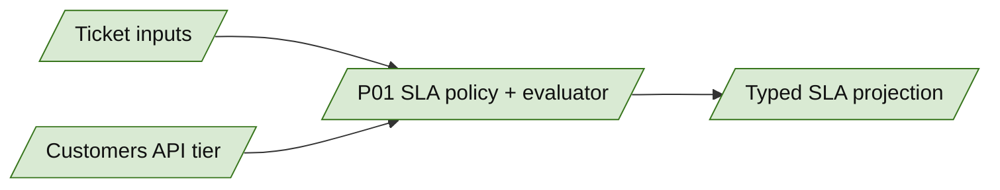
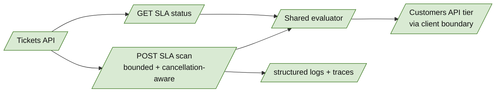
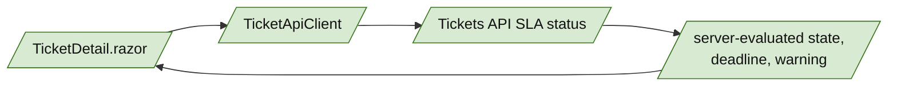
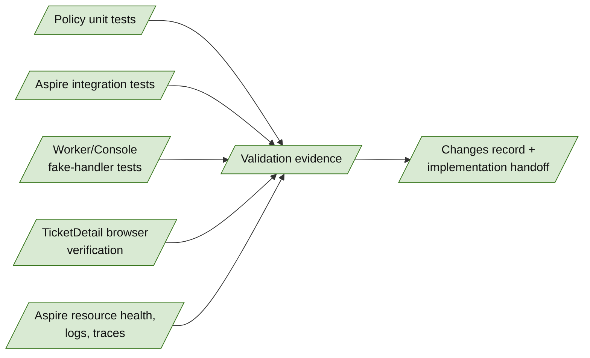

<!-- markdownlint-disable-file -->
# RPI Plan: SupportHub SLA Management

## Task Metadata

* Task ID: `supporthub-sla-management`
* Task slug: `supporthub-sla-management`
* Plan date: 2026-10-18

## Executive Summary

* Bottom line: Plan a Tickets API-owned SLA evaluator and scan API, then connect the SLA Worker, Operations Console, Blazor UI, and tests to that single behavior.
* Why this matters: The design preserves SupportHub data ownership, keeps scheduled/manual/UI results consistent, and makes time-dependent behavior deterministic.
* Planning result: In progress; confirmed research and policy decisions are recorded, with phase drafting and standard critique pending.
* Confidence and uncertainty: High confidence in architecture and policy semantics. The main implementation risk is bounded customer-tier lookup during scans because tier data remains owned by Customers API.

### What You May Not Know

* `feature/sla` currently has SLA project scaffolding but no SLA implementation. The AppHost already wires `sla-worker` and `supporthub-cli` to `ticketsapi`, so no new infrastructure resource is planned.
* The current policy intentionally gives Standard, Premium, and Enterprise the same targets: Low `24h`, Medium `12h`, High `2h`. The tier remains an explicit input so later tier differentiation can be versioned deliberately.
* SLA status is planned as an on-demand projection, not a new persisted table, because the approved scope has no alert history, acknowledgement, or notification requirement.

## Phase Checklist

### Before



### After



### P01 — Establish the Tickets API SLA policy and deterministic evaluator

Goals:

* Establish one feature-local policy and evaluator that produces the same result for API requests, scheduled scans, manual scans, and UI projections.
* Keep all calculations deterministic, UTC-based, injectable, and independent of HTTP or persistence concerns.

Tasks:

#### P01-T01 — Define SLA policy inputs, targets, states, and projection contracts

Goals:

* Represent priority, support tier, terminal ticket status, deadline, evaluation time, state, remaining/lateness, and policy version explicitly so callers cannot infer business meaning from persistence entities.

Requirements:

* Satisfy `FR-001`, `FR-002`, `FR-003`, `FR-004`, `FR-005`, `NFR-001`, and `NFR-002`.
* Add explicit contracts under the Tickets feature for policy input/result and scan result/error shapes.
* Preserve the 3x3 priority/tier mapping even though all current tier targets are equal.
* Use a stable enum/string representation for `OnTrack`, `AtRisk`, `Breached`, and terminal `Completed`/equivalent semantics; document the chosen wire values in the contract.
* Include one `EvaluatedAtUtc` in each result and distinguish remaining duration from lateness.

Details:

* Place the contracts beside existing ticket contracts rather than exposing `Ticket` persistence entities.
* Treat the following as a contract, not illustrative pseudocode:

  ```text
  SlaStatus {
      TicketId,
      CustomerId,
      Priority,
      SupportTier,
      TicketStatus,
      CreatedAtUtc,
      TargetDuration,
      DeadlineUtc,
      EvaluatedAtUtc,
      State,
      RemainingOrLateness,
      PolicyVersion
  }

  SlaScanResult {
      EvaluatedAtUtc,
      Items[],
      EvaluatedCount,
      FailedCount,
      Failures[]
  }
  ```

* Keep terminal state explicit rather than treating resolved/closed tickets as `OnTrack`.

References:

* [src/SupportHub.Tickets.Api/Features/Tickets/Ticket.cs](../../../src/SupportHub.Tickets.Api/Features/Tickets/Ticket.cs)
* [src/SupportHub.Tickets.Api/Features/Tickets/TicketContracts.cs](../../../src/SupportHub.Tickets.Api/Features/Tickets/TicketContracts.cs)
* [src/SupportHub.Customers.Api/Features/Customers/CustomerContracts.cs](../../../src/SupportHub.Customers.Api/Features/Customers/CustomerContracts.cs)
* [`.copilot-tracking/research/2026-10-18/supporthub-sla-management-research.md`](../../research/2026-10-18/supporthub-sla-management-research.md), decisions D3-D5 and findings C2-C8

Dependencies:

* None.

#### P01-T02 — Implement the pure, injectable SLA evaluator

Goals:

* Calculate deadlines and states correctly at exact boundaries without depending on wall-clock time, HTTP, logging, or EF Core.

Requirements:

* Satisfy `FR-001` through `FR-004` and `NFR-002`.
* Register production evaluation against `TimeProvider.System`; accept an injected `TimeProvider` in the evaluator.
* Calculate `DeadlineUtc = CreatedAtUtc + TargetDuration`.
* Apply `AtRisk` when `remaining <= target * 20% OR remaining <= 1h`, including exact equality; apply `Breached` after the deadline.
* Stop evaluation for `Resolved` and `Closed`.
* Define behavior for malformed/future creation timestamps and unsupported priority/tier values through explicit validation or a repository-consistent error path; do not silently default.
* Keep duration arithmetic overflow-safe and use UTC consistently.

Details:

* Prefer a policy object/table plus evaluator over separate conditionals in callers.
* Use `FakeTimeProvider` or the repository-compatible equivalent in unit tests; do not use sleeps.
* The policy version should be returned by the evaluator so changes are observable and test fixtures can pin the expected version.

References:

* [src/SupportHub.Tickets.Api/Features/Tickets/Ticket.cs](../../../src/SupportHub.Tickets.Api/Features/Tickets/Ticket.cs)
* [src/SupportHub.Tickets.Api/Program.cs](../../../src/SupportHub.Tickets.Api/Program.cs)
* [`.copilot-tracking/research/2026-10-18/supporthub-sla-management-research.md`](../../research/2026-10-18/supporthub-sla-management-research.md), policy decisions and official `TimeProvider` evidence
* [Testing with FakeTimeProvider - .NET](https://learn.microsoft.com/en-us/dotnet/core/extensions/timeprovider-testing)

Dependencies:

* Depends on `P01-T01`.

#### P01-T03 — Extend the customer-tier boundary for SLA orchestration

Goals:

* Let the Tickets API obtain the support tier it needs without violating Customers API ownership or making worker/console calls customer-specific.

Requirements:

* Satisfy `NFR-001`, `NFR-003`, and `NFR-004`.
* Extend the existing customer API client boundary to return support tier for a customer ID, preserving service discovery and resilience registration.
* Propagate cancellation tokens and surface not-found/unavailable responses explicitly.
* Use the existing customer-by-ID API contract with a maximum of `50` tickets per scan and at most `4` concurrent tier lookups; do not add a Customers API batch endpoint in this layer.
* Do not add a Tickets API reference to the Customers database or duplicate customer support-tier data.

Details:

* The selected trade-off is bounded per-ticket lookup: at most `50` ticket evaluations per request and at most `4` in-flight customer lookups. This keeps the feature within the current service contracts while making the N+1 cost explicit and testable.
* A missing customer is an item failure with a stable `CustomerNotFound` category; timeout, cancellation, or unavailable Customers API is an item failure with a stable `CustomerLookupUnavailable` category. The scan returns successful items and failures together when at least one item completes; an all-failure request returns a dependency failure response using existing Problem Details conventions.

References:

* [src/SupportHub.Tickets.Api/Features/Tickets/CustomerLookupClient.cs](../../../src/SupportHub.Tickets.Api/Features/Tickets/CustomerLookupClient.cs)
* [src/SupportHub.Customers.Api/Features/Customers/CustomerEndpoints.cs](../../../src/SupportHub.Customers.Api/Features/Customers/CustomerEndpoints.cs)
* [src/SupportHub.Customers.Api/Features/Customers/CustomerContracts.cs](../../../src/SupportHub.Customers.Api/Features/Customers/CustomerContracts.cs)
* [src/SupportHub.AppHost/AppHost.cs](../../../src/SupportHub.AppHost/AppHost.cs)

Dependencies:

* Depends on `P01-T01`.



### P02 — Expose bounded SLA status and scan APIs from Tickets API

Goals:

* Make the evaluator usable by all clients through explicit HTTP contracts while keeping scan behavior bounded, cancellation-aware, and observable.

Tasks:

#### P02-T01 — Add single-ticket SLA status endpoint behavior

Goals:

* Provide the Web client and operational callers a direct, consistent SLA projection for one ticket.

Requirements:

* Satisfy `FR-005`, `NFR-003`, and `NFR-004`.
* Add a feature-organized Minimal API endpoint under the Tickets API for one ticket's SLA status.
* Return appropriate `404`/`4xx`/`5xx` Problem Details according to existing conventions; do not return a success-shaped fallback when customer lookup or evaluation fails.
* Propagate request cancellation through ticket retrieval and customer-tier lookup.
* Use one evaluation timestamp for the response and include the policy version.

Details:

* Follow existing ticket endpoint route and response conventions. The endpoint may internally compose ticket persistence, customer-tier lookup, policy selection, and evaluator invocation, but none of these details belong in the public contract.
* Keep terminal ticket responses useful to UI callers by returning explicit terminal state and deadline metadata where available.

References:

* [src/SupportHub.Tickets.Api/Features/Tickets/TicketEndpoints.cs](../../../src/SupportHub.Tickets.Api/Features/Tickets/TicketEndpoints.cs)
* [src/SupportHub.Tickets.Api/Program.cs](../../../src/SupportHub.Tickets.Api/Program.cs)
* [src/SupportHub.Web/TicketApiClient.cs](../../../src/SupportHub.Web/TicketApiClient.cs)

Dependencies:

* Depends on `P01-T01`, `P01-T02`, and `P01-T03`.

#### P02-T02 — Add bounded SLA scan endpoint behavior

Goals:

* Allow scheduled and manual operations to request the same scan behavior with one consistent evaluation timestamp and explicit partial-failure semantics.

Requirements:

* Satisfy `FR-005`, `FR-006`, `FR-007`, `NFR-001`, `NFR-003`, and `NFR-004`.
* Add an authenticated-by-existing-host-boundary or otherwise repository-consistent scan endpoint; do not invent a separate persistence path.
* Define bounded request inputs such as status/priority filters and a maximum item count capped at `50`; reject values above the cap using existing validation conventions.
* Resolve customer tiers with at most `4` concurrent lookups and return `EvaluatedAtUtc`, result items, counts, and structured per-item/dependency failures; never silently omit failed items.
* Ensure scheduled and manual calls invoke the same application service and evaluator path.
* Make the scan cancellation-aware and prevent unbounded memory or request time.

Details:

* Use a scan application service that obtains a bounded ticket snapshot of at most `50`, resolves tiers with a maximum of `4` concurrent calls, evaluates through `SlaEvaluator`, and maps the result contract. The worker and console should only select operational request options and render/log results.
* Use one `EvaluatedAtUtc` per scan, passing it into the evaluator rather than allowing each item to read the clock independently.

References:

* [src/SupportHub.Tickets.Api/Features/Tickets/TicketEndpoints.cs](../../../src/SupportHub.Tickets.Api/Features/Tickets/TicketEndpoints.cs)
* [src/SupportHub.Tickets.Api/Features/Tickets/TicketDbContext.cs](../../../src/SupportHub.Tickets.Api/Features/Tickets/TicketDbContext.cs)
* [src/SupportHub.Tickets.Api/Program.cs](../../../src/SupportHub.Tickets.Api/Program.cs)
* [`.copilot-tracking/research/2026-10-18/supporthub-sla-management-research.md`](../../research/2026-10-18/supporthub-sla-management-research.md), scan/N+1 risk

Dependencies:

* Depends on `P01-T01`, `P01-T02`, `P01-T03`, and `P02-T01`.

#### P02-T03 — Register production dependencies and API observability

Goals:

* Make the Tickets API path deployable and diagnosable using existing ServiceDefaults conventions.

Requirements:

* Satisfy `NFR-002`, `NFR-003`, `NFR-004`, and `NFR-006`.
* Register `TimeProvider.System`, policy/evaluator services, and the customer-tier client through dependency injection.
* Preserve `AddServiceDefaults`, health endpoints, resilience, service discovery, metrics, and tracing.
* Emit structured scan outcome logs including evaluation timestamp, requested bounds, evaluated/failed counts, and failure categories without secrets.
* Keep failures visible to HTTP callers and health/telemetry consumers; do not swallow exceptions.

Details:

* Use the existing `Program.cs` registration style and avoid adding a new cross-project shared library for this layer unless a concrete parent/stack requirement appears.
* The scan endpoint should expose enough response data for worker and console logs to agree without parsing human-readable log text.

References:

* [src/SupportHub.Tickets.Api/Program.cs](../../../src/SupportHub.Tickets.Api/Program.cs)
* [src/SupportHub.ServiceDefaults/Extensions.cs](../../../src/SupportHub.ServiceDefaults/Extensions.cs)
* [src/SupportHub.AppHost/AppHost.cs](../../../src/SupportHub.AppHost/AppHost.cs)

Dependencies:

* Depends on `P02-T01` and `P02-T02`.



### P03 — Connect scheduled and on-demand operational clients

Goals:

* Replace the Worker placeholder loop and Console placeholder operation with thin clients of the Tickets API scan contract.
* Keep scheduling, command interaction, cancellation, and presentation operational; keep SLA policy and evaluation in Tickets API.

Tasks:

#### P03-T01 — Implement non-overlapping scheduled scans in SLA Worker

Goals:

* Run bounded, observable SLA scans on a configured cadence through Aspire service discovery.

Requirements:

* Satisfy `FR-006`, `NFR-003`, `NFR-004`, and `NFR-006`.
* Replace the one-second logging loop with a `BackgroundService`/hosted-service periodic loop that awaits each scan before the next interval.
* Use the existing named `tickets` client and exact `https+http://ticketsapi` resource URI.
* Read interval and scan bounds from configuration with safe validation and a nonzero operational default.
* Propagate shutdown cancellation; log start, success counts, partial failures, HTTP failures, and cancellation distinctly.
* Do not calculate policy status or call a database from the Worker.

Details:

* Prefer an awaited periodic timer or equivalent repository-compatible hosted-service pattern; do not use fire-and-forget tasks that can overlap.
* Treat a non-success HTTP response as a failed scan and preserve the response/problem detail in logs without exposing secrets.
* The Worker should remain independently deployable and use only the Tickets API contract.

References:

* [src/SupportHub.Sla.Worker/Program.cs](../../../src/SupportHub.Sla.Worker/Program.cs)
* [src/SupportHub.Sla.Worker/Worker.cs](../../../src/SupportHub.Sla.Worker/Worker.cs)
* [src/SupportHub.AppHost/AppHost.cs](../../../src/SupportHub.AppHost/AppHost.cs)
* [Background tasks with hosted services in ASP.NET Core](https://learn.microsoft.com/en-us/aspnet/core/fundamentals/host/hosted-services?view=aspnetcore-10.0)

Dependencies:

* Depends on `P02-T02` and `P02-T03`.

#### P03-T02 — Add the Operations Console on-demand SLA scan

Goals:

* Let operators trigger the same Tickets API scan from `supporthub-cli` and see actionable results without duplicating domain logic.

Requirements:

* Satisfy `FR-007`, `NFR-001`, `NFR-003`, `NFR-004`, and `NFR-006`.
* Add a menu command using existing console interaction conventions and the named `tickets` client.
* Display evaluated count, at-risk/breached summary, partial failures, and service errors distinctly.
* Propagate cancellation where the existing terminal interaction supports it and avoid blocking the process indefinitely.
* Do not query Tickets API persistence directly or implement policy rules in the Console.

Details:

* Reuse the same scan request/response DTOs or a shared client contract; the Console may format results differently from Worker logs but must not reinterpret states.
* Preserve the AppHost resource name `supporthub-cli`, `WithTerminal()`, `ticketsapi` reference, and `WaitFor` relationship.

References:

* [src/SupportHub.Sla.Console/Program.cs](../../../src/SupportHub.Sla.Console/Program.cs)
* [src/SupportHub.AppHost/AppHost.cs](../../../src/SupportHub.AppHost/AppHost.cs)

Dependencies:

* Depends on `P02-T02` and `P02-T03`; it does not depend on Worker runtime success.

```mermaid
flowchart LR
    timer[/"Configured timer"/] --> worker[/"SLA Worker"/]
    command[/"CLI scan command"/] --> console[/"supporthub-cli"/]
    worker -->|named tickets client| scan[/"Tickets API scan endpoint"/]
    console -->|named tickets client| scan
    scan --> result[/"same SlaScanResult"/]
    result --> workerlog[/"worker structured logs"/]
    result --> consoleout[/"operator output"/]
    classDef changed fill:#d9ead3,stroke:#38761d,color:#111;
    class timer,worker,command,console,scan,result,workerlog,consoleout changed;
    style timer fill:#d9ead3,stroke:#38761d,color:#111;
    style worker fill:#d9ead3,stroke:#38761d,color:#111;
    style command fill:#d9ead3,stroke:#38761d,color:#111;
    style console fill:#d9ead3,stroke:#38761d,color:#111;
    style scan fill:#d9ead3,stroke:#38761d,color:#111;
    style result fill:#d9ead3,stroke:#38761d,color:#111;
    style workerlog fill:#d9ead3,stroke:#38761d,color:#111;
    style consoleout fill:#d9ead3,stroke:#38761d,color:#111;
    classDef darkChanged fill:#294d2b,stroke:#8fce8f,color:#fff;
```



### P04 — Add typed Web integration and SLA presentation

Goals:

* Present the Tickets API SLA projection in Blazor with clear semantic states and existing page-state conventions.
* Avoid client-side duplication of deadline or at-risk calculations.

Tasks:

#### P04-T01 — Extend the typed Ticket API client with SLA contracts

Goals:

* Give Web components a strongly typed, service-discovery-backed method for retrieving one ticket's SLA status.

Requirements:

* Satisfy `FR-005`, `FR-008`, `NFR-003`, and `NFR-005`.
* Add DTOs and a cancellable client method following existing `TicketApiClient` patterns.
* Map non-success responses into the existing Web error/unavailable handling rather than returning a fabricated SLA state.
* Preserve the existing Tickets API base address/service discovery configuration.

Details:

* Keep the client as transport/orchestration code; it must not calculate deadlines or classify states.
* If the selected list projection can be served by the scan/status API without N+1 calls, add it as a bounded client method; otherwise limit the first UI surface to ticket detail.

References:

* [src/SupportHub.Web/TicketApiClient.cs](../../../src/SupportHub.Web/TicketApiClient.cs)
* [src/SupportHub.Web/Program.cs](../../../src/SupportHub.Web/Program.cs)
* [src/SupportHub.Tickets.Api/Features/Tickets/TicketContracts.cs](../../../src/SupportHub.Tickets.Api/Features/Tickets/TicketContracts.cs)

Dependencies:

* Depends on `P02-T01`.

#### P04-T02 — Render deadline, state, and warnings in ticket UI

Goals:

* Make SLA status understandable to support staff on the safest existing UI surface without introducing client-side business rules.

Requirements:

* Satisfy `FR-008` and `NFR-005`.
* Integrate SLA loading, success, empty/terminal, unavailable, and error states into `TicketDetail.razor`.
* Render text labels for at least `OnTrack`, `AtRisk`, `Breached`, and terminal state; do not rely on color alone.
* Display deadline and either remaining time or lateness using the server-provided evaluation result.
* Add list indicators only if the API exposes a bounded multi-ticket projection; otherwise document detail-only scope in the implementation changes record.
* Preserve existing attachment/activity behavior and avoid duplicate API calls on rerender.

Details:

* Use existing component patterns for loading/error states and existing styling conventions.
* The UI may format durations and dates, but must not recompute the SLA state from current browser time.

References:

* [src/SupportHub.Web/Components/Pages/TicketDetail.razor](../../../src/SupportHub.Web/Components/Pages/TicketDetail.razor)
* [src/SupportHub.Web/Components/Pages/Tickets.razor](../../../src/SupportHub.Web/Components/Pages/Tickets.razor)

Dependencies:

* Depends on `P04-T01` and `P02-T01`.



### P05 — Prove policy, service boundaries, and Aspire runtime behavior

Goals:

* Lock the exact policy boundaries in fast tests, prove API/client composition in distributed tests, and verify scheduled/manual operations through Aspire evidence.

Tasks:

#### P05-T01 — Add deterministic policy and evaluator unit tests

Goals:

* Make every time and policy boundary executable and regression-resistant without real-time waits.

Requirements:

* Satisfy `FR-001` through `FR-004`, `FR-009`, and `NFR-002`.
* Add tests for all nine priority/tier combinations.
* Cover exact deadline, one tick before/after deadline, exact 20% threshold, exact one-hour threshold, the OR rule when either threshold wins, terminal `Resolved`/`Closed`, UTC offsets, and invalid inputs.
* Assert deadline, state, remaining/lateness, evaluation timestamp, and policy version rather than only truthiness.
* Keep tests in `tests/SupportHub.Tickets.Api.Tests`; use fake time and no sleeps.

Details:

* Prefer table-driven cases for policy mapping and named tests for boundary semantics.
* If the test project needs a fake-time package, update central package management minimally and only after confirming the framework does not already provide it.

References:

* [tests/SupportHub.Tickets.Api.Tests/TicketValidationTests.cs](../../../tests/SupportHub.Tickets.Api.Tests/TicketValidationTests.cs)
* [tests/SupportHub.Tickets.Api.Tests/SupportHub.Tickets.Api.Tests.csproj](../../../tests/SupportHub.Tickets.Api.Tests/SupportHub.Tickets.Api.Tests.csproj)
* [Directory.Packages.props](../../../Directory.Packages.props)

Dependencies:

* Depends on `P01-T01` and `P01-T02`.

#### P05-T02 — Add Tickets API and distributed integration coverage

Goals:

* Prove that endpoint composition, customer-tier ownership, scan bounds, and typed clients work across the actual Aspire graph.

Requirements:

* Satisfy `FR-005`, `FR-006`, `FR-007`, `FR-009`, and `NFR-001` through `NFR-004`.
* Extend `tests/SupportHub.AppHost.Tests` using the existing distributed builder and exact resource names.
* Wait for `ticketsapi`, `customersapi`, `sla-worker`, and `supporthub-cli` as applicable before exercising behavior.
* Verify single-ticket status uses Customers API tier data and returns the expected policy/deadline/state.
* Verify bounded scan results and explicit partial failures for missing-customer data through the Aspire graph.
* Add focused Tickets API scan-orchestration tests using an injected fake customer-tier client/handler to deterministically return timeout/unavailable responses; assert `CustomerLookupUnavailable`, partial results, all-failure response behavior, cancellation, the `50`-item cap, and the `4`-lookup concurrency bound.
* Verify Worker and Console use the Tickets API boundary rather than direct database access; use observable HTTP/log evidence where the harness supports it.
* Verify manual and scheduled paths produce the same scan contract semantics for the same ticket snapshot/time assumptions.

Details:

* Keep integration data isolated using existing test fixture conventions. Use the distributed harness for reachable service behavior and missing-customer data; do not add a production-visible fault-injection endpoint.
* Do not make emulator limitations look like SLA failures; record any inherited Activity-layer runtime limitation in the changes record and distinguish it from feature regressions.

References:

* [tests/SupportHub.AppHost.Tests/TicketsApiTests.cs](../../../tests/SupportHub.AppHost.Tests/TicketsApiTests.cs)
* [tests/SupportHub.AppHost.Tests/SupportHub.AppHost.Tests.csproj](../../../tests/SupportHub.AppHost.Tests/SupportHub.AppHost.Tests.csproj)
* [tests/SupportHub.Tickets.Api.Tests/SupportHub.Tickets.Api.Tests.csproj](../../../tests/SupportHub.Tickets.Api.Tests/SupportHub.Tickets.Api.Tests.csproj)
* [src/SupportHub.AppHost/AppHost.cs](../../../src/SupportHub.AppHost/AppHost.cs)
* [`.copilot-tracking/changes/2026-10-18/activity-and-audit-changes.md`](../../changes/2026-10-18/activity-and-audit-changes.md)

Dependencies:

* Depends on `P02-T01`, `P02-T02`, `P03-T01`, and `P03-T02`.

#### P05-T03 — Test operational clients and Blazor SLA behavior

Goals:

* Prove that Worker/Console transport behavior and the changed ticket detail surface consume the server contract correctly without duplicating policy.

Requirements:

* Satisfy `FR-007`, `FR-008`, `FR-009`, `NFR-003`, and `NFR-005`.
* Add focused Worker and Console client tests using a fake `HttpMessageHandler` or equivalent injectable transport seam, asserting the exact Tickets API scan request, successful result handling, partial-failure rendering/logging, non-success handling, and cancellation.
* Add a browser-level Aspire check for `TicketDetail.razor` that exercises a successful SLA projection and asserts visible semantic state/deadline text; include an unavailable/error scenario if the existing harness can deterministically induce it.
* Assert that the Web component uses server-provided state and does not recalculate classification from browser time.
* Keep test additions in existing `tests/SupportHub.AppHost.Tests` and the repository's existing browser test surface; do not create a new test project solely for this feature.

Details:

* If Worker/Console implementation types are not directly referenceable from the existing test project, expose a small internal scan-client seam and add the minimum project references needed for tests; do not test long-running process timing as the only evidence.
* Use a short test-only Worker interval or an explicit trigger seam for runtime coverage, while unit-testing the client request/response path deterministically.
* Record a browser verification limitation explicitly if an inherited emulator or authentication constraint prevents the unavailable/error scenario.

References:

* [src/SupportHub.Sla.Worker/Program.cs](../../../src/SupportHub.Sla.Worker/Program.cs)
* [src/SupportHub.Sla.Worker/Worker.cs](../../../src/SupportHub.Sla.Worker/Worker.cs)
* [src/SupportHub.Sla.Console/Program.cs](../../../src/SupportHub.Sla.Console/Program.cs)
* [src/SupportHub.Web/Components/Pages/TicketDetail.razor](../../../src/SupportHub.Web/Components/Pages/TicketDetail.razor)
* [tests/SupportHub.AppHost.Tests/SupportHub.AppHost.Tests.csproj](../../../tests/SupportHub.AppHost.Tests/SupportHub.AppHost.Tests.csproj)

Dependencies:

* Depends on `P03-T01`, `P03-T02`, and `P04-T02`.

#### P05-T04 — Run build, tests, and Aspire runtime verification

Goals:

* Produce implementation evidence that the solution builds, relevant tests pass, and affected resources are healthy and observable.

Requirements:

* Satisfy `FR-009`, `NFR-003`, and `NFR-006`.
* Run the smallest relevant test selectors first, then `dotnet restore SupportHub.slnx`, `dotnet build SupportHub.slnx`, and `dotnet test SupportHub.slnx` as required by repository completion rules.
* Start or inspect the distributed application with the repository Aspire workflow; confirm `ticketsapi`, `sla-worker`, and `supporthub-cli` reach expected states.
* Trigger a manual console scan and observe a scheduled Worker scan through service discovery using the explicit test trigger or short test-only interval.
* Inspect relevant Aspire logs/traces for successful scans, customer lookup failures, cancellation/shutdown, matching request/result semantics, and no direct database access from worker/console.
* Record validation commands, results, limitations, and any residual risk in the implementation changes record.

Details:

* Use repository-local Aspire monitoring/orchestration guidance for version-specific commands and runtime evidence.
* Stop any attached runtime helper after verification unless the user explicitly requests it remain running.

References:

* [src/SupportHub.AppHost/AppHost.cs](../../../src/SupportHub.AppHost/AppHost.cs)
* [.github/copilot-instructions.md](../../../.github/copilot-instructions.md)
* [`.copilot-tracking/research/2026-10-18/supporthub-sla-management-research.md`](../../research/2026-10-18/supporthub-sla-management-research.md)

Dependencies:

* Depends on `P05-T01`, `P05-T02`, and `P05-T03`.



## User Decisions and Requirements

### Confirmed User Direction

* Implement only SupportHub SLA Management on `feature/sla`, whose parent is `feature/activity`.
* Preserve customer and ticket data ownership; the SLA Worker and Operations Console must use Tickets API APIs rather than databases.
* Use one shared evaluation behavior without duplicating policy rules in the worker and console.
* Use elapsed UTC time with injectable time for deterministic tests.
* Use Low `24h`, Medium `12h`, and High `2h` targets for every support tier.
* Mark tickets `AtRisk` when remaining time is `<= 20%` of the target or `<= 1h`; mark open tickets `Breached` after the deadline.
* Stop SLA evaluation at `Resolved` or `Closed`; pause/reopen semantics are outside this layer.
* Add scheduled worker scans, an on-demand `supporthub-cli` scan, Blazor SLA status/warnings, unit tests, integration tests, and Aspire runtime verification.
* Do not implement later stack layers, change application code during planning, or create a pull request.

### Planning Decisions and Feedback

| Group | Decision or feedback item | Status | Owner | Rationale or input needed | Evidence | Planning impact |
|---|---|---|---|---|---|---|
| D1 | Tickets API owns policy inputs, customer-tier lookup orchestration, evaluation, and scan/status contracts | confirmed recommendation | architecture | Preserves ownership and gives worker, console, and Web one source of truth | Research C2-C8 | Drives P01-P04 |
| D2 | SLA status is calculated on demand; no SLA persistence/migration in this layer | confirmed recommendation | architecture | No alert/history/acknowledgement requirement | Research C2, C5, C7 | Removes database migration work |
| D3 | Standard/Premium/Enterprise use identical priority targets in this version | confirmed | user | User confirmed unchanged tier mapping | Research C13; user decision | Requires explicit 3x3 policy tests and versioned policy representation |
| D4 | Worker scheduling interval and console presentation/filter syntax | proposed | planner | Operational details are not product policy; choose configuration and existing CLI conventions during implementation | Research C3-C4, W2-W3 | Affects P03 task details, not evaluator semantics |

## Planning Readiness and Next Step

| Field | Record |
|---|---|
| Planning execution and readiness | Finalized; implementation-ready with standard critique passed |
| Decision participation | user-owned; standalone/manual RPI, with policy decisions D3 confirmed |
| Blockers | None |
| Latest critique | [`.copilot-tracking/reviews/plans/2026-10-18/supporthub-sla-management-plan-critique-3.md`](../../reviews/plans/2026-10-18/supporthub-sla-management-plan-critique-3.md); verdict Pass with PC-001 through PC-004 resolved |
| Relevant research | [`.copilot-tracking/research/2026-10-18/supporthub-sla-management-research.md`](../../research/2026-10-18/supporthub-sla-management-research.md) |
| Plan | `.copilot-tracking/plans/2026-10-18/supporthub-sla-management-plan.md` |
| Changes-record role | `.copilot-tracking/changes/2026-10-18/supporthub-sla-management-changes.md` will be implementation evidence |
| Continuation owner | user/manual RPI |
| Required gates or confirmations | User approval before implementation |
| Next action | Invoke `/rpi-implement` after approval |

## Goals

* Establish one deterministic SLA policy and evaluator in the Tickets API.
* Expose bounded SLA status and scan behavior through explicit application contracts.
* Execute scheduled and manual scans through service discovery without direct database access.
* Display understandable SLA deadlines, at-risk warnings, and breaches in Blazor.
* Prove policy boundaries, cross-service behavior, and Aspire observability with focused and distributed tests.

## Scope and Non-Goals

### In Scope

* Tickets API SLA policy, evaluator, customer-tier lookup orchestration, contracts, endpoints, and dependency registration.
* SLA Worker scheduled scan client and logging.
* `SupportHub.Sla.Console` on-demand scan command.
* Typed Web client and ticket detail/list SLA presentation as supported by bounded API results.
* Unit, API, AppHost integration, and runtime validation for this feature.

### Non-Goals

* Direct worker/console access to PostgreSQL or Customers database.
* Durable SLA evaluation history, notifications, acknowledgements, or breach event publication.
* Business-hours calendars, paused/reopened SLA clocks, or tier-specific targets beyond the confirmed identical mapping.
* Support Dashboard metrics and later `feature/dashboard` work.
* Authentication, authorization, deployment, or unrelated refactoring.

## Functional Requirements

* FR-001: The Tickets API evaluates SLA deadline and state from ticket priority, customer support tier, ticket creation time, policy version, and current injected UTC time.
* FR-002: The current policy maps Low to `24h`, Medium to `12h`, and High to `2h` for Standard, Premium, and Enterprise.
* FR-003: An open ticket is `OnTrack` until the at-risk rule applies, `AtRisk` when remaining time is `<= 20%` of target or `<= 1h`, and `Breached` after the deadline.
* FR-004: Resolved and Closed tickets stop SLA evaluation and return an explicit terminal representation.
* FR-005: Tickets API exposes a bounded SLA status/scan contract with ticket identity, policy inputs, deadline, evaluation time, state, remaining/lateness, and explicit dependency failures.
* FR-006: SLA Worker performs scheduled scans only through `ticketsapi` using Aspire service discovery.
* FR-007: `supporthub-cli` triggers the same scan behavior through application APIs and does not duplicate policy rules.
* FR-008: Blazor displays SLA deadline, state, and warnings through `TicketApiClient` with explicit loading, empty, error, and unavailable states.
* FR-009: Unit and integration tests cover all priority/tier combinations, time boundaries, terminal behavior, scheduled/manual consistency, and service boundaries.

## Non-Functional Requirements

* NFR-001: Tickets API owns ticket/SLA orchestration; Customers API owns support tier; Worker, Console, and Web do not access service-owned databases.
  * Objective threshold or evaluation condition: No database client/reference is registered in SLA Worker or Console; all scan calls target `ticketsapi`.
* NFR-002: SLA calculations use UTC and injectable `TimeProvider`.
  * Objective threshold or evaluation condition: Policy tests use `FakeTimeProvider` or equivalent and require no real-time sleeping.
* NFR-003: All cross-service HTTP calls use the existing `https+http://<resource-name>` service-discovery pattern and shared HTTP resilience defaults.
  * Objective threshold or evaluation condition: Aspire integration and runtime logs show calls through named resources.
* NFR-004: Scan work is bounded, cancellation-aware, and explicit about dependency failures.
  * Objective threshold or evaluation condition: Results expose evaluation time and bounded result/error behavior; no silent success fallback.
* NFR-005: At-risk and breached UI meaning is available without color alone.
  * Objective threshold or evaluation condition: Rendered text/semantic status accompanies visual styling.
* NFR-006: Logs and traces identify scan outcomes and ticket IDs without secrets.
  * Objective threshold or evaluation condition: Aspire runtime verification finds structured worker/console/API evidence for successful and failed scans.

## Risks and Open Questions

| Priority | Type | Risk, question, or planning item | Affected work | Impact | Smallest action or evidence needed | Owner |
|---|---|---|---|---|---|---|
| M | accepted risk | Bounded per-ticket customer-tier lookup creates controlled N+1 traffic | P01-T03, P02-T02, P05-T02 | Scan latency and dependency load increase with the 50-ticket cap | Enforce the 50-ticket/4-concurrent limits, test failure categories, and revisit only in a later feature with evidence | planner/implementer |
| H | risk | Identical targets across tiers may be mistaken for missing tier behavior | P01-T01, P05-T01 | Future policy changes could silently alter deadlines | Keep tier in policy input, contract, logs, and 3x3 tests; version the policy | implementer |
| M | risk | Tickets can change while a scan runs | P02-T02, P03-T01 | Results may differ between scan calls | Include one evaluation timestamp and bounded snapshot semantics | implementer |
| M | scope constraint | Detail view is the initial SLA UI surface; list indicators are conditional on a bounded projection | P04-T02 | Per-row calls could create N+1 UI traffic | Implement detail first and add list indicators only when one bounded endpoint supports them | implementer |
| M | risk | Worker runtime cadence can produce overlapping scans | P03-T01 | Duplicate load and confusing logs | Use a non-overlapping awaited loop and configured interval | implementer |
| L | compatibility | `FakeTimeProvider` package version must align with .NET 10 central package management | P05-T01 | Restore/build mismatch | Add one centrally managed compatible package only if required by tests | implementer |

## Dependencies

* Existing `ticketsapi`, `customersapi`, `sla-worker`, `supporthub-cli`, and `webfrontend` AppHost resources: preserve exact names and references.
* Existing `CustomerLookupClient`/Customers API contract: extend the API client boundary only as needed to obtain support tier; do not add database coupling.
* Existing `SupportHub.ServiceDefaults`: retain service discovery, resilience, health checks, logging, metrics, and tracing.
* Existing Aspire integration-test harness: use `DistributedApplicationTestingBuilder`, resource health waits, and `CreateHttpClient`.
* Confirmed research artifact: architecture, policy, risks, and source evidence are authoritative inputs to this plan.

## Test Ownership and Validation Lock

| Dimension | Locked plan |
|---|---|
| Canonical test owners | `tests/SupportHub.Tickets.Api.Tests` owns policy/evaluator tests; `tests/SupportHub.AppHost.Tests` owns distributed API, Worker, Console, service-discovery, and focused client tests; Web UI behavior is verified through the existing browser/Aspire test surface, with no new test project |
| Exact removals | None |
| Maximum additions | Feature-scoped tests only: policy/evaluator cases, Tickets API status/scan cases, distributed Worker/Console/service-discovery cases, and the minimum UI coverage needed for the changed component |
| Canonical targets | Existing test projects under `tests/`; no generated test targets |
| Semantic coverage | All nine priority/tier combinations; `OnTrack`/`AtRisk`/`Breached`/terminal boundaries; exact 20% and 1-hour thresholds; UTC and injected time; bounded scans; partial dependency failures; same scan semantics for Worker and Console |
| Regression coverage | Existing ticket CRUD, customer lookup, activity, attachment, health, and AppHost tests remain passing |
| Validation evidence | Targeted tests, solution restore/build/test, Aspire resource health, fake-handler Worker/Console client tests, browser verification of `TicketDetail.razor`, manual console scan, scheduled Worker scan, and relevant logs/traces recorded in `.copilot-tracking/changes/2026-10-18/supporthub-sla-management-changes.md` |

## Sources

* [src/SupportHub.AppHost/AppHost.cs](../../../src/SupportHub.AppHost/AppHost.cs): exact Aspire resource names and service relationships.
* [src/SupportHub.Tickets.Api/Features/Tickets/Ticket.cs](../../../src/SupportHub.Tickets.Api/Features/Tickets/Ticket.cs): ticket inputs and lifecycle state.
* [src/SupportHub.Tickets.Api/Features/Tickets/TicketEndpoints.cs](../../../src/SupportHub.Tickets.Api/Features/Tickets/TicketEndpoints.cs): Minimal API conventions and query behavior.
* [src/SupportHub.Customers.Api/Features/Customers/CustomerContracts.cs](../../../src/SupportHub.Customers.Api/Features/Customers/CustomerContracts.cs): support-tier contract.
* [src/SupportHub.Sla.Worker/Program.cs](../../../src/SupportHub.Sla.Worker/Program.cs) and [src/SupportHub.Sla.Worker/Worker.cs](../../../src/SupportHub.Sla.Worker/Worker.cs): existing worker scaffold and client registration.
* [src/SupportHub.Sla.Console/Program.cs](../../../src/SupportHub.Sla.Console/Program.cs): existing terminal client and command loop.
* [src/SupportHub.Web/TicketApiClient.cs](../../../src/SupportHub.Web/TicketApiClient.cs) and [src/SupportHub.Web/Components/Pages/TicketDetail.razor](../../../src/SupportHub.Web/Components/Pages/TicketDetail.razor): typed Web/API and UI seams.
* [tests/SupportHub.Tickets.Api.Tests/TicketValidationTests.cs](../../../tests/SupportHub.Tickets.Api.Tests/TicketValidationTests.cs) and [tests/SupportHub.AppHost.Tests/TicketsApiTests.cs](../../../tests/SupportHub.AppHost.Tests/TicketsApiTests.cs): unit and distributed test patterns.
* [`.copilot-tracking/research/2026-10-18/supporthub-sla-management-research.md`](../../research/2026-10-18/supporthub-sla-management-research.md): completed SLA research, decisions, and evidence.
* [Testing with FakeTimeProvider - .NET](https://learn.microsoft.com/en-us/dotnet/core/extensions/timeprovider-testing): deterministic time-testing guidance.
* [Background tasks with hosted services in ASP.NET Core](https://learn.microsoft.com/en-us/aspnet/core/fundamentals/host/hosted-services?view=aspnetcore-10.0): scheduled hosted-service guidance.

## Critique Disposition

* Critique setting and provenance: standard; default required by the planning contract.
* Critique status: complete
* Latest critique and verdict: final standard follow-up returned Pass with no remaining substantive findings.
* Earlier critiques: [initial](../../reviews/plans/2026-10-18/supporthub-sla-management-plan-critique.md), [follow-up](../../reviews/plans/2026-10-18/supporthub-sla-management-plan-critique-2.md)
* Limitations: none

## Artifact Self-Check

* [x] Phase/task blocks, diagrams, and requirements are complete.
* [x] Standard critique has run after the plan became implementation-ready.
* [x] Critique findings are resolved or accepted with explicit residual risk.
* [x] Handoff and changes-record paths are synchronized.

## Follow-Up Items

* None

## Handoff

* Authoritative implementation handoff: Planning Readiness and Next Step.

## Relevant Artifacts

| Artifact | Description |
|---|---|
| [`.copilot-tracking/plans/2026-10-18/supporthub-sla-management-plan.md`](.copilot-tracking/plans/2026-10-18/supporthub-sla-management-plan.md) | Final implementation-ready SLA plan |
| [`.copilot-tracking/research/2026-10-18/supporthub-sla-management-research.md`](.copilot-tracking/research/2026-10-18/supporthub-sla-management-research.md) | Completed research and confirmed policy decisions |
| [`.copilot-tracking/reviews/plans/2026-10-18/supporthub-sla-management-plan-critique-3.md`](.copilot-tracking/reviews/plans/2026-10-18/supporthub-sla-management-plan-critique-3.md) | Final standard critique with Pass verdict |
| [`.github/copilot-instructions.md`](.github/copilot-instructions.md) | Repository architecture and validation constraints |

## Next Steps

The plan is implementation-ready and the standard critique passed. Obtain user approval, then run `/rpi-implement`; implementation validation must record evidence in `.copilot-tracking/changes/2026-10-18/supporthub-sla-management-changes.md`.
