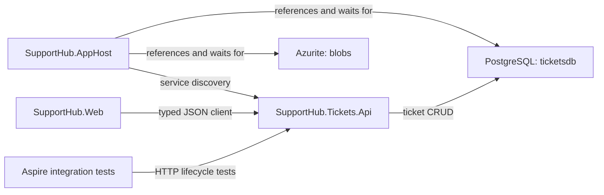
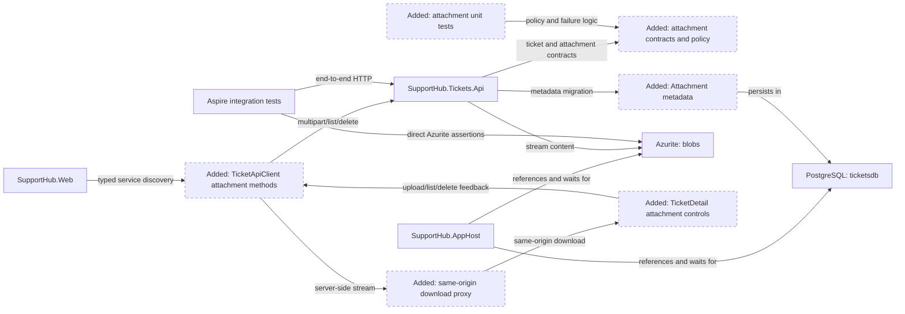
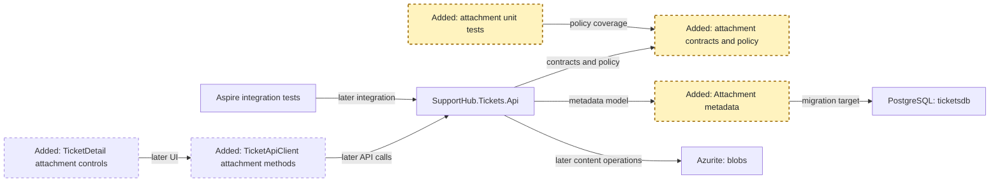
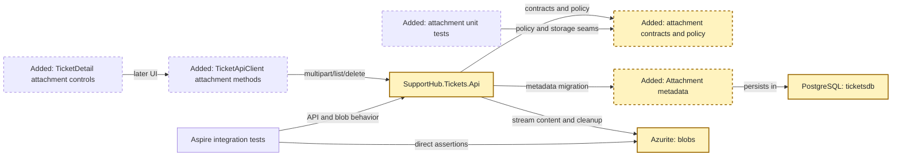
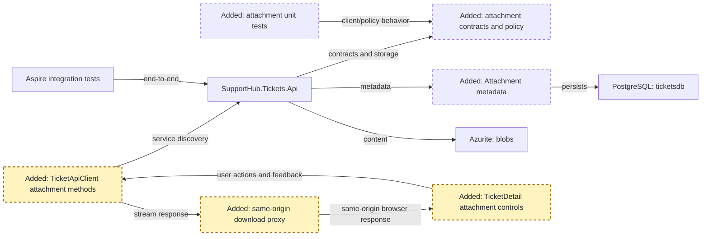
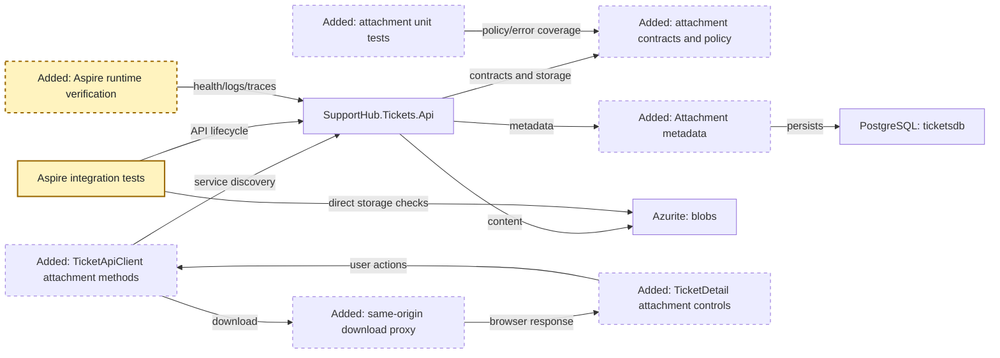

<!-- markdownlint-disable-file -->

# RPI Plan: SupportHub Ticket Attachments

## Task Metadata

* Task ID: `supporthub-ticket-attachments`
* Task slug: `ticket-attachments`
* Plan date: 2026-10-18

## Executive Summary

* Bottom line: Add ticket-scoped attachment management as a vertical slice owned by `SupportHub.Tickets.Api`: metadata and lifecycle state in `ticketsdb`, content in the existing Azurite-backed `blobs` resource, typed C# API/client contracts, Blazor detail-page controls, and real Aspire/Azurite integration coverage.
* Why this matters: Upload and delete span two non-transactional stores, while browser downloads cannot use server-side Aspire service-discovery URIs directly. The plan makes those boundaries, failure modes, and verification points explicit without adding a new service or later stack layer.
* Planning result: Complete and implementation-ready after the standard critiques and user decisions; the plan defines ticket-delete cleanup, the exact blob container/provisioning rule, the same-origin Web route, executable failure-test placement, bounded multipart parsing, approved policy defaults, a reproducible browser failure stimulus, and consistent critique provenance.
* Confidence and uncertainty: High confidence in the repository seams, ownership, resource names, API shape, migration path, and test strategy. Malware scanning, identity authorization, resumable uploads, and automated orphan reconciliation remain outside this feature.

### What You May Not Know

The current repository has no authentication or identity model, so “access” means that every operation is scoped to an existing ticket and an attachment belonging to that ticket. User/role authorization must be added later without moving attachment ownership out of Tickets API.

The branch `feature/attachments` currently points at the same commit as `feature/tickets`; the plan introduces all attachment behavior while preserving the existing AppHost resource graph and later stack boundaries.

## Phase Checklist

### Before



### After



The plan preserves the existing `storage`/`blobs` AppHost resource and adds only service-owned metadata, attachment endpoints, typed Web access, UI behavior, and verification. No Activity Worker, SLA behavior, authentication, malware scanner, or reconciliation worker is introduced.

<!-- rpi:phase id=P01 -->
### [x] P01: Establish the attachment contract, policy, and metadata foundation

Goals:
* Establish one server-authoritative attachment policy and explicit metadata contracts so every later API, client, UI, and test surface shares the same limits, names, and route semantics.

Dependencies:
* Existing ticket model, `TicketDbContext`, migration conventions, and the completed attachment research.



Highlighted work: `contracts`, `metadata`, and their focused unit-test seams.

<!-- rpi:task id=P01-T01 -->
#### [x] P01-T01: Define the attachment policy and public contracts

Goals:
* Create a single, server-authoritative policy and explicit request/response shapes that make size, type, filename, route ownership, and content metadata testable.

Requirements:
* `FR-003`, `FR-005`, `FR-006`, `NFR-001`, `NFR-002`.
* The selected policy is a contract:

```text
MaximumBytes = 10 MiB
AllowedTypes = application/pdf, text/plain, image/png, image/jpeg
AllowedExtensions = .pdf, .txt, .png, .jpg, .jpeg
```

* The API accepts one multipart file per upload and returns metadata without a blob URL or caller-controlled storage path.
* The policy rejects empty content, unsupported or mismatched type/extension, over-limit content, and unsafe names before metadata is committed.

Details:

* Place feature code under the existing `Features/Tickets` organization or a focused `Features/Attachments` area that remains owned by Tickets API.
* Represent metadata with `Guid` attachment ID, required ticket ID, opaque blob name, safe display filename, validated content type, server-observed size, and UTC creation time.
* Keep original filename display-only. Generate blob keys from server IDs, such as `tickets/{ticketId}/{attachmentId}`.
* Normalize and validate filenames without using them as filesystem paths or blob keys. Preserve enough display information for support staff while rejecting path separators, NUL/control characters, and empty names.
* Keep the policy reusable by API validation and Web UI hints; the server remains authoritative because browser metadata can be forged.

References:

* [src/SupportHub.Tickets.Api/Features/Tickets/TicketContracts.cs](../../../src/SupportHub.Tickets.Api/Features/Tickets/TicketContracts.cs): existing explicit contract and validation pattern.
* [src/SupportHub.Tickets.Api/Features/Tickets/TicketEndpoints.cs](../../../src/SupportHub.Tickets.Api/Features/Tickets/TicketEndpoints.cs): existing route and Problem Details conventions.
* [.copilot-tracking/research/2026-10-18/ticket-attachments-research.md](../../research/2026-10-18/ticket-attachments-research.md): metadata, validation, filename, and API findings.
* [Microsoft Learn: ASP.NET Core Blazor file uploads](https://learn.microsoft.com/en-us/aspnet/core/blazor/file-uploads?view=aspnetcore-10.0): explicit stream limits and untrusted browser filename guidance.

Dependencies:

* None.

<!-- rpi:task id=P01-T02 -->
#### [x] P01-T02: Add the attachment entity, EF mapping, and migration

Goals:
* Persist attachment metadata in the service-owned `ticketsdb` schema with deterministic indexes and migration-backed local/test startup behavior.

Requirements:

* `FR-001`, `FR-002`, `FR-007`, `NFR-003`.
* The metadata contract is:

```text
Attachment
  Id: Guid
  TicketId: Guid
  BlobName: string
  OriginalFileName: string
  ContentType: string
  Size: long
  CreatedAt: DateTimeOffset
```

* `BlobName` is unique; `TicketId` is indexed; metadata does not contain file bytes or customer-database fields.
* The migration is applied only through the existing gated `SUPPORTHUB_APPLY_MIGRATIONS` path.

Details:

* Extend `TicketDbContext` with an attachment set and explicit length/requiredness/conversion configuration consistent with existing entities.
* Decide whether the local relationship is represented as an EF navigation/foreign key or an application-level ticket lookup; either choice must preserve ticket ownership and avoid cross-service relationships.
* Generate the migration and update the model snapshot through the repository’s existing EF tooling conventions.
* Ensure the metadata model and migration support the confirmed D4 ticket-delete cleanup path in P02-T04, with its failure-aware integration coverage in P04-T02; ticket deletion must not silently leave unreachable attachment metadata.

References:

* [src/SupportHub.Tickets.Api/Features/Tickets/Ticket.cs](../../../src/SupportHub.Tickets.Api/Features/Tickets/Ticket.cs): existing persistence entity style.
* [src/SupportHub.Tickets.Api/Features/Tickets/TicketDbContext.cs](../../../src/SupportHub.Tickets.Api/Features/Tickets/TicketDbContext.cs): current model mapping and indexes.
* [src/SupportHub.Tickets.Api/Migrations/20261018024106_InitialCreate.cs](../../../src/SupportHub.Tickets.Api/Migrations/20261018024106_InitialCreate.cs): migration baseline.
* [.copilot-tracking/research/2026-10-18/ticket-attachments-research.md](../../research/2026-10-18/ticket-attachments-research.md): C5-C7 and attachment metadata recommendation.

Dependencies:

* P01-T01.

<!-- rpi:phase id=P02 -->
### [x] P02: Implement ticket-scoped storage and API behavior

Goals:
* Provide complete upload, list, streamed download, and delete behavior with authoritative validation, explicit storage failures, and safe compensation across Blob Storage and PostgreSQL.

Dependencies:

* P01 complete.
* Existing `blobs` AppHost reference and `AddAzureBlobServiceClient("blobs")` registration.



Highlighted work: Tickets API endpoints, storage operations, and failure semantics over the existing `ticketsdb`/`blobs` resources.

<!-- rpi:task id=P02-T01 -->
#### [x] P02-T01: Establish the blob container/client seam and upload stream boundary

Goals:
* Make the Tickets API resolve the existing `blobs` resource and stream validated multipart content without whole-file buffering.

Requirements:

* `FR-001`, `FR-007`, `FR-008`, `NFR-001`, `NFR-002`.
* Preserve the exact AppHost resource names `storage` and `blobs`; do not introduce a second storage resource or hard-coded host/port.
* Use the Aspire-registered `BlobServiceClient` and a stable feature-owned container/name convention.
* Enforce the configured maximum during request parsing/streaming and persist the actual transferred byte count.

Details:

* Verify the pinned Aspire 13.6.1 client API and resolve a `BlobContainerClient` or equivalent from the injected `BlobServiceClient`.
* Use the exact container name `ticket-attachments`. The Tickets API attachment storage seam must create that container idempotently (`CreateIfNotExistsAsync` or the verified equivalent) before use; AppHost continues to own the storage service resource, not application container data.
* Use persisted content headers for downloads and avoid overwrite behavior by generating a fresh attachment ID per upload.
* Parse the single-file multipart request with the pinned .NET 10 `MultipartReader` path (or the exact equivalent verified at implementation time), not default whole-form buffering. Set a request-body ceiling of `11 MiB` to allow bounded multipart overhead, enforce the exact `10 MiB` file limit with a counting stream, reject additional file parts, and propagate cancellation.
* Map a framework/request-body rejection or file-limit breach to `413 Payload Too Large` with no metadata row; validation failures that occur before transfer remain structured validation problems.
* Keep storage exceptions distinct from validation and not-found results so the API can return explicit Problem Details and preserve operational diagnostics.

References:

* [src/SupportHub.AppHost/AppHost.cs](../../../src/SupportHub.AppHost/AppHost.cs): exact `storage`, `blobs`, and `ticketsapi` references.
* [src/SupportHub.Tickets.Api/Program.cs](../../../src/SupportHub.Tickets.Api/Program.cs): current Blob client registration.
* [src/SupportHub.Tickets.Api/SupportHub.Tickets.Api.csproj](../../../src/SupportHub.Tickets.Api/SupportHub.Tickets.Api.csproj): current Aspire Blob package.
* [.copilot-tracking/research/2026-10-18/ticket-attachments-research.md](../../research/2026-10-18/ticket-attachments-research.md): C3-C4 and W1-W5.

Dependencies:

* P01-T01.

<!-- rpi:task id=P02-T02 -->
#### [x] P02-T02: Implement upload, list, download, and delete endpoints

Goals:
* Expose the complete ticket-scoped attachment API with explicit status/error behavior and no cross-ticket access path.

Requirements:

* `FR-001`, `FR-002`, `FR-003`, `FR-004`, `FR-005`, `FR-006`, `FR-007`, `NFR-001`, `NFR-002`, `NFR-003`.
* The endpoint contract is:

```text
GET    /tickets/{ticketId}/attachments
POST   /tickets/{ticketId}/attachments        multipart/form-data, one file
GET    /tickets/{ticketId}/attachments/{attachmentId}/content
DELETE /tickets/{ticketId}/attachments/{attachmentId}
```

* Upload returns `201 Created` with metadata and a `Location` pointing to the content endpoint.
* List returns deterministic metadata ordering.
* Download streams content with stored content type and safe `Content-Disposition`.
* Unknown tickets and cross-ticket attachment IDs do not disclose another ticket’s attachment.

Details:

* Verify the ticket exists before every operation. Resolve attachments using both route IDs.
* Upload in the selected order: validate; generate IDs/key; stream blob; insert metadata; compensate with a blob delete if metadata persistence fails.
* The endpoint must not bind the entire multipart form into memory. It reads the file part through the bounded parser/counting stream, verifies the server-observed byte count, and does not write metadata until the blob upload succeeds.
* Use `Results.ValidationProblem` for caller input and `Results.Problem` for storage/dependency failures, matching existing API conventions.
* For delete, use the selected retry-safe policy: attempt blob deletion first, delete metadata only after successful blob deletion, and return an explicit storage problem without claiming success when blob deletion fails. If metadata deletion fails after blob deletion, retain the row and return an explicit problem so retry can reconcile the stale record.
* Make repeated delete attempts safe and ensure missing content during download returns a clear not-found/content-missing problem rather than an empty success response.
* Propagate `CancellationToken` through EF and Azure SDK calls.

References:

* [src/SupportHub.Tickets.Api/Features/Tickets/TicketEndpoints.cs](../../../src/SupportHub.Tickets.Api/Features/Tickets/TicketEndpoints.cs): route grouping, async I/O, and error-result patterns.
* [src/SupportHub.Tickets.Api/Features/Tickets/TicketDbContext.cs](../../../src/SupportHub.Tickets.Api/Features/Tickets/TicketDbContext.cs): service-owned persistence boundary.
* [.copilot-tracking/research/2026-10-18/ticket-attachments-research.md](../../research/2026-10-18/ticket-attachments-research.md): API and dual-store consistency findings.
* [Microsoft Learn: Upload a blob with .NET](https://learn.microsoft.com/en-us/azure/storage/blobs/storage-blob-upload): stream upload and content-header guidance.

Dependencies:

* P01-T01.
* P01-T02.
* P02-T01.

<!-- rpi:task id=P02-T03 -->
#### [x] P02-T03: Add explicit failure mapping and operational diagnostics

Goals:
* Ensure failed uploads, failed compensation, missing content, and delete inconsistencies are visible and retryable rather than silently converted into success.

Requirements:

* `FR-005`, `FR-006`, `NFR-001`, `NFR-002`.
* Every storage/database failure path returns an explicit Problem Details result or a documented not-found result.
* Compensation failure records enough structured diagnostic context to identify the ticket, attachment ID, and operation without logging file contents or secrets.
* No broad catch or success-shaped fallback is introduced.

Details:

* Define the mapping for validation, ticket/attachment not found, missing blob, storage unavailable, metadata persistence failure, compensation failure, and delete inconsistency.
* Introduce only a narrow attachment side-effect seam for deterministic tests, such as an internal `IAttachmentBlobStore` plus a feature-local metadata-write operation boundary. This is not a generic repository abstraction; it exists to force upload-compensation and delete-failure branches while production uses the existing Azure Blob client and EF Core.
* Place seam-driven failure tests in `tests/SupportHub.Tickets.Api.Tests`, where the feature coordinator can be constructed with fakes or a test metadata boundary. Do not require the distributed AppHost process to replace production services and do not expose a runtime fault-injection endpoint or configuration switch.
* Keep diagnostic messages free of connection strings, file contents, credentials, or raw untrusted paths.
* Preserve the attachment ID/blob key correlation needed for an operator or later cleanup tool, while not adding a reconciliation worker in this stack layer.
* Treat malware scanning as a documented future operational control, not as an invented local dependency.

References:

* [src/SupportHub.Tickets.Api/Features/Tickets/TicketEndpoints.cs](../../../src/SupportHub.Tickets.Api/Features/Tickets/TicketEndpoints.cs): current explicit `Problem`/validation mapping.
* [src/SupportHub.ServiceDefaults/Extensions.cs](../../../src/SupportHub.ServiceDefaults/Extensions.cs): shared diagnostics and telemetry conventions.
* [.copilot-tracking/research/2026-10-18/ticket-attachments-research.md](../../research/2026-10-18/ticket-attachments-research.md): risks and residual consistency behavior.

Dependencies:

* P02-T02.

<!-- rpi:task id=P02-T04 -->
#### [x] P02-T04: Integrate attachment cleanup with ticket deletion

Goals:
* Ensure deleting an existing ticket cannot silently strand attachment metadata or blobs that the ticket route can no longer reach.

Requirements:

* `FR-004`, `FR-006`, `FR-007`, `FR-008`, `NFR-003`.
* Ticket deletion follows the confirmed D4 contract:
  * Load all attachment metadata for the ticket.
  * Delete each blob using the same blob-first policy.
  * Delete attachment metadata only after its blob deletion succeeds.
  * Delete the ticket only after all attachment cleanup succeeds.
  * Return an explicit failure and retain retryable state when any cleanup operation fails.
* A ticket with attachments cannot be reported as successfully deleted while attachment cleanup remains incomplete.

Details:

* Update the existing ticket-delete endpoint/service path rather than creating a second deletion route.
* Keep cleanup bounded to the target ticket and its metadata rows; never enumerate or delete the whole container.
* Define behavior for an already-missing blob consistently with the single-attachment delete policy: treat an idempotent “not found” blob delete as complete cleanup, but surface unexpected storage failures.
* Use one transaction for metadata/ticket row changes where EF can provide it, while retaining explicit blob compensation/retry semantics because blob deletion is outside the database transaction.
* Add telemetry context for the ticket ID, attachment count, and failed operation without logging file contents or secrets.

References:

* [src/SupportHub.Tickets.Api/Features/Tickets/TicketEndpoints.cs](../../../src/SupportHub.Tickets.Api/Features/Tickets/TicketEndpoints.cs): existing ticket-delete behavior that must be extended.
* [src/SupportHub.Tickets.Api/Features/Tickets/TicketDbContext.cs](../../../src/SupportHub.Tickets.Api/Features/Tickets/TicketDbContext.cs): metadata/ticket transaction boundary.
* `.copilot-tracking/reviews/plans/2026-10-18/ticket-attachments-plan-critique.md`: PC-001.

Dependencies:

* P01-T02.
* P02-T02.
* P02-T03.

<!-- rpi:phase id=P03 -->
### [x] P03: Add typed Blazor attachment workflows and same-origin download behavior

Goals:
* Give support staff a usable ticket-detail attachment experience with explicit loading, progress, success, empty, and retryable error states while keeping all storage access behind Tickets API.

Dependencies:

* P02 complete and API contracts stable.
* Existing interactive-server Web app and `TicketApiClient`.



Highlighted work: typed client methods, the ticket-detail attachment section, and a same-origin download path.

<!-- rpi:task id=P03-T01 -->
#### [x] P03-T01: Extend `TicketApiClient` with attachment contracts and streaming operations

Goals:
* Provide strongly typed C# client methods for attachment list/upload/delete and server-side streamed download without exposing service-discovery details to components.

Requirements:

* `FR-001`, `FR-002`, `FR-003`, `FR-004`, `FR-009`, `NFR-002`.
* The client contract is:

```text
GetAttachmentsAsync(ticketId)
UploadAttachmentAsync(ticketId, stream/file metadata, progress, cancellationToken)
DeleteAttachmentAsync(ticketId, attachmentId)
OpenAttachmentDownloadAsync(ticketId, attachmentId, cancellationToken)
```

* Multipart upload uses the configured policy and reports progress without reading the entire file into memory.
* Download uses response headers/read streaming and preserves content type and safe filename metadata for the Web response.

Details:

* Add attachment DTOs separate from Tickets API persistence entities.
* Reuse the existing `TicketApiException` pattern and map validation, not-found, storage, and unavailable responses to useful UI messages.
* Use `MultipartFormDataContent` and a C# progress wrapper/content implementation where required; do not add JavaScript.
* Ensure streams and HTTP responses are disposed correctly and cancellation propagates from the component.

References:

* [src/SupportHub.Web/TicketApiClient.cs](../../../src/SupportHub.Web/TicketApiClient.cs): existing typed client, JSON options, and exception behavior.
* [src/SupportHub.Web/Program.cs](../../../src/SupportHub.Web/Program.cs): `https+http://ticketsapi` service-discovery registration.
* [.copilot-tracking/research/2026-10-18/ticket-attachments-research.md](../../research/2026-10-18/ticket-attachments-research.md): Web and download boundary finding.

Dependencies:

* P02-T02.

<!-- rpi:task id=P03-T02 -->
#### [x] P03-T02: Add ticket-detail attachment controls and feedback states

Goals:
* Let support staff select, upload, list, download, and delete attachments from the existing ticket detail page with clear state transitions.

Requirements:

* `FR-009`, `NFR-002`, `NFR-003`.
* The UI provides loading, empty, upload-in-progress, progress, success, validation-error, missing-content, delete-error, and retry states.
* The UI does not duplicate server validation rules or access databases/blob storage directly.

Details:

* Extend [TicketDetail.razor](../../../src/SupportHub.Web/Components/Pages/TicketDetail.razor) with an attachment section rather than creating a separate ticket ownership surface.
* Use `<InputFile>` with the shared policy as a client hint, while handling server rejection as authoritative.
* Disable conflicting actions while an upload/delete is active; refresh the list after successful mutation.
* Display the safe original filename, size, type, and created timestamp. Do not render blob names or direct storage URLs.
* Keep errors actionable and preserve the existing page’s loading/not-found/error conventions.

References:

* [src/SupportHub.Web/Components/Pages/TicketDetail.razor](../../../src/SupportHub.Web/Components/Pages/TicketDetail.razor): existing detail-page lifecycle and state handling.
* [src/SupportHub.Web/Components/Pages/TicketEdit.razor](../../../src/SupportHub.Web/Components/Pages/TicketEdit.razor): existing interactive form and saving-state conventions.
* [Microsoft Learn: ASP.NET Core Blazor file uploads](https://learn.microsoft.com/en-us/aspnet/core/blazor/file-uploads?view=aspnetcore-10.0): `InputFile`, explicit limits, and streaming guidance.

Dependencies:

* P03-T01.

<!-- rpi:task id=P03-T03 -->
#### [x] P03-T03: Provide a same-origin browser download path

Goals:
* Allow browser downloads without exposing internal Aspire service-discovery URIs or bypassing Tickets API route checks.

Requirements:

* `FR-003`, `FR-006`, `FR-009`, `NFR-002`.
* The browser-facing download path is same-origin with `SupportHub.Web`, calls the typed Tickets API client server-side, and returns persisted content headers and a safe `Content-Disposition`.
* The exact Web route is:

```text
GET /tickets/{ticketId}/attachments/{attachmentId}/download
```

* The ticket-detail component invokes that same-origin route as its download action; it does not construct a `ticketsapi` URL.
* The Web layer never creates a Blob Storage client or reads `ticketsdb`.

Details:

* Add the exact route in `SupportHub.Web` and proxy the streamed API response using `ResponseHeadersRead`.
* Preserve not-found and storage error status behavior instead of converting failures to an empty file.
* Verify the selected ASP.NET streaming response API against the pinned .NET 10 package before implementation; if an equivalent existing Web pattern is found, use it rather than duplicating response plumbing.
* Do not use direct public/SAS URLs, hard-coded `ticketsapi` hosts, or JavaScript download helpers.

References:

* [src/SupportHub.Web/Program.cs](../../../src/SupportHub.Web/Program.cs): current Web pipeline and service registration.
* [src/SupportHub.Web/TicketApiClient.cs](../../../src/SupportHub.Web/TicketApiClient.cs): typed server-side API boundary.
* [.copilot-tracking/research/2026-10-18/ticket-attachments-research.md](../../research/2026-10-18/ticket-attachments-research.md): same-origin download rationale.

Dependencies:

* P03-T01.

<!-- rpi:phase id=P04 -->
### [x] P04: Prove behavior with focused tests and Aspire runtime verification

Goals:
* Demonstrate that attachment metadata, content, API contracts, UI-facing client behavior, failure compensation, and local Azurite wiring work together in the real distributed application.

Dependencies:

* P01-P03 complete.
* Docker/Azurite and the repository’s existing Aspire test prerequisites.



Highlighted work: focused policy tests, end-to-end Azurite tests, and runtime health/log evidence.

<!-- rpi:task id=P04-T01 -->
#### [x] P04-T01: Add focused attachment policy and contract tests

Goals:
* Lock down deterministic validation, filename normalization, blob-key generation, and error mapping independently from container startup.

Requirements:

* `FR-005`, `FR-006`, `FR-008`, `NFR-001`, `NFR-003`.
* Tests cover allowed values, empty/oversized/disallowed/mismatched files, unsafe names, deterministic metadata projection, and cross-ticket route resolution.
* Assertions verify exact error keys/messages or problem types where the API contract makes them stable, not only status-code presence.

Details:

* Add tests under `tests/SupportHub.Tickets.Api.Tests` following the existing `TicketValidationTests` style.
* Keep tests free of real storage dependencies; isolate policy and pure contract behavior.
* Add coordinator tests in this project for metadata-write failure after blob success, compensation-delete failure, single-attachment delete failure, and ticket-delete cleanup failure. Assert compensation attempts, retained metadata/ticket state, and retry-safe outcomes.
* Include boundary values at zero, exactly maximum, and maximum-plus-one bytes.
* Cover missing-content and storage-error mapping at the narrowest testable seam available without inventing broad catches.

References:

* [tests/SupportHub.Tickets.Api.Tests/TicketValidationTests.cs](../../../tests/SupportHub.Tickets.Api.Tests/TicketValidationTests.cs): current focused validation test conventions.
* [src/SupportHub.Tickets.Api/Features/Tickets/TicketContracts.cs](../../../src/SupportHub.Tickets.Api/Features/Tickets/TicketContracts.cs): existing validation style.
* [.copilot-tracking/research/2026-10-18/ticket-attachments-research.md](../../research/2026-10-18/ticket-attachments-research.md): acceptance criteria 5-8.

Dependencies:

* P01-T01.
* P02-T03.

<!-- rpi:task id=P04-T02 -->
#### [x] P04-T02: Add Aspire/Azurite attachment lifecycle integration tests

Goals:
* Prove real distributed upload, metadata persistence, download, isolation, deletion, and failure behavior against the AppHost’s local Blob Storage and PostgreSQL resources.

Requirements:

* `FR-001` through `FR-008`, `NFR-001` through `NFR-003`.
* The integration suite starts the actual AppHost, waits for `blobs`, `customersapi`, and `ticketsapi` health, and uses `app.CreateHttpClient("ticketsapi")`.
* Tests cover upload/list/download/delete, missing ticket/attachment, cross-ticket IDs, invalid files, metadata persistence, missing blob behavior, oversized multipart rejection, and ticket-delete cleanup. Coordinator failure/compensation cases are owned by P04-T01 with deterministic fakes rather than this distributed process.
* Tests assert the exact `ticket-attachments` container and its ticket-scoped blob names.
* Direct blob assertions use the exact pinned Aspire 13.6.1 resource connection-string/test API only after compile-time verification; API download assertions remain mandatory.

Details:

* Extend [tests/SupportHub.AppHost.Tests/TicketsApiTests.cs](../../../tests/SupportHub.AppHost.Tests/TicketsApiTests.cs) or add a focused attachment test file in the same project.
* Create tickets through the existing Customers API/Tickets API test flow instead of bypassing ownership boundaries.
* Use unique ticket/attachment data per test and preserve the existing `SUPPORTHUB_TEST_MODE`/migration conventions.
* Keep failure-seam cases in `SupportHub.Tickets.Api.Tests` (P04-T01), where injected fakes can force metadata-write and blob-delete failures deterministically. The AppHost suite in this task covers real Azurite success paths, missing content, oversized requests, cross-ticket isolation, and ticket-delete cleanup against actual resources; it must not claim to inject in-process fakes.
* Assert that an over-limit multipart request returns `413 Payload Too Large` and creates no attachment metadata row.
* Keep direct Azurite cleanup scoped to test-created IDs/containers and avoid broad resource deletion.

References:

* [tests/SupportHub.AppHost.Tests/TicketsApiTests.cs](../../../tests/SupportHub.AppHost.Tests/TicketsApiTests.cs): current distributed lifecycle and HTTP assertions.
* [tests/SupportHub.AppHost.Tests/SupportHub.AppHost.Tests.csproj](../../../tests/SupportHub.AppHost.Tests/SupportHub.AppHost.Tests.csproj): existing Aspire test dependency.
* [src/SupportHub.AppHost/AppHost.cs](../../../src/SupportHub.AppHost/AppHost.cs): exact resource names and dependency graph.
* [Aspire: Access resources in tests](https://aspire.dev/testing/accessing-resources/): health waits, HTTP clients, and resource connection access.
* [.copilot-tracking/research/2026-10-18/ticket-attachments-research.md](../../research/2026-10-18/ticket-attachments-research.md): C9, W6, and acceptance criteria.
* `.copilot-tracking/reviews/plans/2026-10-18/ticket-attachments-plan-critique.md`: PC-003 and PC-004.

Dependencies:

* P01-T02.
* P02-T02.
* P02-T03.
* P02-T04.

<!-- rpi:task id=P04-T03 -->
#### [x] P04-T03: Verify Aspire runtime health, logs, and end-to-end behavior

Goals:
* Confirm the final distributed graph starts with the existing `blobs` resource, Tickets API health checks pass, and attachment operations produce no unexpected runtime failures.

Requirements:

* `FR-007`, `FR-009`, `NFR-002`, `NFR-003`.
* Runtime verification uses the exact AppHost and resource names, confirms `blobs` and `ticketsapi` become healthy, and inspects relevant logs for upload/download/delete errors.
* The verification record distinguishes application failures from emulator/startup failures and does not claim success from source inspection alone.

Details:

* Use the repository-local Aspire lifecycle/monitoring guidance rather than ad-hoc host/port assumptions.
* Verify API health after migration startup and Blob Storage readiness.
* Exercise at least one full upload/list/download/delete flow through the running graph and verify the Web-facing download path where applicable.
* Capture only non-sensitive evidence; do not record connection strings, tokens, or file contents in tracking artifacts.

References:

* [src/SupportHub.AppHost/AppHost.cs](../../../src/SupportHub.AppHost/AppHost.cs): AppHost source of truth.
* `.agents/skills/aspire/SKILL.md`: project-local Aspire lifecycle and diagnostics guidance.
* [.copilot-tracking/research/2026-10-18/ticket-attachments-research.md](../../research/2026-10-18/ticket-attachments-research.md): Aspire resource and runtime constraints.

Dependencies:

* P04-T02.

<!-- rpi:task id=P04-T04 -->
#### [x] P04-T04: Verify the Web attachment experience through the running app

Goals:
* Prove the meaningful Blazor behavior required by the feature, not only the Tickets API, including same-origin download routing and user-visible state transitions.

Requirements:

* `FR-009`, `NFR-002`, `NFR-003`.
* Browser-level verification covers:
  * ticket detail initial loading and empty attachment state;
  * selecting a permitted file and observing upload progress/success;
  * server rejection of an invalid file with an actionable error;
  * attachment list refresh and same-origin download through `/tickets/{ticketId}/attachments/{attachmentId}/download`;
  * delete success;
  * a reproducible missing-content download failure and retryable error state: create an attachment through supported API flow, remove only its blob through the test’s exact Azurite resource client, then open the attachment in the running Web app and assert the user-visible missing-content error/retry behavior.
* Storage-operation failure semantics (blob deletion failure, metadata-write failure, and ticket-delete cleanup failure) are covered by P04-T01 coordinator tests with deterministic fakes, not by a production-visible browser fault hook.
* If a browser test cannot exercise a specific progress timing deterministically, assert the stable state transitions and retain a documented limitation rather than dropping the behavior.

Details:

* Use the repository-local `playwright-cli`/Aspire browser verification guidance against the running `SupportHub.Web` resource.
* Seed or create a ticket through supported API/UI flows; do not inject database rows directly for the primary browser path.
* Verify the browser sees the Web route and response headers, not an internal `ticketsapi` or Blob Storage address.
* Keep this as a focused smoke/conformance path; do not turn the feature into a broad frontend regression suite.

References:

* [src/SupportHub.Web/Components/Pages/TicketDetail.razor](../../../src/SupportHub.Web/Components/Pages/TicketDetail.razor): target component.
* [src/SupportHub.Web/Program.cs](../../../src/SupportHub.Web/Program.cs): Web pipeline and resource registration.
* [src/SupportHub.AppHost/AppHost.cs](../../../src/SupportHub.AppHost/AppHost.cs): Web resource and dependency graph.
* `.github/copilot-instructions.md`: browser-level verification requirement for meaningful frontend behavior.
* `.copilot-tracking/reviews/plans/2026-10-18/ticket-attachments-plan-critique.md`: PC-002.
* `.copilot-tracking/reviews/plans/2026-10-18/ticket-attachments-plan-critique-3.md`: PC-007.

Dependencies:

* P03-T02.
* P03-T03.
* P04-T03.

## User Decisions and Requirements

### Confirmed User Direction

* Work only on `feature/attachments`, whose parent is `feature/tickets`; do not implement later stack layers.
* Support upload, list, download, and delete for attachments on existing tickets.
* Store file content in Azurite-backed Azure Blob Storage resource `blobs` and metadata in `ticketsdb`.
* Validate file size, permitted types, ticket existence/access, and unsafe filenames/path use.
* Handle failed uploads, orphaned blobs, and missing content deliberately.
* Add Blazor controls with progress/error feedback.
* Add integration tests against local Blob Storage.
* Original planning-only direction is superseded for this invocation by the explicit `/hve-core:rpi-implement` request; application changes are now authorized within the approved feature scope. No pull request will be created.

### Planning Decisions and Feedback

| Group | Decision or feedback item | Status | Owner | Rationale or input needed | Evidence | Planning impact |
|-------|---------------------------|--------|-------|--------------------------|----------|-----------------|
| D1 | Maximum size `10 MiB`; permitted types `application/pdf`, `text/plain`, `image/png`, `image/jpeg` with matching `.pdf`, `.txt`, `.png`, `.jpg`, `.jpeg` extensions | Confirmed by user | User | A concrete bounded policy is required for implementation and tests; the brief did not provide values | User response; research D6; W4-W5 | Binds P01-T01, P02-T01, P04-T01, P04-T02 |
| D2 | Delete blob first; delete metadata only after blob deletion succeeds; retain stale metadata and return an explicit problem if metadata deletion fails | Confirmed by user | User | Preserves content until storage deletion succeeds and makes retries possible; it does not claim atomicity | User response; research D7; P02-T02 | Binds P02-T02, P02-T03, P04-T02 |
| D3 | Route-scoped ticket/attachment ownership is the access boundary; identity authorization is deferred | Confirmed by repository constraint | Constraint | No auth/identity model exists | research C8-C10 | Prevents invented authorization scope |
| D4 | Existing ticket deletion cleans every attachment blob and metadata before deleting the ticket; aborts and reports failure if cleanup cannot complete | Confirmed by user | User | Prevents reachable-ticket deletion from creating silent orphaned attachments; cleanup is explicit and retryable | User response; critique PC-001; current ticket delete endpoint | Binds P01-T02, P02-T04, P04-T02 |

## Planning Readiness and Next Step

| Field | Record |
|-------|--------|
| Planning execution and readiness | Complete; implementation complete and ready for review |
| Decision participation | user-owned; D1, D2, and D4 are confirmed user decisions |
| Blockers | None |
| Latest critique | [.copilot-tracking/reviews/plans/2026-10-18/ticket-attachments-plan-critique-6.md](../../reviews/plans/2026-10-18/ticket-attachments-plan-critique-6.md) with Pass verdict |
| Relevant research | [.copilot-tracking/research/2026-10-18/ticket-attachments-research.md](../../research/2026-10-18/ticket-attachments-research.md) |
| Plan | `.copilot-tracking/plans/2026-10-18/ticket-attachments-plan.md` |
| Changes-record role | `.copilot-tracking/changes/2026-10-18/ticket-attachments-changes.md` is the implementation evidence |
| Continuation owner | user/manual RPI |
| Required gates or confirmations | Review should preserve the confirmed D1/D2/D4 policies, exact resource/container names, C#-only scope, and the listed tests |
| Next action | Run `/rpi-review`; optional direct Azurite enumeration remains follow-up validation |

## Goals

* Deliver complete ticket-scoped attachment lifecycle behavior without adding a service or violating Tickets API data ownership.
* Keep content and metadata consistent as far as two non-transactional stores permit, with explicit compensation and retry behavior.
* Provide a support-staff Blazor experience with progress and actionable errors.
* Prove behavior through focused tests, real Azurite/AppHost integration tests, and runtime health/log inspection.

## Scope and Non-Goals

### In Scope

* `SupportHub.Tickets.Api` attachment policy, metadata entity, EF migration, Blob Storage operations, and four ticket-scoped endpoints.
* `SupportHub.Web` typed client methods, ticket-detail controls, progress/error feedback, and same-origin streamed download behavior.
* `tests/SupportHub.Tickets.Api.Tests` focused policy/contract coverage.
* `tests/SupportHub.AppHost.Tests` real AppHost/Azurite lifecycle and consistency coverage.
* Aspire runtime verification for `blobs`, `ticketsapi`, and the affected Web path.

### Non-Goals

* Authentication, identity, user/role authorization, or customer access policy.
* Activity/audit events, SLA behavior, Service Bus changes, or later stack layers.
* Malware scanning, resumable/multi-file upload protocols, public/SAS URL distribution, or an orphan-reconciliation worker.
* Production deployment, cloud account configuration, or unrelated refactoring.

## Functional Requirements

* `FR-001`: An existing ticket can accept one permitted attachment through a multipart upload endpoint.
* `FR-002`: Attachments can be listed for one ticket with deterministic metadata ordering.
* `FR-003`: Attachment content can be downloaded as a streamed response with persisted type and safe display filename.
* `FR-004`: Attachments can be deleted using ticket-scoped IDs with retry-safe explicit failure behavior.
* `FR-005`: The server rejects empty, oversized, unsupported, mismatched, missing, and unsafe file inputs before committing metadata.
* `FR-006`: Ticket existence and attachment ownership are enforced for every operation; cross-ticket IDs do not disclose content.
* `FR-007`: Blob content uses the existing `blobs` resource and metadata uses the service-owned `ticketsdb` migration.
* `FR-008`: Metadata persistence failure triggers compensating blob deletion; failed compensation is explicit and diagnosable.
* `FR-009`: Blazor exposes list, upload, download, delete, progress, loading, empty, success, and retryable error states through typed C# access.

## Non-Functional Requirements

* `NFR-001`: File handling is stream-based and bounded.
  * Objective threshold or evaluation condition: No whole-file buffering; request and browser streams enforce the selected `10 MiB` maximum.
  * Operating condition or verification approach, if needed: Boundary tests cover zero, exact maximum, and maximum-plus-one sizes.
* `NFR-002`: Service boundaries and diagnostics remain explicit.
  * Objective threshold or evaluation condition: Web never accesses Blob Storage/PostgreSQL directly; Tickets API returns structured validation/problem responses and propagates cancellation.
  * Operating condition or verification approach, if needed: Integration tests and runtime logs verify named-resource/service-discovery behavior.
* `NFR-003`: Attachment operations are isolated and deterministic.
  * Objective threshold or evaluation condition: Blob keys are server-generated and ticket-scoped; metadata has a unique blob key and indexed ticket ID; tests use isolated IDs and no broad cleanup.
  * Operating condition or verification approach, if needed: Cross-ticket, repeated-delete, missing-content, and restart/request persistence tests.

## Risks and Open Questions

| Priority | Type | Risk, question, or planning item | Affected work | Impact | Smallest action or evidence needed | Owner |
|----------|------|----------------------------------|---------------|--------|------------------------------------|-------|
| H | risk | PostgreSQL and Blob Storage cannot commit atomically | P02-T02, P02-T03, P04-T02 | Orphaned blobs or stale metadata remain possible | Implement documented compensation/order and failure tests | Implementer |
| H | risk | No identity service exists | P02-T02, P03-T02 | User authorization cannot be enforced | Keep route ownership only and defer identity integration | Downstream |
| H | risk | Uploads can cause DoS or contain malware | P01-T01, P02-T01 | Resource exhaustion or unsafe content | Enforce bounded streams/allowlist; record scanner as future control | Implementer/downstream |
| M | open question | Browser download proxy API shape may vary with pinned .NET APIs | P03-T03 | Download could fail or leak topology if guessed | Verify compile-time response-stream API before implementation | Implementer |
| M | open question | Direct Azurite connection-string access from tests may vary in Aspire 13.6.1 | P04-T02 | Direct orphan assertions may need a test seam | Verify exact pinned API; keep API download assertions mandatory | Implementer |
| L | follow-up | Automated orphan reconciliation or cleanup command | Outside active plan | Operational recovery remains manual | Revisit after telemetry or production requirement | Downstream |

## Dependencies

* Existing `storage`/`blobs` AppHost resource and `ticketsapi` reference: supplies local Azurite and service-discovery configuration.
* Existing `ticketsdb`/EF migration path: supplies metadata persistence and gated local/test migration.
* Existing `Aspire.Azure.Storage.Blobs` 13.6.1 package: supplies `BlobServiceClient` DI and health/telemetry integration.
* Existing interactive-server Blazor app and `TicketApiClient`: supplies the UI/API boundary.
* Existing `Aspire.Hosting.Testing` 13.6.1 test project: supplies distributed lifecycle and named-resource health waits.
* Docker/Azurite availability: required for local integration and runtime verification.

## Sources

* [.copilot-tracking/research/2026-10-18/ticket-attachments-research.md](../../research/2026-10-18/ticket-attachments-research.md): primary evidence, recommendation, alternatives, acceptance criteria, and residual risks.
* [.github/copilot-instructions.md](../../../.github/copilot-instructions.md): authoritative repository ownership, C#/.NET/Aspire, testing, and service-discovery constraints.
* [src/SupportHub.AppHost/AppHost.cs](../../../src/SupportHub.AppHost/AppHost.cs): exact AppHost resource names and relationships.
* [src/SupportHub.Tickets.Api/Program.cs](../../../src/SupportHub.Tickets.Api/Program.cs): current Blob client registration.
* [src/SupportHub.Tickets.Api/Features/Tickets/TicketDbContext.cs](../../../src/SupportHub.Tickets.Api/Features/Tickets/TicketDbContext.cs): current EF ownership/mapping pattern.
* [src/SupportHub.Web/TicketApiClient.cs](../../../src/SupportHub.Web/TicketApiClient.cs): current typed API client pattern.
* [src/SupportHub.Web/Components/Pages/TicketDetail.razor](../../../src/SupportHub.Web/Components/Pages/TicketDetail.razor): current UI insertion point.
* [tests/SupportHub.AppHost.Tests/TicketsApiTests.cs](../../../tests/SupportHub.AppHost.Tests/TicketsApiTests.cs): current distributed test pattern.
* [Aspire Azure Blob Storage hosting integration](https://aspire.dev/integrations/cloud/azure/azure-storage-blobs/azure-storage-blobs-host/): `AddAzureStorage`, `AddBlobs`, and Azurite resource behavior.
* [Aspire Connect to Azure Blob Storage](https://aspire.dev/integrations/cloud/azure/azure-storage-blobs/azure-storage-blobs-connect/): `AddAzureBlobServiceClient("blobs")`, injected configuration, health checks, and telemetry.
* [Microsoft Learn: Upload a blob with .NET](https://learn.microsoft.com/en-us/azure/storage/blobs/storage-blob-upload): stream upload and blob operation guidance.
* [Microsoft Learn: ASP.NET Core Blazor file uploads](https://learn.microsoft.com/en-us/aspnet/core/blazor/file-uploads?view=aspnetcore-10.0): bounded streaming and safe browser-file handling.
* [Microsoft Learn: Upload files in ASP.NET Core](https://learn.microsoft.com/en-us/aspnet/core/mvc/models/file-uploads?view=aspnetcore-10.0): server validation, safe names, approved types, and upload risks.
* [Aspire: Access resources in tests](https://aspire.dev/testing/accessing-resources/): distributed test health waits, HTTP clients, and connection access.
* BRD/PRD/ADR sources: none found or supplied for this feature; no business-source citation is asserted.

## Critique Disposition

* Critique setting and provenance: `standard`; default required by the RPI Plan contract.
* Critique status: Complete.
* Latest critique and verdict: `.copilot-tracking/reviews/plans/2026-10-18/ticket-attachments-plan-critique-6.md` — Pass.
* Earlier critiques: `.copilot-tracking/reviews/plans/2026-10-18/ticket-attachments-plan-critique.md`, `-2.md`, `-3.md`, `-4.md`, and `-5.md`.
* Limitations: The critique is read-only and does not replace implementation-time compile/runtime verification.

| Critique run and finding | Disposition | Action owner | Exact resolving evidence | Decision route | Plan response or residual risk |
|--------------------------|-------------|--------------|--------------------------|---------------|--------------------------------|
| `PC-001`: Existing ticket deletion has no attachment cleanup contract | Resolved | Planner/user | D4 and P02-T04 define cleanup-before-ticket-delete and failure-aware integration coverage | User decision recorded; direct planner correction | Ticket deletion now has an explicit attachment lifecycle |
| `PC-002`: Required Blazor behavior lacks an executable verification path | Resolved pending critique | Planner | P03-T03 names the route; P04-T04 adds browser verification for required states | Direct planner correction | Follow-up critique must confirm the route and verification are sufficient |
| `PC-003`: Blob container contract is not fixed | Resolved pending critique | Planner | P02-T01 and P04-T02 name `ticket-attachments` and idempotent provisioning/assertion | Direct planner correction | Follow-up critique must confirm exact storage boundary |
| `PC-004`: Failure-compensation tests rely on an unspecified fault seam | Resolved pending critique | Planner | P02-T03 and P04-T02 define a narrow side-effect seam and deterministic fixtures | Direct planner correction | Follow-up critique must confirm seam is appropriately scoped |
| `PC-005`: Approval-gated policy defaults conflict with implementation-ready status | Resolved | User/planner | D1/D2/D4 record explicit user decisions; readiness is held for follow-up critique only | User decision recorded | No unapproved policy remains |
| `PC-006`: Server-side bounded multipart streaming is not implementation-determinate | Resolved pending critique | Planner | P02-T01/P02-T02/P04-T02 now specify `MultipartReader`, request/file limits, `413` behavior, and no-row integration coverage | Direct planner correction | Follow-up critique must confirm request-pipeline contract |
| `PC-007`: Browser delete-failure verification has no reproducible stimulus | Resolved pending critique | Planner | P04-T04 now uses a seeded missing-content download failure for browser retry-state verification; storage-failure semantics remain in P04-T01 | Direct planner correction | Follow-up critique must confirm the narrowed browser assertion |
| `PC-008`: Readiness record retains stale approval-gate language | Resolved pending critique | Planner | Planning Readiness now states D1/D2/D4 are confirmed and only final critique gates implementation | Direct planner correction | Follow-up critique must confirm consistent handoff wording |
| `PC-009`: Final handoff metadata contradicts the confirmed decisions and critique history | Resolved | Planner | Critique Disposition and Artifact Self-Check enumerate the critique chain and state D1/D2/D4 are confirmed | Direct planner correction | No residual metadata contradiction |
| `PC-010`: Metadata-foundation task retains a contradictory ticket-delete alternative | Resolved | Planner | P01-T02 now directly depends on D4/P02-T04/P04-T02 and contains no deferral alternative; critique-6 passed | Direct planner correction | No residual lifecycle contradiction |

## Artifact Self-Check

* [x] Executive Summary, What You May Not Know, and Phase Checklist come first and are understandable without supporting sections.
* [x] Confirmed direction, decisions, readiness, goals, scope, requirements, risks, dependencies, and sources are current and consistent with the checklist.
* [x] Planning participation and provenance are recorded; D1, D2, and D4 are confirmed user decisions and no policy approval gate remains.
* [x] Every `FR-nnn` and `NFR-nnn` is cited by at least one task.
* [x] Every phase has Goals, Dependencies, a phase diagram, and ordered tasks.
* [x] Every task has Goals, Requirements, Details, References, and Dependencies.
* [x] Open decisions and risks live in plan tables with affected task IDs.
* [x] Existing files use workspace-relative Markdown links; not-yet-created paths use backticks.
* [x] Before/After and phase diagrams reuse stable nodes, prescribed Mermaid initialization, explicit colors, and dashed new nodes.
* [x] Critique setting, status, findings, prior critique lineage, dispositions, and residual risks are recorded.
* [x] Planning execution, readiness, continuation, gates, next action, and implementation changes-record path are recorded; implementation is complete and review-ready.
* [x] Follow-Up Items remain outside active plan completion claims.
* Checked sections: all required plan sections.
* Missing or limited sections: implementation-time compile/API/runtime verification remains downstream.

## Follow-Up Items

* Direct Azurite container/blob enumeration assertions remain optional follow-up validation if the pinned Aspire test resource API is verified and the scope remains required.

## Handoff

* Authoritative implementation handoff: Planning Readiness and Next Step.
