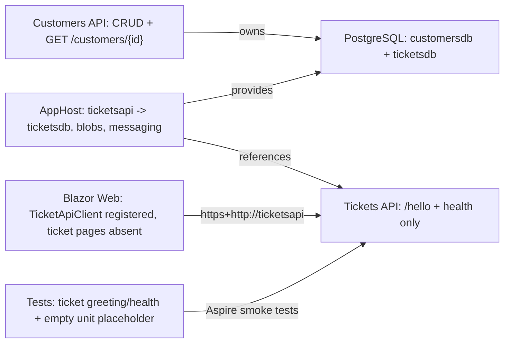
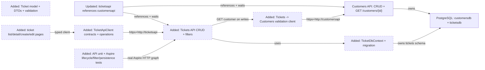
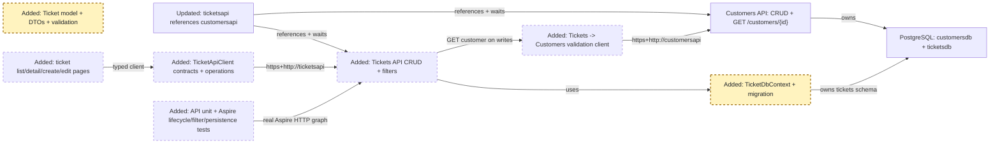
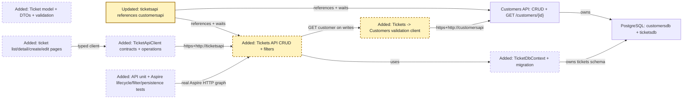
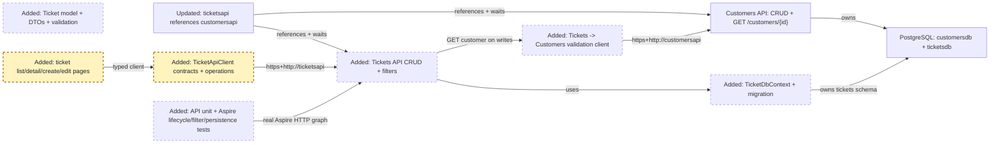
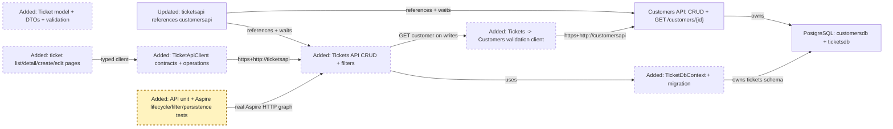

<!-- markdownlint-disable-file -->
# RPI Plan: SupportHub Ticket Management

## Task Metadata

* Task ID: `ticket-management`
* Task slug: `ticket-management`
* Plan date: 2026-10-18

## Executive Summary

* Bottom line: Implement Ticket Management as a bounded vertical slice across the existing Tickets API, `ticketsdb` PostgreSQL resource, Customers API validation boundary, typed Blazor client/pages, and API/Aspire integration tests.
* Why this matters: Every ticket must belong to exactly one existing customer without violating service ownership. The plan keeps customer data in Customers API, stores only `CustomerId` in Tickets API, and uses Aspire service discovery for write-time validation.
* Planning result: Complete and ready for implementation after resolving all findings from the required standard critique; no application code or pull request is created by this plan.
* Confidence and uncertainty: High confidence in the affected projects, resource names, contracts, dependencies, and test seams. Production migration execution, cross-service customer deletion coordination, pagination, and concurrency remain outside this feature.

### What You May Not Know

* `ticketsapi` already waits for Blob Storage and Service Bus even though attachments and lifecycle events are later stack layers. The plan preserves that graph rather than changing unrelated infrastructure, so integration tests must continue to account for those existing dependencies.
* The customer relationship is mandatory but cannot be represented as a database foreign key because Customers and Tickets own separate databases. Unknown customers are rejected on create and reassignment through `GET /customers/{id}`.

## Phase Checklist

### Before



### After



The plan turns the current Tickets API shell into a service-owned CRUD surface, wires only the additional Customers API dependency required by the mandatory relationship, and proves the result through real distributed tests and API-backed Blazor workflows.

<!-- rpi:phase id=P01 -->
### [ ] P01: Establish the ticket domain, contracts, and persistence

Goals:
* Establish a durable Tickets API model and explicit public contracts so ticket data can be validated, stored in `ticketsdb`, and evolved independently from Customers API.

Dependencies:
* Existing `ticketsdb` AppHost resource and EF/Aspire package references.
* Confirmed ticket vocabulary: `New`, `Open`, `InProgress`, `Resolved`, `Closed`; `Low`, `Medium`, `High`; nullable bounded assignee display string.



Highlighted work: `Ticket`, request/response/filter contracts, validation rules, `TicketDbContext`, entity mapping, and the initial migration.

<!-- rpi:task id=P01-T01 -->
#### [ ] P01-T01: Define ticket domain and API contracts

Goals:
* Establish a service-owned ticket representation and stable request/response/filter contracts for CRUD and list filtering.

Requirements:
* `FR-001`, `FR-002`, `FR-003`, `FR-004`, `FR-005`, `NFR-003`.
* The ticket relationship is mandatory: every request that creates or updates a ticket carries a valid `CustomerId`; assignee is nullable.
* Use the confirmed closed enums and server-managed timestamps:

```text
TicketStatus: New | Open | InProgress | Resolved | Closed
TicketPriority: Low | Medium | High
Ticket fields: Id, Title, Description, Status, Priority, Assignee, CustomerId, CreatedAt, UpdatedAt
```

Details:
* Add feature-oriented files under `src/SupportHub.Tickets.Api/Features/Tickets/`.
* Keep the persistence entity separate from public contracts. Define explicit create/update request, response, and filter representations.
* Apply bounded validation for required title/description/customer ID, enum values, and nullable assignee. Use maximum lengths of `200` for title, `4,000` for description, and `200` for assignee; keep these exact limits consistent between validation, EF mapping, Web annotations, and boundary tests.
* Preserve server ownership of timestamps: clients cannot set `CreatedAt` or `UpdatedAt`; `CreatedAt` remains immutable and `UpdatedAt` changes only after a successful update.

References:
* [src/SupportHub.Tickets.Api/Program.cs](../../../src/SupportHub.Tickets.Api/Program.cs): current API pipeline and endpoint registration point.
* [.github/copilot-instructions.md](../../../.github/copilot-instructions.md): explicit contracts, validation, Minimal API, async I/O, and ownership rules.
* [.copilot-tracking/research/2026-10-18/ticket-management-research.md](../../research/2026-10-18/ticket-management-research.md): findings on the mandatory customer relationship and decisions D1-D5.

Dependencies:
* None.

<!-- rpi:task id=P01-T02 -->
#### [ ] P01-T02: Add ticket EF Core persistence and migration

Goals:
* Persist tickets in the service-owned `ticketsdb` schema and make local/test startup able to establish that schema deterministically.

Requirements:
* `FR-001`, `FR-002`, `FR-003`, `FR-004`, `FR-005`, `NFR-001`, `NFR-002`, `NFR-005`.
* Register `TicketDbContext` through the existing Aspire PostgreSQL integration using the exact connection name `ticketsdb`.
* Map enum values as bounded strings, require `CustomerId`, index fields used by filters, and add a service-local EF migration.
* Apply migrations only behind the existing explicit `SUPPORTHUB_APPLY_MIGRATIONS` gate; do not introduce unconditional production startup migration behavior.

Details:
* Mirror the established Customers API pattern without sharing its persistence model or context.
* Use asynchronous database operations and preserve the existing health/defaults pipeline so migration failures are visible during startup.
* Add the migration and model snapshot under `src/SupportHub.Tickets.Api/Migrations/`.
* Index `Status`, `Priority`, `CustomerId`, and `Assignee` only where useful for the requested filters; do not add speculative full-text or concurrency infrastructure.

References:
* [src/SupportHub.Customers.Api/Features/Customers/CustomerDbContext.cs](../../../src/SupportHub.Customers.Api/Features/Customers/CustomerDbContext.cs): established EF mapping conventions.
* [src/SupportHub.Customers.Api/Program.cs](../../../src/SupportHub.Customers.Api/Program.cs): gated migration application pattern.
* [src/SupportHub.Tickets.Api/SupportHub.Tickets.Api.csproj](../../../src/SupportHub.Tickets.Api/SupportHub.Tickets.Api.csproj): existing `Aspire.Npgsql.EntityFrameworkCore.PostgreSQL` and EF Design dependencies.
* [Directory.Packages.props](../../../Directory.Packages.props): pinned Aspire `13.6.1` and EF `10.0.12` package family.

Dependencies:
* P01-T01.

<!-- rpi:phase id=P02 -->
### [ ] P02: Implement customer-integrated API behavior and AppHost wiring

Goals:
* Deliver the complete Tickets API lifecycle and filter surface while enforcing the mandatory customer relationship through Customers API service discovery.

Dependencies:
* P01 ticket contracts and persistence.
* Existing Customers API `GET /customers/{id}` contract.



Highlighted work: customer validation client, CRUD/filter endpoints, API error behavior, gated migration startup, and the `ticketsapi -> customersapi` reference/wait edge.

<!-- rpi:task id=P02-T01 -->
#### [ ] P02-T01: Register service discovery and enforce customer validation

Goals:
* Make Tickets API reject unknown customer references and dependency failures explicitly while preserving independent service ownership.

Requirements:
* `FR-001`, `FR-006`, `NFR-003`, `NFR-004`.
* Add a typed or named HttpClient with base address `https+http://customersapi`.
* Validate customer existence on ticket create and when `CustomerId` changes during update; do not revalidate on reads or delete.
* Do not reference `SupportHub.Customers.Api` from Tickets API and do not access `customersdb`.

Details:
* Define a small Tickets API-local customer lookup response contract matching the existing Customers API response shape needed for existence validation.
* Distinguish a customer `404` from an unavailable Customers API dependency. Return `404`/structured validation problem details for an invalid customer and `503 Service Unavailable` with Problem Details `type` `https://supporthub.dev/problems/customer-service-unavailable` and title `Customer service unavailable` for dependency failure; map these distinctions in `TicketApiClient` and do not silently accept or default the relationship.
* Add `WithReference(customersapi)` and `WaitFor(customersapi)` to the existing Tickets API AppHost registration. The dependency is acyclic because Customers API does not call Tickets API.
* Preserve existing Blob Storage and Service Bus references and waits; attachment/event behavior is outside scope.

References:
* [src/SupportHub.AppHost/AppHost.cs](../../../src/SupportHub.AppHost/AppHost.cs): exact resource names and current Tickets API registration.
* [src/SupportHub.Customers.Api/Features/Customers/CustomerEndpoints.cs](../../../src/SupportHub.Customers.Api/Features/Customers/CustomerEndpoints.cs): `GET /customers/{id}` validation contract.
* [src/SupportHub.ServiceDefaults/Extensions.cs](../../../src/SupportHub.ServiceDefaults/Extensions.cs): service discovery and standard HTTP resilience.
* [src/SupportHub.Sla.Worker/Program.cs](../../../src/SupportHub.Sla.Worker/Program.cs): existing `https+http://ticketsapi` client pattern.

Dependencies:
* P01-T01.

<!-- rpi:task id=P02-T02 -->
#### [ ] P02-T02: Implement ticket CRUD and filtering endpoints

Goals:
* Expose a complete, deterministic HTTP lifecycle for tickets and support the required status, priority, customer, and assignee filters.

Requirements:
* `FR-001`, `FR-002`, `FR-003`, `FR-004`, `FR-005`, `FR-006`, `NFR-003`, `NFR-004`.
* Implement this contract:

```text
GET    /tickets?status=&priority=&customerId=&assignee=
GET    /tickets/{id}
POST   /tickets
PUT    /tickets/{id}
DELETE /tickets/{id}
```

* Return `201 Created` with `Location` for create, `200 OK` for list/read/update, `204 No Content` for delete, `404 Not Found` for missing tickets, and structured validation errors for invalid payloads or filters.
* Combine supplied filters with AND semantics and use deterministic ordering, such as `UpdatedAt DESC` then `Id`.
* Propagate `CancellationToken` through EF and customer HTTP operations.

Details:
* Organize endpoints under the Tickets feature and map entities to response contracts rather than exposing EF entities.
* Treat a missing customer returned by Customers API as a client-visible validation/not-found problem; do not create an orphan ticket.
* Keep reads local to Tickets API so a stale customer reference caused by a later customer deletion does not make ticket listing unavailable. The UI can display a missing customer state without changing ticket ownership.
* Do not implement attachments, activity events, SLA calculations, pagination, or optimistic concurrency in this phase.

References:
* [src/SupportHub.Customers.Api/Features/Customers/CustomerEndpoints.cs](../../../src/SupportHub.Customers.Api/Features/Customers/CustomerEndpoints.cs): established Minimal API CRUD/status-code style.
* [src/SupportHub.Customers.Api/Features/Customers/CustomerContracts.cs](../../../src/SupportHub.Customers.Api/Features/Customers/CustomerContracts.cs): explicit request/response/validation pattern.
* [.copilot-tracking/research/2026-10-18/ticket-management-research.md](../../research/2026-10-18/ticket-management-research.md): proposed endpoint contract, filter behavior, risks, and acceptance criteria.

Dependencies:
* P01-T01.
* P01-T02.
* P02-T01.

<!-- rpi:task id=P02-T03 -->
#### [ ] P02-T03: Gate Tickets API migration startup for local and test execution

Goals:
* Ensure the Tickets API becomes healthy only after its schema is available in development/test while leaving production migration policy explicit and controlled.

Requirements:
* `NFR-001`, `NFR-002`, `NFR-005`.
* Use `SUPPORTHUB_APPLY_MIGRATIONS=true` as the only automatic startup-migration gate.
* Preserve visible startup failure when migration application fails.
* Do not add a production-only migration runner or deployment changes to this feature.

Details:
* Apply the migration during startup using the same scoped-service pattern as Customers API.
* Keep the AppHost’s existing `SUPPORTHUB_TEST_MODE` behavior for ephemeral PostgreSQL test resources.
* Add the same Development-only `WithEnvironment("SUPPORTHUB_APPLY_MIGRATIONS", "true")` registration used by `customersapi` to `ticketsapi`; retain the test setup’s explicit migration gate and leave production opt-in behavior unchanged.
* Verify in an ordinary Development Aspire run that `ticketsapi` does not become healthy before the `ticketsdb` migration is applied.

References:
* [src/SupportHub.Customers.Api/Program.cs](../../../src/SupportHub.Customers.Api/Program.cs): existing migration gate.
* [src/SupportHub.AppHost/AppHost.cs](../../../src/SupportHub.AppHost/AppHost.cs): test-mode volume behavior and resource startup ordering.
* [tests/SupportHub.AppHost.Tests/CustomerApiTests.cs](../../../tests/SupportHub.AppHost.Tests/CustomerApiTests.cs): test environment setup.

Dependencies:
* P01-T02.

<!-- rpi:phase id=P03 -->
### [ ] P03: Add API-backed Blazor ticket workflows

Goals:
* Give support staff list/filter, detail, create, and edit workflows without duplicating ticket persistence or business rules in Web.

Dependencies:
* P02 ticket HTTP contract and customer validation behavior.
* Existing `CustomerApiClient` for customer selection and display.



Highlighted work: typed ticket client, filter/query serialization, ticket pages, navigation, and explicit UI states.

<!-- rpi:task id=P03-T01 -->
#### [ ] P03-T01: Implement TicketApiClient contracts and operations

Goals:
* Provide a resilient typed client that exposes the Tickets API contract to Blazor without coupling Web to Tickets API persistence types.

Requirements:
* `FR-001`, `FR-002`, `FR-003`, `FR-004`, `FR-005`, `FR-006`, `NFR-003`.
* Support list filters, get, create, update, and delete operations against `https+http://ticketsapi`.
* Represent API errors consistently with the existing `CustomerApiException` pattern and preserve meaningful validation/not-found/dependency distinctions.
* Use strongly typed models and JSON enum conversion for the confirmed status and priority values.

Details:
* Extend `src/SupportHub.Web/TicketApiClient.cs` with client models and request/filter models local to Web.
* Serialize omitted filters as absent query parameters and preserve customer ID/assignee filtering exactly.
* Reuse the existing Web HTTP resilience and service-discovery registration in `Program.cs`; do not add direct URLs or project references.

References:
* [src/SupportHub.Web/CustomerApiClient.cs](../../../src/SupportHub.Web/CustomerApiClient.cs): established typed-client methods, JSON options, and exception pattern.
* [src/SupportHub.Web/Program.cs](../../../src/SupportHub.Web/Program.cs): existing `TicketApiClient` registration.
* [src/SupportHub.Web/SupportHub.Web.csproj](../../../src/SupportHub.Web/SupportHub.Web.csproj): Web dependency boundary.

Dependencies:
* P02-T02.

<!-- rpi:task id=P03-T02 -->
#### [ ] P03-T02: Add ticket list, detail, create, edit, and navigation workflows

Goals:
* Enable support staff to manage tickets through interactive-server Blazor pages with clear loading, empty, validation, not-found, dependency-error, and success states.

Requirements:
* `FR-001`, `FR-002`, `FR-003`, `FR-004`, `FR-005`, `FR-006`, `NFR-003`, `NFR-004`.
* Add routes `/tickets`, `/tickets/{id}`, `/tickets/new`, and `/tickets/{id}/edit`.
* The list page must filter by status, priority, customer, and assignee and link to detail/edit flows.
* Create/edit must require a customer selection, expose the confirmed enum values, preserve nullable assignee behavior, and never allow client-controlled timestamps.
* Add ticket navigation without altering unrelated customer or later-feature navigation semantics.

Details:
* Follow the existing `Customers.razor`, `CustomerDetail.razor`, and `CustomerEdit.razor` state-handling pattern.
* Load customer options through `CustomerApiClient`; if customer loading fails, show an explicit error and do not submit an invalid ticket.
* Display customer name when available and a clear missing-customer state if a stale reference is returned by Tickets API.
* Keep business validation in Tickets API; Web performs only presentation and form validation appropriate to the existing pattern.

References:
* [src/SupportHub.Web/Components/Pages/Customers.razor](../../../src/SupportHub.Web/Components/Pages/Customers.razor): list/filter-free table and loading/error/empty states.
* [src/SupportHub.Web/Components/Pages/CustomerDetail.razor](../../../src/SupportHub.Web/Components/Pages/CustomerDetail.razor): detail/not-found behavior.
* [src/SupportHub.Web/Components/Pages/CustomerEdit.razor](../../../src/SupportHub.Web/Components/Pages/CustomerEdit.razor): interactive create/edit/delete form pattern.
* [src/SupportHub.Web/Components/Layout/NavMenu.razor](../../../src/SupportHub.Web/Components/Layout/NavMenu.razor): navigation registration.

Dependencies:
* P03-T01.
* P02-T02.

<!-- rpi:phase id=P04 -->
### [ ] P04: Prove behavior with focused tests and Aspire runtime verification

Goals:
* Demonstrate the complete ticket lifecycle, mandatory customer relationship, filtering, persistence, and distributed startup behavior using the repository’s existing test seams.

Dependencies:
* P02 and P03 implementation surfaces.
* Aspire test environment and emulator dependencies already defined by AppHost.



Highlighted work: focused domain/API tests, real AppHost lifecycle tests, migration/persistence assertions, filter coverage, and build/test/runtime evidence.

<!-- rpi:task id=P04-T01 -->
#### [ ] P04-T01: Add focused Tickets API validation and contract tests

Goals:
* Cover deterministic ticket validation, mapping, enum behavior, timestamps, and customer-validation outcomes without replacing distributed tests with mocks.

Requirements:
* `FR-001`, `FR-002`, `FR-003`, `FR-004`, `FR-005`, `FR-006`, `NFR-003`.
* Cover required customer ID, required fields, title/description/assignee boundary lengths (`200`/`4,000`/`200`), invalid enum/filter values, nullable assignee, timestamp invariants, and response mapping.
* Keep tests under `tests/SupportHub.Tickets.Api.Tests` and remove the empty placeholder test.

Details:
* Prefer direct validation/mapping tests for pure behavior and HTTP integration tests for status codes and serialized problem details.
* Do not assert implementation-specific query plans or database internals; assert observable contract behavior.

References:
* [tests/SupportHub.Tickets.Api.Tests/UnitTest1.cs](../../../tests/SupportHub.Tickets.Api.Tests/UnitTest1.cs): placeholder to replace.
* [tests/SupportHub.Customers.Api.Tests/CustomerValidationTests.cs](../../../tests/SupportHub.Customers.Api.Tests/CustomerValidationTests.cs): focused validation-test style.
* [.copilot-tracking/research/2026-10-18/ticket-management-research.md](../../research/2026-10-18/ticket-management-research.md): acceptance criteria and required edge cases.

Dependencies:
* P01-T01.
* P02-T02.

<!-- rpi:task id=P04-T02 -->
#### [ ] P04-T02: Extend Aspire integration tests for lifecycle, relationship, filters, and persistence

Goals:
* Prove the real distributed graph supports ticket CRUD, mandatory customer association, filtering, migrations, and persistence across requests.

Requirements:
* `FR-001`, `FR-002`, `FR-003`, `FR-004`, `FR-005`, `FR-006`, `NFR-001`, `NFR-002`, `NFR-004`, `NFR-005`.
* Configure `SUPPORTHUB_TEST_MODE=true` and `SUPPORTHUB_APPLY_MIGRATIONS=true` before building the test graph.
* Wait for `customersapi` and `ticketsapi` health using Aspire notifications and use `CreateHttpClient` with exact resource names.
* Create a customer through Customers API, then verify ticket create/list/detail/update/delete through Tickets API.
* Cover invalid customer references, customer reassignment, every filter independently, combined filters, invalid filter values, missing tickets, deterministic ordering, cross-request persistence, and the explicit two-start restart-persistence procedure described below.

Details:
* Extend `tests/SupportHub.AppHost.Tests/TicketsApiTests.cs` rather than creating a second distributed-test project.
* Keep smoke/health coverage, but replace the greeting-only success criterion with observable ticket behavior.
* Prove restart persistence with two application starts against the same test PostgreSQL resource/volume: create a ticket during the first start, stop only the distributed application while retaining the test resource, start a second application against that resource, and read the ticket back. If the testing API cannot preserve the resource across starts, record that limitation explicitly in the changes record and retain migration plus cross-request persistence assertions rather than claiming restart coverage.
* Add a focused customer-client/handler test that maps a simulated Customers API transport failure to the specified `503` Problem Details contract; the distributed graph test covers the customer `404` path.
* If the existing Blob Storage or Service Bus emulator prevents graph startup, diagnose the named resource failure through Aspire rather than bypassing AppHost dependencies or replacing the integration test with mocks.

References:
* [tests/SupportHub.AppHost.Tests/TicketsApiTests.cs](../../../tests/SupportHub.AppHost.Tests/TicketsApiTests.cs): existing Tickets API Aspire test harness.
* [tests/SupportHub.AppHost.Tests/CustomerApiTests.cs](../../../tests/SupportHub.AppHost.Tests/CustomerApiTests.cs): migration/test-mode setup and CRUD integration style.
* [src/SupportHub.AppHost/AppHost.cs](../../../src/SupportHub.AppHost/AppHost.cs): exact resource names and dependency graph.
* [.github/copilot-instructions.md](../../../.github/copilot-instructions.md): Aspire integration-test and runtime-verification requirements.

Dependencies:
* P02-T03.
* P02-T02.

<!-- rpi:task id=P04-T03 -->
#### [ ] P04-T03: Run solution, targeted, and Aspire verification

Goals:
* Produce implementation evidence that the planned feature builds, passes relevant tests, and reaches expected Aspire resource health without unexpected failures.

Requirements:
* `NFR-001`, `NFR-002`, `NFR-004`, `NFR-005`.
* Run `dotnet restore SupportHub.slnx`, `dotnet build SupportHub.slnx`, relevant API tests, AppHost tests, and `dotnet test SupportHub.slnx` when targeted validation is clean.
* Start or inspect the Aspire application using the repository’s Aspire workflow, wait for affected resources, and inspect health/logs for migration, service-discovery, or dependency failures.
* Record whether the two-start persistence proof succeeded; if the harness limitation described in P04-T02 applies, record the limitation and the narrower evidence actually obtained.
* Record any unverified browser behavior honestly; do not add a browser test framework solely for this feature without evidence that it is required.

Details:
* Use the repository-local Aspire skills for lifecycle and diagnostics; do not replace Aspire verification with hard-coded URLs.
* Treat migration, customer-service availability, and emulator startup as runtime evidence, not source assumptions.
* Implementation owns the changes record at `.copilot-tracking/changes/2026-10-18/ticket-management-changes.md`.

References:
* [README.md](../../../README.md): repository architecture and feature evolution.
* [.agents/skills/aspire/SKILL.md](../../../.agents/skills/aspire/SKILL.md): version-specific Aspire lifecycle and diagnostics guidance.
* [.github/copilot-instructions.md](../../../.github/copilot-instructions.md): definition of done and runtime verification.

Dependencies:
* P04-T01.
* P04-T02.
* P03-T02.

## User Decisions and Requirements

### Confirmed User Direction

* Implement only Ticket Management on `feature/tickets`, whose parent is `feature/customers`; do not implement attachments, activity/audit, SLA, dashboard, deployment, or pull-request work.
* Implement ticket CRUD with title, description, status, priority, assignee, timestamps, and a mandatory relationship to an existing customer.
* Validate customer IDs through Customers API and never access `customersdb` from Tickets API or Web.
* Support list filters for status, priority, customer, and assignee.
* Use EF Core migrations in PostgreSQL `ticketsdb`.
* Add Blazor list, detail, create, and edit workflows.
* Add automated API and Aspire integration tests.
* Use status values `New`, `Open`, `InProgress`, `Resolved`, `Closed`.
* Use priority values `Low`, `Medium`, `High`.
* Represent assignee as a nullable bounded display string for this layer.

### Planning Decisions and Feedback

| Group | Decision or feedback item | Status | Owner | Rationale or input needed | Evidence | Planning impact |
|-------|---------------------------|--------|-------|--------------------------|----------|-----------------|
| D1 | Ticket status vocabulary | confirmed | user | Fixed to `New`, `Open`, `InProgress`, `Resolved`, `Closed` | research D1; user answer | P01-T01, P02-T02, P03-T02, P04-T01 |
| D2 | Ticket priority vocabulary | confirmed | user | Fixed to `Low`, `Medium`, `High` | research D2; user answer | P01-T01, P02-T02, P03-T02, P04-T01 |
| D3 | Assignee representation | confirmed | user | Nullable bounded display string; no identity service exists in this layer | research D3; user answer | P01-T01, P03-T01, P03-T02 |
| D4 | Customer relationship | confirmed | user/constraint | Every ticket has exactly one existing customer; validate through Customers API on create/reassignment | research D5; user clarification | P01-T01, P02-T01, P02-T02, P03-T02, P04-T02 |
| D5 | Preserve existing Blob/Service Bus AppHost references | proposed | planner/evidence | They are already part of `ticketsapi` topology but later behavior is out of scope | research What You May Not Know | P02-T01, P04-T02 |
| D6 | Production migration execution policy | deferred | downstream | Repository only establishes gated local/test migration behavior | research risks | P01-T02, P02-T03, P04-T03 |

## Planning Readiness and Next Step

| Field | Record |
|-------|--------|
| Planning execution and readiness | Complete; Ready for implementation after resolving all findings from the standard critique |
| Decision participation | user-owned; standalone/manual planning, with all material contract decisions already confirmed |
| Blockers | none |
| Latest critique | [.copilot-tracking/reviews/plans/2026-10-18/ticket-management-plan-critique.md](../../reviews/plans/2026-10-18/ticket-management-plan-critique.md): initial standard verdict `Revise`; all four findings are resolved in this plan without a scope or architecture change |
| Relevant research | [.copilot-tracking/research/2026-10-18/ticket-management-research.md](../../research/2026-10-18/ticket-management-research.md) |
| Plan | `.copilot-tracking/plans/2026-10-18/ticket-management-plan.md` |
| Changes-record role | `.copilot-tracking/changes/2026-10-18/ticket-management-changes.md` is implementation evidence |
| Continuation owner | user/manual RPI |
| Required gates or confirmations | Standard critique complete; preserve confirmed contracts and feature boundary; implement the resolved migration, validation, dependency-error, and restart-persistence requirements |
| Next action | Run `/rpi-implement` using this plan |

## Goals

* Deliver an independently deployable Tickets API CRUD surface backed by `ticketsdb`.
* Enforce a mandatory customer relationship through Customers API without cross-service database access.
* Provide deterministic status, priority, customer, and assignee filtering.
* Provide API-backed Blazor ticket list, detail, create, and edit workflows.
* Prove behavior through focused API tests, Aspire integration tests, build/test validation, and runtime health evidence.

## Scope and Non-Goals

### In Scope

* `SupportHub.Tickets.Api` feature contracts, validation, EF context, migration, customer lookup client, CRUD endpoints, filtering, and gated migration startup.
* `SupportHub.AppHost` Tickets API dependency reference/wait for `customersapi`, while preserving existing resources.
* `SupportHub.Web` typed `TicketApiClient`, ticket pages, customer selection, filters, navigation, and explicit UI states.
* `tests/SupportHub.Tickets.Api.Tests` focused contract/domain tests.
* `tests/SupportHub.AppHost.Tests` distributed lifecycle, relationship, filter, persistence, and health tests.
* Solution build, targeted tests, full tests as appropriate, and Aspire runtime verification.

### Non-Goals

* Attachments or Blob Storage behavior.
* Ticket lifecycle events, Activity Worker, Cosmos DB, or audit history.
* SLA calculations, SLA Worker, operations console changes, or dashboard work.
* Authentication, authorization, identity/agent directory, or replacing assignee string with a user ID.
* Cross-service customer deletion coordination, pagination, full-text search, optimistic concurrency, deployment migration tooling, or pull requests.

## Functional Requirements

* `FR-001`: Users can create tickets with title, description, status, priority, nullable assignee, and a required existing customer.
* `FR-002`: Users can list and retrieve tickets with deterministic ordering and server-managed timestamps.
* `FR-003`: Users can update ticket fields and reassign a ticket only to an existing customer.
* `FR-004`: Users can delete tickets and receive appropriate missing-resource behavior.
* `FR-005`: Users can filter tickets by status, priority, customer ID, and assignee independently or in combination.
* `FR-006`: Invalid ticket data, filters, and customer references produce explicit structured errors.
* `FR-007`: Blazor provides ticket list/filter, detail, create, and edit workflows through typed HTTP clients.
* `FR-008`: Ticket data persists in the service-owned `ticketsdb` PostgreSQL schema through EF Core migrations.

## Non-Functional Requirements

* `NFR-001`: Tickets API uses the existing Aspire `ticketsdb` connection and exact resource names; no hard-coded hostnames or ports.
  * Objective threshold or evaluation condition: Integration tests start through `DistributedApplicationTestingBuilder`, wait for named resources, and use `CreateHttpClient`.
* `NFR-002`: Migration application is explicit and gated for local/test execution; migration failure is visible through startup/resource health.
  * Objective threshold or evaluation condition: `SUPPORTHUB_APPLY_MIGRATIONS=true` is required for automatic test migration, and the Development AppHost sets it for `ticketsapi` before health verification.
* `NFR-003`: API and Web use explicit contracts, async I/O, cancellation, Problem Details/error handling, and service ownership boundaries.
  * Objective threshold or evaluation condition: No Tickets API/Web reference to `customersdb` or Customers API persistence types.
* `NFR-004`: Ticket list behavior is deterministic and filter semantics are composable.
  * Objective threshold or evaluation condition: Integration tests assert each filter and a combined-filter result.
* `NFR-005`: Existing ServiceDefaults resilience, discovery, health checks, tracing, and metrics remain intact.
  * Objective threshold or evaluation condition: Affected resources become healthy and runtime logs show no unexpected startup/dependency failures.

## Risks and Open Questions

| Priority | Type | Risk, question, or planning item | Affected work | Impact | Smallest action or evidence needed | Owner |
|----------|------|----------------------------------|---------------|--------|------------------------------------|-------|
| H | risk | A customer may later be deleted by Customers API, leaving a stale `CustomerId` | P02-T02, P03-T02 | Detail/list may not resolve a customer name | Keep ticket reads local and render a missing-customer state; defer cross-service deletion coordination | downstream |
| M | risk | Tickets API startup depends on Customers API plus existing Blob/Service Bus resources | P02-T01, P04-T02 | Startup/test fragility | Preserve exact waits and diagnose named resource health through Aspire | implementer |
| M | risk | Customers API transport failures must not be confused with invalid customer IDs | P02-T01, P03-T01, P04-T01, P04-T02 | Misleading write failures or unsafe retry behavior | Use the explicit `503` Problem Details contract and focused simulated-failure coverage | implementer |
| M | risk | Production migration policy is not represented | P01-T02, P02-T03, P04-T03 | Startup migration could be unsafe in production | Keep migration gate local/test-only and record production policy as downstream | downstream |
| L | open question | Pagination and concurrency may become necessary at larger scale | P02-T02, P04-T02 | Future list/update behavior may need expansion | Defer until requirements or measured behavior justify it | downstream |

## Dependencies

* Existing `ticketsdb`, `customersapi`, `blobs`, and `messaging` resource names and references in [src/SupportHub.AppHost/AppHost.cs](../../../src/SupportHub.AppHost/AppHost.cs).
* Existing Customers API `GET /customers/{id}` contract and customer lifecycle test setup.
* Existing Aspire 13.6.1, EF Core 10.0.12, and `Aspire.Hosting.Testing` package versions.
* Existing ServiceDefaults service discovery/resilience and Web `https+http://...` client registration.
* Local/test environment support for PostgreSQL, Blob Storage, and Service Bus emulator resources used by the current AppHost graph.

## Sources

* [.copilot-tracking/research/2026-10-18/ticket-management-research.md](../../research/2026-10-18/ticket-management-research.md): completed balanced research cycle, evidence C1-C20, decisions D1-D5, acceptance criteria, and readiness.
* [.github/copilot-instructions.md](../../../.github/copilot-instructions.md): repository architecture, service ownership, API, frontend, Aspire, test, and definition-of-done constraints.
* [src/SupportHub.AppHost/AppHost.cs](../../../src/SupportHub.AppHost/AppHost.cs): authoritative resource names and dependency graph.
* [src/SupportHub.Customers.Api/Features/Customers/CustomerEndpoints.cs](../../../src/SupportHub.Customers.Api/Features/Customers/CustomerEndpoints.cs): existing CRUD and customer lookup contract.
* [src/SupportHub.Customers.Api/Features/Customers/CustomerDbContext.cs](../../../src/SupportHub.Customers.Api/Features/Customers/CustomerDbContext.cs): EF mapping pattern.
* [src/SupportHub.Customers.Api/Program.cs](../../../src/SupportHub.Customers.Api/Program.cs): gated migration pattern.
* [src/SupportHub.Web/CustomerApiClient.cs](../../../src/SupportHub.Web/CustomerApiClient.cs): typed-client and error-handling pattern.
* [src/SupportHub.Web/Components/Pages/Customers.razor](../../../src/SupportHub.Web/Components/Pages/Customers.razor), [src/SupportHub.Web/Components/Pages/CustomerDetail.razor](../../../src/SupportHub.Web/Components/Pages/CustomerDetail.razor), and [src/SupportHub.Web/Components/Pages/CustomerEdit.razor](../../../src/SupportHub.Web/Components/Pages/CustomerEdit.razor): Blazor workflow patterns.
* [tests/SupportHub.AppHost.Tests/CustomerApiTests.cs](../../../tests/SupportHub.AppHost.Tests/CustomerApiTests.cs): Aspire integration and migration test pattern.
* [Directory.Packages.props](../../../Directory.Packages.props): pinned dependency versions.

## Critique Disposition

* Critique setting and provenance: standard; default under `rpi-plan`, not explicitly overridden by the user.
* Critique status: complete.
* Latest critique and verdict: `ticket-management-plan-critique.md` returned `Revise`; the planner resolved PC-001 through PC-004 directly in the plan. A follow-up critique is not required because the corrections clarify implementation contracts and evidence without changing scope, architecture, or confirmed user decisions.
* Earlier critiques: none.
* Limitations: none known; critique is restricted to supplied plan, research, repository instructions, and directly relevant source evidence.

| Critique run and finding | Disposition | Action owner | Exact resolving evidence | Decision route | Plan response or residual risk |
|--------------------------|-------------|--------------|--------------------------|---------------|--------------------------------|
| Initial standard critique | resolved | planner | PC-001: P02-T03 now requires Development-only migration wiring for `ticketsapi` and explicit health verification; PC-002: P01-T01/P04-T01 fix title/description/assignee limits at `200`/`4,000`/`200`; PC-003: P02-T01/P03-T01/P04-T01 define and test `503` Problem Details for customer-service outage; PC-004: P04-T02/P04-T03 define the two-start persistence proof and honest fallback evidence | direct planner correction | All findings are incorporated; no divergent user decision is required |

## Artifact Self-Check

* [x] Executive Summary, What You May Not Know, and Phase Checklist appear first and explain the intended result.
* [x] Confirmed direction, decisions, readiness, goals, scope, requirements, risks, dependencies, and sources are recorded.
* [x] Functional and non-functional requirements are cited by task Requirements blocks.
* [x] Every phase has Goals, Dependencies, a phase diagram, and ordered tasks.
* [x] Every task has Goals, Requirements, Details, References, and Dependencies.
* [x] Before and After diagrams use stable nodes, prescribed Mermaid initialization values, and explicit added-node styling.
* [x] Existing files are linked relative to the plan; not-yet-created paths use backticks.
* [x] Follow-up items remain outside active plan work.
* [x] Standard critique result and finding dispositions are complete.
* Checked sections: metadata, executive summary, phase checklist, user direction, decisions, readiness, goals, scope, requirements, risks, dependencies, sources, task blocks, diagrams.
* Missing or limited sections: none known.

## Follow-Up Items

* None

## Handoff

* Authoritative implementation handoff: `Planning Readiness and Next Step`.
* The implementation stage owns `.copilot-tracking/changes/2026-10-18/ticket-management-changes.md`.
