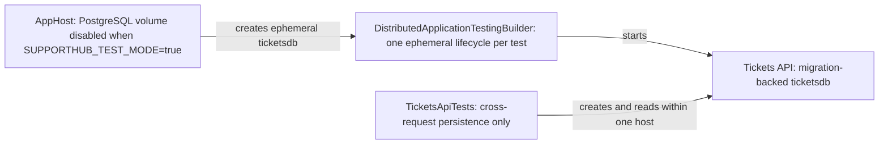
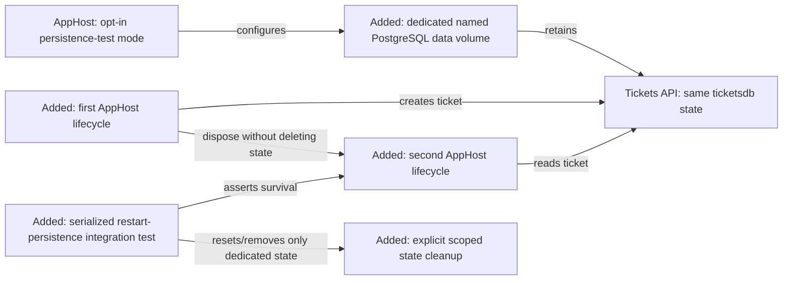

<!-- markdownlint-disable-file -->
# RPI Plan: SupportHub Ticket Management Restart Persistence

## Task Metadata

* Task ID: `ticket-management-restart-persistence`
* Task slug: `ticket-management-restart-persistence`
* Plan date: 2026-10-18

## Executive Summary

* Bottom line: Add a narrowly scoped, serialized Aspire integration test that creates a ticket in one AppHost lifecycle, disposes that lifecycle, starts a second lifecycle against the same PostgreSQL data volume, and verifies the ticket remains readable.
* Why this matters: The Ticket Management review could prove migration-backed and cross-request persistence but not the acceptance requirement that tickets survive separate application starts. This plan closes that evidence gap without enabling persistent state for ordinary tests.
* Planning result: Complete and implementation-ready; the user selected the dedicated persistence-test route and the initial critique findings were resolved by direct planner corrections.
* Confidence and uncertainty: High confidence in the repository seams and pinned Aspire APIs. The implementation must still verify the exact cleanup behavior in the local/CI container environment and preserve stable PostgreSQL credentials across both starts.

### What You May Not Know

* The existing `SUPPORTHUB_TEST_MODE=true` path intentionally disables PostgreSQL data volumes. The new persistence test must use a separate opt-in mode or test-specific configuration and must not alter the isolation behavior of the existing suite.
* `WithDataVolume()` is the essential data-retention mechanism. The test will use the existing session container lifetime plus a retained named volume unless implementation evidence shows the container itself must be persistent; persistent lifetime must not be enabled globally.
* Persistent test state can contaminate later runs if cleanup is not explicit. The test will use a fixed xUnit non-parallel collection, a per-run volume name, a per-run stable password passed through process configuration, and exact-volume cleanup after the assertion without touching unrelated resources.

## Phase Checklist

### Before

### After

The follow-up changes only persistence-test configuration and evidence. Ticket contracts, service ownership, customer validation, and production application behavior remain unchanged.

<!-- rpi:phase id=P01 -->
### [x] P01: Establish an isolated persistent test mode

Goals:
* Allow one explicitly selected integration test to retain PostgreSQL state across AppHost disposal while preserving ephemeral isolation for all existing tests.

Dependencies:
* Existing `SupportHub.AppHost` PostgreSQL resource and `SUPPORTHUB_TEST_MODE` configuration gate.
* Pinned Aspire Hosting `13.6.1`, PostgreSQL Hosting `13.6.1`, and Hosting Testing `13.6.0` APIs.
* Stable credentials available before the first persistent-volume initialization through `Parameters__supporthub-persistence-test-postgres-password`.

Highlighted work: Add an opt-in persistence-test configuration path, named volume identity, stable credential handling, and serialization/cleanup boundaries.

<!-- rpi:task id=P01-T01 -->
#### [x] P01-T01: Add opt-in PostgreSQL persistence-test configuration

Goals:
* Make the AppHost expose a test-only persistence mode that enables a dedicated named PostgreSQL data volume without changing the default ephemeral behavior.

Requirements:
* `FR-001`, `NFR-001`, `NFR-002`.
* Existing tests that set `SUPPORTHUB_TEST_MODE=true` remain ephemeral and isolated.
* The persistence mode must enable `WithDataVolume` with an explicit, dedicated volume identity and must not remove or mutate unrelated resource volumes.
* The mode must use the pinned Aspire lifetime API only where required for reuse across AppHost lifecycles; do not make PostgreSQL globally persistent.

Details:
* Extend the existing AppHost configuration decision point rather than adding a second PostgreSQL resource or bypassing the AppHost graph.
* Use the exact boolean key `SUPPORTHUB_PERSISTENCE_TEST_MODE`, independent of `SUPPORTHUB_TEST_MODE`, so ordinary test mode and persistence test mode cannot be accidentally conflated.
* Use the exact string key `SUPPORTHUB_PERSISTENCE_TEST_VOLUME_NAME`; the test generates one unique `supporthub-ticket-persistence-{runId}` value and passes that same value to both AppHost builders.
* In persistence-test mode, bind the PostgreSQL password from the Aspire parameter key `Parameters__supporthub-persistence-test-postgres-password`. The test generates one per-run password in memory, sets it before either builder is created, and never commits or logs it.
* Keep the existing no-volume path unchanged for ordinary development/test execution.

References:
* [src/SupportHub.AppHost/AppHost.cs](../../../src/SupportHub.AppHost/AppHost.cs): existing PostgreSQL volume gate and resource names.
* [tests/SupportHub.AppHost.Tests/TicketsApiTests.cs](../../../tests/SupportHub.AppHost.Tests/TicketsApiTests.cs): current `SUPPORTHUB_TEST_MODE` setup and test-host construction.
* [.copilot-tracking/research/2026-10-18/ticket-management-restart-persistence-research.md](../../research/2026-10-18/ticket-management-restart-persistence-research.md): `D2`, findings on volumes, lifetimes, credentials, and cleanup.

Dependencies:
* None.

<!-- rpi:task id=P01-T02 -->
#### [x] P01-T02: Define serialized persistent-resource cleanup boundaries

Goals:
* Prevent the retained test state from leaking into unrelated tests or subsequent local runs while preserving enough state for the second AppHost lifecycle.

Requirements:
* `NFR-003`.
* The persistence test cannot run concurrently with another test that uses the same named volume or database identity.
* Cleanup is scoped to the dedicated persistence-test resource and occurs after both lifecycle assertions, including the failure path where the test framework permits cleanup.
* Cleanup must not use broad or destructive AppHost/resource commands that could remove unrelated developer data.

Details:
* Put the persistence test in an explicit xUnit collection named `SupportHub persistent resources` with `DisableParallelization = true`; do not serialize the entire test assembly.
* Dispose each `DistributedApplication` instance before constructing the next one, while retaining the dedicated data volume.
* In a `finally` path, invoke the exact Docker volume cleanup operation `docker volume rm --force <generated-volume-name>` through `ProcessStartInfo.ArgumentList`; assert that the command succeeds and never pass a wildcard, `--all`, or an unrelated resource name.
* If Docker cleanup is unavailable, fail the focused test with an explicit environment error and record the limitation; do not silently leave ambiguous retained state.

References:
* [tests/SupportHub.AppHost.Tests/SupportHub.AppHost.Tests.csproj](../../../tests/SupportHub.AppHost.Tests/SupportHub.AppHost.Tests.csproj): xUnit and Aspire Hosting Testing dependencies.
* [Aspire testing overview](https://aspire.dev/testing/overview/): test AppHost/resource lifecycle and disposal behavior.
* [Configure resource lifetimes in Aspire](https://aspire.dev/app-host/resource-lifetimes/): session versus persistent lifetime semantics.

Dependencies:
* P01-T01.

<!-- rpi:phase id=P02 -->
### [x] P02: Prove ticket survival across two AppHost lifecycles

Goals:
* Produce direct, repeatable evidence that a ticket created before teardown remains readable after a later AppHost start against the same `ticketsdb` state.

Dependencies:
* P01-T01 and P01-T02.
* Existing Customers API and Tickets API health/migration gates.
* Existing ticket create/read contracts and customer fixture helpers.

Highlighted work: Add the two-start integration scenario, assertions for identity and persisted values, and focused validation evidence.

<!-- rpi:task id=P02-T01 -->
#### [x] P02-T01: Implement the two-start ticket persistence integration test

Goals:
* Demonstrate the review acceptance condition by creating a customer and ticket in the first distributed application lifecycle, disposing that host, starting a second host, and reading the same ticket successfully.

Requirements:
* `FR-001`, `FR-002`, `NFR-001`, `NFR-002`, `NFR-003`.
* The first lifecycle must wait for `customersapi` and `ticketsapi` health before creating data.
* The second lifecycle must wait for the same resources and retrieve the original ticket by ID with unchanged title, customer ID, timestamps, and other persisted fields.
* The test must fail with a clear assertion if the second lifecycle starts with a fresh database or cannot authenticate to the retained database.
* The test must use the exact AppHost resource names and service-discovered HTTP clients; it must not connect directly to PostgreSQL.

Details:
* Keep the test in `tests/SupportHub.AppHost.Tests/` and reuse the existing JSON contracts and customer creation helper where appropriate.
* Use two separately built/disposed `DistributedApplication` instances rather than merely stopping and restarting an HTTP resource within one host; this matches the review resolution condition.
* Keep the ticket identifier and expected values in test-local state only. Do not rely on ordering, pre-existing persistent data, or a shared customer record from another test.
* Preserve server-owned timestamp assertions without requiring exact wall-clock equality across starts; verify persisted values are present and logically unchanged.
* Set `SUPPORTHUB_PERSISTENCE_TEST_MODE`, `SUPPORTHUB_PERSISTENCE_TEST_VOLUME_NAME`, and `Parameters__supporthub-persistence-test-postgres-password` before each builder is created and keep the values identical across both lifecycles.

References:
* [tests/SupportHub.AppHost.Tests/TicketsApiTests.cs](../../../tests/SupportHub.AppHost.Tests/TicketsApiTests.cs): existing lifecycle, health wait, create, and read patterns.
* [src/SupportHub.Tickets.Api/Features/Tickets/TicketEndpoints.cs](../../../src/SupportHub.Tickets.Api/Features/Tickets/TicketEndpoints.cs): ticket HTTP contract and read behavior.
* [.copilot-tracking/research/2026-10-18/ticket-management-restart-persistence-research.md](../../research/2026-10-18/ticket-management-restart-persistence-research.md): selected dedicated serialized test route and fallback.

Dependencies:
* P01-T01.
* P01-T02.

<!-- rpi:task id=P02-T02 -->
#### [x] P02-T02: Validate persistence evidence and fallback behavior

Goals:
* Confirm the new test is credible in the repository’s supported environment and leave an explicit, actionable fallback if persistent test-host reuse is unavailable.

Requirements:
* `NFR-001`, `NFR-002`, `NFR-003`.
* Run the focused Aspire test and the relevant solution test/build checks without changing unrelated behavior.
* Capture startup/migration/health evidence sufficient to distinguish a volume-retention failure from an API or migration failure.
* If the automated path cannot run because the environment cannot retain the dedicated resource, record the exact limitation and the separately managed isolated AppHost procedure needed to prove the same acceptance condition; do not claim restart persistence as passed.

Details:
* Prefer Aspire resource state and logs over guessed endpoints or manual HTTP polling.
* Verify both lifecycle starts reach healthy `customersapi` and `ticketsapi`; inspect relevant `ticketsapi` and PostgreSQL logs when the second read fails.
* Keep the validation scoped to the follow-up. Do not rerun or alter the completed Ticket Management review unless new evidence changes its finding disposition.
* The implementation changes record should identify the persistence-test mode, volume/credential safeguards, exact test command, and any environment-specific cleanup limitation.
* If the automated test-host route is unavailable, use this bounded fallback: start the exact AppHost with `aspire start --non-interactive --isolated --apphost src/SupportHub.AppHost/SupportHub.AppHost.csproj`, wait for `customersapi` and `ticketsapi`, use the discovered `ticketsapi` endpoint from `aspire describe --format Json` to create one uniquely marked ticket, stop only that exact AppHost with `aspire stop --non-interactive --apphost src/SupportHub.AppHost/SupportHub.AppHost.csproj`, start it again with the same persistence-test configuration, wait again, read the ticket, collect `aspire describe`/`aspire logs` evidence, and remove only the generated volume. The changes record must report RV-001 as unproven if any step fails.

References:
* [src/SupportHub.AppHost/AppHost.cs](../../../src/SupportHub.AppHost/AppHost.cs): authoritative resource graph and migration environment wiring.
* [tests/SupportHub.AppHost.Tests/SupportHub.AppHost.Tests.csproj](../../../tests/SupportHub.AppHost.Tests/SupportHub.AppHost.Tests.csproj): focused test project.
* [Aspire testing overview](https://aspire.dev/testing/overview/): distributed test lifecycle.
* [Aspire monitoring guidance](../../../.agents/skills/aspire-monitoring/SKILL.md): resource state and log evidence workflow.

Dependencies:
* P02-T01.

## User Decisions and Requirements

### Confirmed User Direction

* Address RV-001 only: prove Ticket Management persistence across separate application starts.
* Use the recommended dedicated serialized persistence test rather than relying only on a manual runtime procedure.
* Preserve ordinary test isolation and keep the work read-only until implementation begins.
* Do not change Ticket Management service ownership, customer validation boundaries, or later stack layers.

### Planning Decisions and Feedback

| Group | Decision or feedback item | Status | Owner | Rationale or input needed | Evidence | Planning impact |
|---|---|---|---|---|---|---|
| D1 | Use a dedicated serialized persistence test mode with a named PostgreSQL volume | confirmed | user | User accepted the research recommendation | [research D2](../../research/2026-10-18/ticket-management-restart-persistence-research.md) | Drives P01 and P02; ordinary tests remain ephemeral |
| D2 | Keep a separately managed retained-volume runtime procedure as fallback only | confirmed | evidence/user | Needed if the test builder cannot safely reuse retained state in the execution environment | [research Recommendation and Alternatives](../../research/2026-10-18/ticket-management-restart-persistence-research.md) | P02-T02 must record the limitation without overstating acceptance |

## Planning Readiness and Next Step

| Field | Record |
|---|---|
| Planning execution and readiness | Complete; implementation complete for the full plan |
| Decision participation | user-owned; standalone/manual RPI plan invocation with D1 confirmed |
| Blockers | None |
| Latest critique | `../../reviews/plans/2026-10-18/ticket-management-restart-persistence-plan-critique-2.md` with `Pass`; earlier `Revise` findings were resolved |
| Relevant research | [ticket-management-restart-persistence research](../../research/2026-10-18/ticket-management-restart-persistence-research.md) |
| Plan | `.copilot-tracking/plans/2026-10-18/ticket-management-restart-persistence-plan.md` |
| Changes-record role | `.copilot-tracking/changes/2026-10-18/ticket-management-restart-persistence-changes.md` is implementation evidence |
| Continuation owner | user/manual RPI Agent |
| Required gates or confirmations | Follow-up standard critique passed; implementation must verify stable credentials, serialized cleanup, and two-start survival |
| Next action | Optional `/rpi-review` for `ticket-management-restart-persistence` |

## Goals

* Prove that a ticket created through the real SupportHub Aspire graph survives teardown of one AppHost lifecycle and startup of another against the same `ticketsdb` state.
* Preserve the existing ephemeral isolation and behavior of ordinary API/Aspire tests.
* Produce implementation evidence that can close RV-001 without changing the completed Ticket Management feature boundary.

## Scope and Non-Goals

### In Scope

* Opt-in AppHost persistence-test configuration for PostgreSQL.
* Named volume/resource identity, stable credential handling, serialization, and scoped cleanup.
* One focused two-start Aspire integration test and its validation evidence.
* Implementation changes record for this follow-up.

### Non-Goals

* Ticket API, Web UI, customer validation, migration schema, or service ownership changes.
* Broad conversion of the test suite to persistent resources.
* Deployment persistence design or production database operations.
* RV-002 timeout mapping, RV-003 filter coverage, or a new Ticket Management review.

## Functional Requirements

* FR-001: A ticket created in the first SupportHub AppHost lifecycle is readable by ID after a second independently built and started lifecycle.
* FR-002: The second lifecycle reads the same persisted ticket fields, including `CustomerId` and server-owned timestamps, rather than merely returning a successful empty response.

## Non-Functional Requirements

* NFR-001: The validation uses the authoritative AppHost graph, exact resource names, Aspire service discovery, and health waits.
* NFR-002: Migration and startup readiness remain explicit; a second-start failure must be diagnosable from assertions and relevant Aspire logs.
* NFR-003: Persistent test state is opt-in under `SUPPORTHUB_PERSISTENCE_TEST_MODE`, uses a per-run `SUPPORTHUB_PERSISTENCE_TEST_VOLUME_NAME` and stable `Parameters__supporthub-persistence-test-postgres-password`, is serialized by the `SupportHub persistent resources` xUnit collection, and is cleaned with the exact generated volume name without secrets or broad destructive operations.

## Risks and Open Questions

| Priority | Type | Risk, question, or planning item | Affected work | Impact | Smallest action or evidence needed | Owner |
|---|---|---|---|---|---|---|
| H | risk | The retained volume may survive a failed test and contaminate later runs | P01-T02, P02-T01 | Flaky or misleading persistence evidence | Use the named xUnit collection and exact generated-volume cleanup in `finally`; fail clearly if cleanup cannot run | implementer |
| M | risk | PostgreSQL credentials may differ between AppHost lifecycles | P01-T01, P02-T01 | Second API startup may fail even though the volume retained data | Set the same per-run `Parameters__supporthub-persistence-test-postgres-password` before both builders and verify both APIs become healthy | implementer |
| M | open question | The installed environment may not expose Docker volume cleanup to the test process | P01-T02, P02-T02 | Automated cleanup may be unavailable | Execute the exact cleanup command in the focused run; otherwise use the bounded fallback and report RV-001 unproven | implementer |

## Dependencies

* Aspire Hosting `13.6.1`, PostgreSQL Hosting `13.6.1`, and Hosting Testing `13.6.0` APIs: required for volume, lifetime, and two-builder lifecycle behavior.
* Docker/container runtime: required for PostgreSQL data volume retention.
* Existing `ticketsdb` migration gate and healthy `customersapi`/`ticketsapi` resources: required to create and read the ticket in both lifecycles.
* xUnit test execution: required to serialize the persistence test and control cleanup.

## Sources

* [ticket-management-restart-persistence research](../../research/2026-10-18/ticket-management-restart-persistence-research.md): evidence, selected route, API surface, and risks.
* [src/SupportHub.AppHost/AppHost.cs](../../../src/SupportHub.AppHost/AppHost.cs): PostgreSQL resource and existing test-mode volume gate.
* [tests/SupportHub.AppHost.Tests/TicketsApiTests.cs](../../../tests/SupportHub.AppHost.Tests/TicketsApiTests.cs): current Aspire lifecycle and ticket test patterns.
* [Aspire testing overview](https://aspire.dev/testing/overview/): test AppHost lifecycle and resource disposal.
* [Manage the AppHost in tests](https://aspire.dev/testing/manage-app-host/?testing-framework=xunit): test-builder configuration and xUnit lifecycle guidance.
* [Configure resource lifetimes in Aspire](https://aspire.dev/app-host/resource-lifetimes/): session/persistent lifetime semantics.
* [Persist Aspire data with volumes and binds](https://aspire.dev/fundamentals/persist-data-volumes/): named volume and stable credential guidance.
* Business sources: none supplied or applicable; no BRD, PRD, or ADR is in scope for this technical follow-up.

## Critique Disposition

* Critique setting and provenance: `standard`; default under `rpi-plan`
* Critique status: `complete`
* Latest critique and verdict: `../../reviews/plans/2026-10-18/ticket-management-restart-persistence-plan-critique-2.md` with `Pass`; the earlier critique is `Revise`
* Earlier critiques: `../../reviews/plans/2026-10-18/ticket-management-restart-persistence-plan-critique.md` with `PC-001` through `PC-003`
* Limitations: none

| Critique run and finding | Disposition | Action owner | Exact resolving evidence | Decision route | Plan response or residual risk |
|---|---|---|---|---|---|
| PC-001 through PC-003 | resolved | planner | Concrete keys, per-run volume/password identity, xUnit collection, exact cleanup, and bounded fallback are now in P01-T01, P01-T02, P02-T01, and P02-T02; follow-up critique confirms the corrections | direct planner correction | No residual planning action |

## Artifact Self-Check

* [x] Executive Summary, What You May Not Know, and Phase Checklist come first and are understandable without reading supporting sections.
* [x] Confirmed direction, grouped decisions, readiness, goals, scope, requirements, risks, and dependencies are current and consistent with the Phase Checklist.
* [x] Planning decision participation and provenance are recorded; D1 is a persisted user-owned decision.
* [x] Functional and non-functional requirements are current, and every `FR-nnn` and `NFR-nnn` is cited by at least one task's Requirements.
* [x] Every phase has Goals, Dependencies, and a phase diagram. Every task has Goals, Requirements, Details, References, and Dependencies.
* [x] Task goals describe observable behavior or state; implementation choices remain bounded by evidence and local judgment.
* [x] Open risks and questions are recorded with affected task IDs and owners.
* [x] Existing files are linked with workspace-relative paths; not-yet-created paths use backticks.
* [x] Before and After diagrams reuse stable node IDs and identify added work with dashed borders.
* [x] Critique setting/status and test ownership boundaries are recorded.
* [x] Follow-Up Items remain outside active plan completion and acceptance claims.
* Checked sections: metadata, summary, diagrams, phases/tasks, decisions, readiness, goals, scope, requirements, risks, dependencies, sources, and critique intake.
* Missing or limited sections: implementation must verify the pinned Aspire overloads and local container cleanup behavior.

## Follow-Up Items

* None

## Handoff

* Authoritative implementation handoff: Planning Readiness and Next Step
