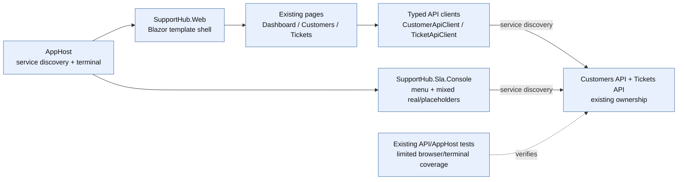
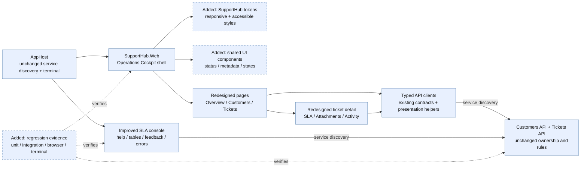
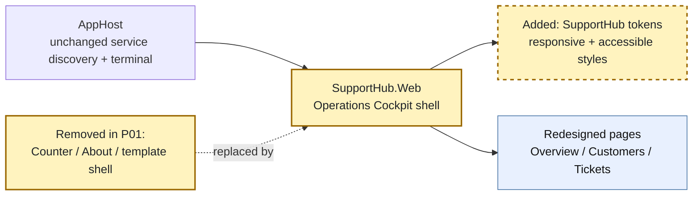
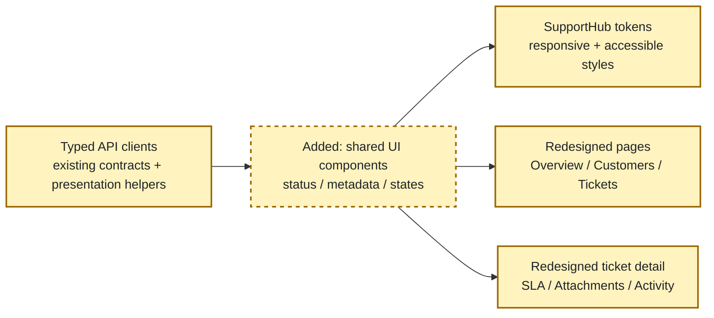
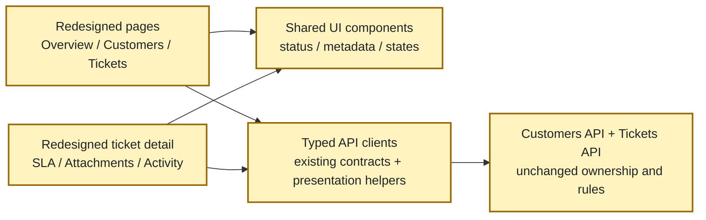
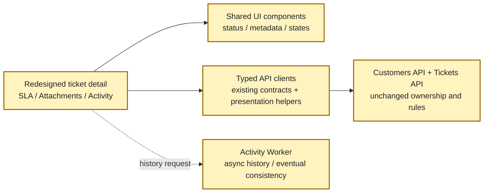
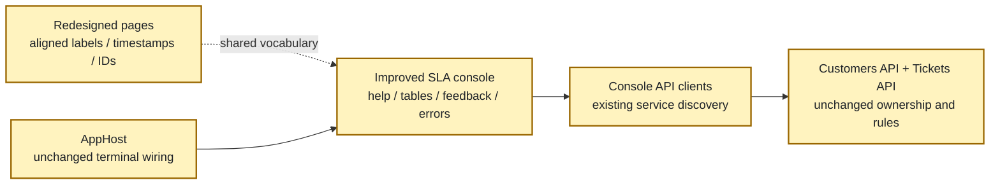
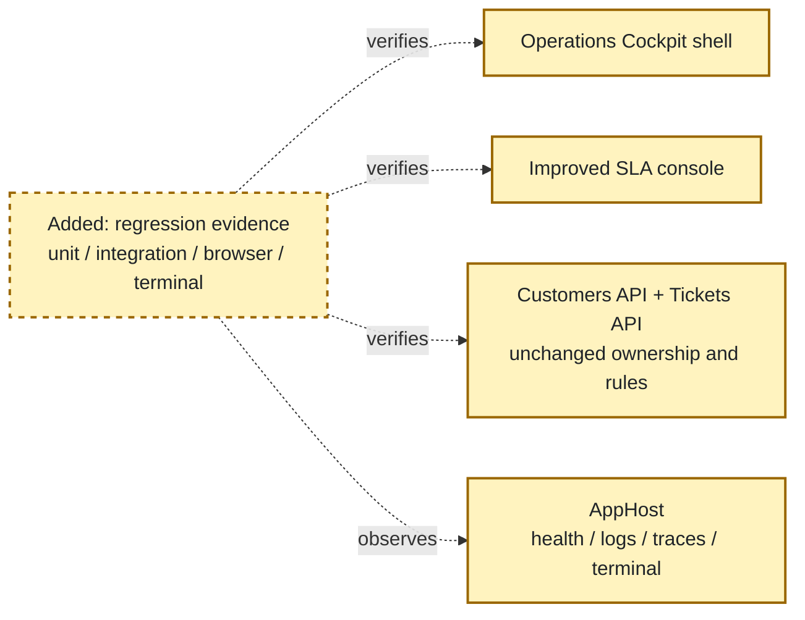

<!-- markdownlint-disable-file -->
# RPI Plan: SupportHub Experience Redesign & Integration

## Task Metadata

* Task ID: `supporthub-experience-redesign-integration`
* Task slug: `supporthub-experience-redesign-integration`
* Plan date: 2026-10-19
* Planning basis: completed research on `feature/ui-ux` against `feature/dashboard`

## Executive Summary

* Bottom line: Plan an incremental C#-first redesign of `SupportHub.Web` and `SupportHub.Sla.Console` that removes the default Blazor presentation, establishes a shared SupportHub visual language, improves all existing support journeys, and aligns operational terminology without changing business behavior or service boundaries.
* Why this matters: The current application has useful customer, ticket, SLA, attachment, activity, and dashboard capabilities, but staff encounter a template shell, raw status labels, dense primitive layouts, and a console whose commands and output do not form one operational narrative.
* Planning result: Complete and implementation-ready after the standard independent critique passed. The plan is intentionally incremental and keeps optional visual polish separate from required behavior, compatibility, and verification work.
* Confidence and uncertainty: High confidence in the affected surfaces, architectural boundaries, sequencing, console command scope, canonical vocabulary seam, and verification gates. Exact visual values and local component file decomposition remain implementation choices within the stated requirements.

### What You May Not Know

* `feature/ui-ux` and `feature/dashboard` currently resolve to the same commit, so this plan starts from the existing dashboard baseline rather than an already-partially-redesigned branch.
* The plan is presentation- and workflow-focused. It does not authorize a new audit backend, operator identity model, live push updates, a new frontend framework, or new domain capabilities.

## Phase Checklist

### Before

### After

The plan moves from template removal and visual foundations, through shared components and page composition, to console alignment and a final cross-surface verification gate. API ownership, service discovery, and business behavior remain unchanged.

<!-- rpi:phase id=P01 -->
### [x] P01: Remove template presentation and establish the SupportHub shell

Goals:
* Replace the default Blazor presentation with a recognizable, responsive SupportHub shell so every route starts from the same accessible operations workspace.

Dependencies:
* None.

Highlighted work: replace `MainLayout`, `NavMenu`, layout CSS, global CSS, and active template/demo assets while retaining the Blazor route and service-discovery foundations.

<!-- rpi:task id=P01-T01 -->
#### [x] P01-T01: Remove active Blazor demo and template affordances

Goals:
* The active application no longer exposes template/demo navigation, routes, links, icons, copy, or unused assets that make SupportHub appear unfinished.

Requirements:
* Satisfy `FR-001` and `FR-008`.
* Remove the active `Counter` route and its navigation entry, or replace it with a real in-scope SupportHub route without leaving a demo alias.
* Remove the template `About`/Microsoft Learn link, default gradient sidebar treatment, template icon backgrounds, and default error-boundary copy from the active shell.
* Remove unused demo assets only when repository search confirms they are not referenced by active routes, styles, or build inputs; preserve assets needed by the redesign.
* Keep `FocusOnNavigate`, route discovery, error handling, and interactive-server behavior intact unless a directly related shell change requires an equivalent replacement.

Details:
* Audit `Components/Pages/Counter.razor`, `Components/Layout/MainLayout.razor`, `Components/Layout/NavMenu.razor`, their CSS files, `Components/Pages/Error.razor`, `wwwroot/app.css`, and project static assets.
* Search for `Counter`, `Microsoft Learn`, template SVG/data-URI icons, `blazor-error-ui`, and default gradient selectors before removal.
* Treat the required template-removal checklist as a regression contract: no `Counter` link/route, no `About` link, no default gradient shell, no template icon treatment, no template error copy, and no unused demo asset referenced from active code.
* This task is required. Any brand illustration, custom logo asset, or decorative enhancement beyond the shell structure is optional and belongs in `P01-T02`.

References:
* [src/SupportHub.Web/Components/Layout/MainLayout.razor](../../../src/SupportHub.Web/Components/Layout/MainLayout.razor): current template layout and top-row link.
* [src/SupportHub.Web/Components/Layout/NavMenu.razor](../../../src/SupportHub.Web/Components/Layout/NavMenu.razor): current navigation and `Counter` entry.
* [src/SupportHub.Web/Components/Layout/MainLayout.razor.css](../../../src/SupportHub.Web/Components/Layout/MainLayout.razor.css): template gradient and error styling.
* [src/SupportHub.Web/Components/Layout/NavMenu.razor.css](../../../src/SupportHub.Web/Components/Layout/NavMenu.razor.css): template navigation/icon styling.
* [src/SupportHub.Web/Components/Pages/Counter.razor](../../../src/SupportHub.Web/Components/Pages/Counter.razor): demo route to remove.
* [src/SupportHub.Web/Components/Pages/Error.razor](../../../src/SupportHub.Web/Components/Pages/Error.razor): template error surface to replace.
* [src/SupportHub.Web/wwwroot/app.css](../../../src/SupportHub.Web/wwwroot/app.css): global template CSS and error boundary.
* [`.copilot-tracking/research/2026-10-19/supporthub-experience-redesign-integration-research.md`](../../research/2026-10-19/supporthub-experience-redesign-integration-research.md):
  * Finding 1 identifies the inherited shell, `Counter`, `About`, gradient, icon, and error remnants.

Dependencies:
* None.

<!-- rpi:task id=P01-T02 -->
#### [x] P01-T02: Build the responsive SupportHub application shell

Goals:
* The web provides a stable support-oriented shell with branded identity, primary navigation, contextual page title, breadcrumbs where useful, and mobile navigation that remains understandable and keyboard-operable.

Requirements:
* Satisfy `FR-001`, `FR-005`, `FR-008`, `NFR-002`, and `NFR-003`.
* Keep existing route URLs and navigation destinations compatible unless a route is explicitly removed as a template/demo route.
* Expose primary destinations for Overview/Dashboard, Tickets, Customers, and the existing operational/SLA surface only when a corresponding route or supported journey exists.
* Provide semantic landmarks, one clear page heading, visible focus, accessible navigation state, and a mobile fallback that does not require unsupported scripting.
* Keep shell presentation responsive at desktop and `390px`-wide mobile viewports without horizontal overflow.

Details:
* Evolve `MainLayout` and `NavMenu` rather than introducing a new frontend framework or navigation dependency.
* Use a compact support-operations shell: brand/mark, primary route list, optional status/freshness area, and a content region with consistent page framing.
* Preserve `FocusOnNavigate` behavior and make any menu toggle state observable to assistive technology.
* Use CSS media queries and semantic HTML for layout; keep decorative marks optional and avoid icon-only navigation unless an accessible name and text fallback are present.
* Optional visual enhancement: a richer branded mark or subtle decorative background may be added only after the required shell and accessibility behavior are complete.

References:
* [src/SupportHub.Web/Components/Layout/MainLayout.razor](../../../src/SupportHub.Web/Components/Layout/MainLayout.razor)
* [src/SupportHub.Web/Components/Layout/NavMenu.razor](../../../src/SupportHub.Web/Components/Layout/NavMenu.razor)
* [src/SupportHub.Web/Components/Layout/MainLayout.razor.css](../../../src/SupportHub.Web/Components/Layout/MainLayout.razor.css)
* [src/SupportHub.Web/Components/Layout/NavMenu.razor.css](../../../src/SupportHub.Web/Components/Layout/NavMenu.razor.css)
* [src/SupportHub.Web/Components/App.razor](../../../src/SupportHub.Web/Components/App.razor): route/focus integration.
* [`.copilot-tracking/research/2026-10-19/supporthub-experience-redesign-integration-research.md`](../../research/2026-10-19/supporthub-experience-redesign-integration-research.md):
  * Finding 1 recommends the operations shell; Finding 6 records the current accessibility and mobile foundations.

Dependencies:
* P01-T01.

<!-- rpi:task id=P01-T03 -->
#### [x] P01-T03: Define SupportHub visual identity and design tokens

Goals:
* The web has one maintainable visual vocabulary for surfaces, typography, spacing, borders, focus, status meaning, and responsive behavior that shared components and pages can consume consistently.

Requirements:
* Satisfy `FR-002`, `FR-008`, `NFR-001`, `NFR-002`, and `NFR-003`.
* Define tokens for surface, elevated surface, primary/strong text, muted text, border, focus, on-track/success, at-risk/warning, breached/danger, processing, unavailable, and neutral states.
* Pair state colors with readable text and/or accessible labels; do not make hue the only status signal.
* Preserve or improve visible focus and validation/error contrast.
* Do not add a third-party UI library or replace the existing C#-first styling approach.

Details:
* Consolidate global rules in `wwwroot/app.css` and component-local rules where they clarify ownership; avoid duplicating raw color values across page files.
* Establish typography and spacing rules that can support cards, tables, forms, timelines, and mobile layouts.
* Define a small token surface rather than an exhaustive design system; token names and exact values are implementation choices subject to contrast checks.
* Optional visual enhancement: elevation, subtle motion, or additional decorative accents are not required and must respect reduced-motion preferences if added.

References:
* [src/SupportHub.Web/wwwroot/app.css](../../../src/SupportHub.Web/wwwroot/app.css): current global colors, focus, validation, and template rules.
* [src/SupportHub.Web/SupportHub.Web.csproj](../../../src/SupportHub.Web/SupportHub.Web.csproj): static asset/build boundary.
* [`.copilot-tracking/research/2026-10-19/supporthub-experience-redesign-integration-research.md`](../../research/2026-10-19/supporthub-experience-redesign-integration-research.md):
  * Finding 6 calls for explicit tokens and deliberate accessibility treatment; the Recommendation selects a cohesive operations cockpit.

Dependencies:
* P01-T01.

<!-- rpi:phase id=P02 -->
### [x] P02: Create accessible shared components and presentation helpers

Goals:
* Establish reusable UI primitives so status, metadata, tables, forms, empty/error states, and asynchronous activity are consistent across pages instead of being rebuilt locally.

Dependencies:
* P01-T02.
* P01-T03.

Highlighted work: add shared components and small presentation-only helpers for consistent labels and state semantics; no domain rules move into the UI.

<!-- rpi:task id=P02-T01 -->
#### [x] P02-T01: Add status, priority, SLA, tier, and state components

Goals:
* Human-readable status and operational state are consistently rendered as accessible text with optional visual emphasis across dashboard, lists, detail pages, and forms.

Requirements:
* Satisfy `FR-002`, `FR-007`, `NFR-002`, and `NFR-004`.
* Cover existing ticket status, priority, SLA state, customer support tier, freshness/cache, processing, unavailable, loading, empty, success, validation, and API error states.
* Preserve the underlying enum/value semantics and use presentation-only humanization; do not change API serialization or business rules.
* Ensure every state has a text label and an accessible name/description; color and iconography are secondary.

Details:
* Add components under `Components/Shared` or an equivalent existing feature-oriented shared location, following the current `MetricCard` pattern.
* Candidate components from research are `StatusBadge`, `PriorityBadge`, `SlaBadge`, `SupportTierBadge`, `EmptyState`, `InlineError`, `SectionCard`, `PageHeader`, and `Breadcrumbs`.
* Keep component parameters strongly typed and explicit. If a state is unavailable, render an explicit unavailable/error state rather than a zero/default value.
* Humanize labels such as `InProgress` at the presentation boundary only.
* Optional visual enhancement: compact icons may accompany labels, but they are not required for meaning or acceptance.

References:
* [src/SupportHub.Web/Components/Shared/MetricCard.razor](../../../src/SupportHub.Web/Components/Shared/MetricCard.razor): existing shared component seam.
* [src/SupportHub.Web/TicketApiClient.cs](../../../src/SupportHub.Web/TicketApiClient.cs): existing ticket, SLA, attachment, activity, and dashboard contracts.
* [src/SupportHub.Web/CustomerApiClient.cs](../../../src/SupportHub.Web/CustomerApiClient.cs): customer and support-tier contracts.
* [src/SupportHub.Tickets.Api/Features/Tickets/TicketContracts.cs](../../../src/SupportHub.Tickets.Api/Features/Tickets/TicketContracts.cs): authoritative wire values.
* [src/SupportHub.Tickets.Api/Features/Tickets/SlaContracts.cs](../../../src/SupportHub.Tickets.Api/Features/Tickets/SlaContracts.cs): SLA state contract.
* [`.copilot-tracking/research/2026-10-19/supporthub-experience-redesign-integration-research.md`](../../research/2026-10-19/supporthub-experience-redesign-integration-research.md):
  * Finding 2 lists the reusable component vocabulary; Finding 6 requires text-first state semantics.

Dependencies:
* P01-T03.

<!-- rpi:task id=P02-T02 -->
#### [x] P02-T02: Add responsive data, metadata, form, attachment, and activity components

Goals:
* Reusable composition patterns make dense support data readable on desktop and mobile while preserving current actions and asynchronous states.

Requirements:
* Satisfy `FR-003`, `FR-004`, `FR-005`, `NFR-002`, `NFR-003`, and `NFR-004`.
* Provide responsive table/list behavior for customer and ticket collections without losing row identity or actions.
* Provide shared metadata, ticket summary, SLA panel, attachment row/list, activity timeline, form field, validation summary, save-state, and destructive-confirmation patterns.
* Distinguish activity “no events yet”, “unavailable”, and “request failed” states; operation-local progress such as upload/save may use “processing” only when the UI has an observable local signal.
* Preserve attachment policy, download, upload, delete, and activity retrieval behavior.

Details:
* Candidate components are `DataTable` or a page-local responsive table pattern, `TicketSummary`, `TicketMetadata`, `SlaPanel`, `AttachmentList`, `ActivityTimeline`, and form primitives.
* Keep component logic presentation-focused. Calls to `CustomerApiClient` and `TicketApiClient` remain in pages or typed wrappers; components receive explicit data and callbacks.
* Prefer semantic lists, tables, headings, buttons, and links over div-only clickable regions.
* For mobile, use stacked cards or intentionally scrollable table regions only when a readable alternative cannot preserve the same information.
* Confirmation wording should identify the destructive action and target; no new authorization or domain policy is introduced.

References:
* [src/SupportHub.Web/Components/Pages/TicketDetail.razor](../../../src/SupportHub.Web/Components/Pages/TicketDetail.razor): current integrated detail behavior.
* [src/SupportHub.Web/Components/Pages/Customers.razor](../../../src/SupportHub.Web/Components/Pages/Customers.razor): current customer collection presentation.
* [src/SupportHub.Web/Components/Pages/Tickets.razor](../../../src/SupportHub.Web/Components/Pages/Tickets.razor): current ticket filters and table.
* [src/SupportHub.Web/Components/Pages/CustomerEdit.razor](../../../src/SupportHub.Web/Components/Pages/CustomerEdit.razor): current form behavior.
* [src/SupportHub.Web/Components/Pages/TicketEdit.razor](../../../src/SupportHub.Web/Components/Pages/TicketEdit.razor): current form behavior.
* [`.copilot-tracking/research/2026-10-19/supporthub-experience-redesign-integration-research.md`](../../research/2026-10-19/supporthub-experience-redesign-integration-research.md):
  * Findings 2 and 3 identify the primitive presentation and ticket-detail component opportunities.

Dependencies:
* P02-T01.

<!-- rpi:task id=P02-T03 -->
#### [x] P02-T03: Add focused presentation tests for shared components

Goals:
* Shared components have regression coverage for semantics and state variation before pages are migrated to them.

Requirements:
* Satisfy `FR-002`, `NFR-002`, `NFR-003`, and `NFR-004`.
* Test humanized labels, status variants, accessible names, empty/loading/error states, operation-local progress states where an observable signal exists, responsive class/state decisions, validation summaries, and destructive confirmation prompts.
* Keep tests focused on rendered semantics and observable behavior rather than implementation-specific CSS selectors.
* Place all new automated tests under `tests/` in the appropriate existing test project or an explicitly justified web test project; do not add tests under `src`.

Details:
* Reuse the repository’s existing test framework and harness patterns for pure presentation mappings and state-model tests. Do not make a component-rendering package a prerequisite for this plan; rendered component semantics are verified through the concrete Playwright procedure in P06-T02.
* Include regression cases for `InProgress` humanization, SLA state labels, activity empty versus unavailable, and no-color-only meaning.
* Browser-level coverage in P06 remains required; these tests are not a substitute for runtime accessibility or viewport checks.

References:
* [tests](../../../tests): repository test boundary.
* [src/SupportHub.Web/Components/Shared/MetricCard.razor](../../../src/SupportHub.Web/Components/Shared/MetricCard.razor): existing component to preserve or evolve.
* [`.copilot-tracking/research/2026-10-19/supporthub-experience-redesign-integration-research.md`](../../research/2026-10-19/supporthub-experience-redesign-integration-research.md):
  * Finding 5 records existing automated coverage and the browser-coverage gap.

Dependencies:
* P02-T01.
* P02-T02.

<!-- rpi:phase id=P03 -->
### [x] P03: Redesign dashboard, customer, and ticket journeys

Goals:
* Apply the shared shell and components to the primary support journeys so staff can scan workload, find customers/tickets, and complete existing CRUD actions without learning new business behavior.

Dependencies:
* P02-T01.
* P02-T02.

Highlighted work: migrate overview, customer, and ticket pages to the shared vocabulary while preserving all existing API calls and actions.

<!-- rpi:task id=P03-T01 -->
#### [x] P03-T01: Redesign the dashboard as an operational overview

Goals:
* The dashboard presents workload, SLA risk, status, priority, freshness, and errors as a clear operational overview with explicit data state.

Requirements:
* Satisfy `FR-002`, `FR-003`, `FR-007`, `NFR-002`, `NFR-004`, and `NFR-005`.
* Preserve the existing dashboard summary contract, cache behavior, freshness semantics, and invalidation behavior.
* Use shared metric/status components for total, open, breached, at-risk, status, and priority views.
* Render fresh, stale/cache, loading, empty, and error states explicitly; never turn unavailable dashboard data into zero-valued success cards.
* Provide links/actions to the relevant existing ticket/customer journeys without inventing new backend filters.

Details:
* Evolve [Home.razor] rather than re-deriving dashboard metrics in the browser.
* Keep the 30-second cache/freshness behavior discovered in research unless implementation evidence proves the current contract differs; visual freshness must identify when data was evaluated or cached.
* Optional visual enhancement: charts or sparklines may be considered only if they add no new dependency and retain a text summary; they are not required.

References:
* [src/SupportHub.Web/Components/Pages/Home.razor](../../../src/SupportHub.Web/Components/Pages/Home.razor): current dashboard states and metrics.
* [src/SupportHub.Web/DashboardSummaryCache.cs](../../../src/SupportHub.Web/DashboardSummaryCache.cs): cache freshness and invalidation behavior.
* [src/SupportHub.Web/TicketApiClient.cs](../../../src/SupportHub.Web/TicketApiClient.cs): dashboard client contract.
* [src/SupportHub.AppHost/AppHost.cs](../../../src/SupportHub.AppHost/AppHost.cs): Redis/cache and service wiring.
* [`.copilot-tracking/research/2026-10-19/supporthub-experience-redesign-integration-research.md`](../../research/2026-10-19/supporthub-experience-redesign-integration-research.md):
  * Findings 2, 5, and 6; Practical verification strategy.

Dependencies:
* P02-T01.
* P02-T02.

<!-- rpi:task id=P03-T02 -->
#### [x] P03-T02: Redesign customer list, detail, and edit journeys

Goals:
* Staff can find, inspect, create, edit, and delete customers through a coherent responsive flow with readable support-tier/contact presentation and explicit form states.

Requirements:
* Satisfy `FR-002`, `FR-003`, `FR-005`, `NFR-002`, `NFR-003`, and `NFR-004`.
* Preserve existing customer API calls, validation, support-tier values, delete behavior, and route compatibility.
* Use shared page framing, data/list, support-tier, empty/error, form, validation, save-state, and destructive-confirmation components.
* Ensure customer data remains readable without horizontal overflow at the target mobile viewport.

Details:
* Evolve `Customers.razor`, `CustomerDetail.razor`, and `CustomerEdit.razor`; keep customer domain behavior in `SupportHub.Customers.Api`.
* Keep contact and support-tier information visible in list/detail contexts where currently available; do not add fields not returned by the API.
* Make loading and API failures explicit and preserve cancellation/submit behavior.
* Optional visual enhancement: richer customer identity summaries or avatars are optional and must not become required data or introduce remote asset dependencies.

References:
* [src/SupportHub.Web/Components/Pages/Customers.razor](../../../src/SupportHub.Web/Components/Pages/Customers.razor)
* [src/SupportHub.Web/Components/Pages/CustomerDetail.razor](../../../src/SupportHub.Web/Components/Pages/CustomerDetail.razor)
* [src/SupportHub.Web/Components/Pages/CustomerEdit.razor](../../../src/SupportHub.Web/Components/Pages/CustomerEdit.razor)
* [src/SupportHub.Web/CustomerApiClient.cs](../../../src/SupportHub.Web/CustomerApiClient.cs)
* [src/SupportHub.Customers.Api](../../../src/SupportHub.Customers.Api): customer ownership boundary.
* [`.copilot-tracking/research/2026-10-19/supporthub-experience-redesign-integration-research.md`](../../research/2026-10-19/supporthub-experience-redesign-integration-research.md):
  * Findings 2 and 5; Q2 customer journey coverage.

Dependencies:
* P02-T01.
* P02-T02.

<!-- rpi:task id=P03-T03 -->
#### [x] P03-T03: Redesign ticket list, filters, and edit journeys

Goals:
* Staff can scan and filter tickets, understand status/priority/SLA meaning, and complete create/edit/delete actions through a consistent responsive workflow.

Requirements:
* Satisfy `FR-002`, `FR-003`, `FR-005`, `FR-007`, `NFR-002`, `NFR-003`, and `NFR-004`.
* Preserve existing ticket filters, route parameters, customer association behavior, validation, status/priority values, and mutation semantics.
* Humanize raw enum labels while retaining the underlying values sent to APIs.
* Provide readable row/card actions and explicit no-results, loading, validation, save, and error states.
* Keep list presentation compatible with existing customer lookup behavior and service discovery.

Details:
* Evolve `Tickets.razor` and `TicketEdit.razor` using the shared data, badge, form, and state components.
* Avoid adding client-side business filtering that changes current API semantics; presentation filters may remain backed by the existing typed client.
* Make SLA state visible where the current data supports it; do not fabricate per-row SLA values if the existing contract does not provide them.
* Optional visual enhancement: a saved-filter or density toggle is out of scope unless it uses existing state only and does not complicate keyboard/mobile behavior.

References:
* [src/SupportHub.Web/Components/Pages/Tickets.razor](../../../src/SupportHub.Web/Components/Pages/Tickets.razor)
* [src/SupportHub.Web/Components/Pages/TicketEdit.razor](../../../src/SupportHub.Web/Components/Pages/TicketEdit.razor)
* [src/SupportHub.Web/TicketApiClient.cs](../../../src/SupportHub.Web/TicketApiClient.cs)
* [src/SupportHub.Tickets.Api/Features/Tickets](../../../src/SupportHub.Tickets.Api/Features/Tickets): ticket and SLA ownership.
* [`.copilot-tracking/research/2026-10-19/supporthub-experience-redesign-integration-research.md`](../../research/2026-10-19/supporthub-experience-redesign-integration-research.md):
  * Findings 2, 3, and 6; raw enum and responsive-table risks.

Dependencies:
* P02-T01.
* P02-T02.

<!-- rpi:phase id=P04 -->
### [x] P04: Redesign ticket detail and cross-service operational states

Goals:
* Make ticket detail the primary operational workspace, prioritizing SLA, customer, attachments, and activity while making eventual consistency and service failures understandable.

Dependencies:
* P02-T01.
* P02-T02.
* P03-T03.

Highlighted work: recompose ticket detail around operational priority while preserving customer lookup, SLA evaluation, attachment policy, activity retrieval, and async processing boundaries.

<!-- rpi:task id=P04-T01 -->
#### [x] P04-T01: Recompose ticket detail around operational priority

Goals:
* Ticket detail immediately communicates identity, customer, status, priority, assignment, and SLA state before secondary content, while retaining all current actions.

Requirements:
* Satisfy `FR-003`, `FR-004`, `FR-007`, `NFR-002`, and `NFR-004`.
* Preserve all current ticket, customer, SLA, attachment, activity, download, upload, and delete calls and error handling.
* Present a top-level summary containing ticket identity, status, priority, customer, and SLA state/deadline where available.
* Keep edit/delete and navigation actions discoverable, keyboard-operable, and compatible with current route behavior.
* Do not move domain behavior or persistence access into `SupportHub.Web`.

Details:
* Evolve `TicketDetail.razor` into explicit sections using `TicketSummary`, `TicketMetadata`, `SlaPanel`, `AttachmentList`, and `ActivityTimeline`.
* Preserve parallel/independent reads where they are safe, but give each subsection its own loading/error/empty state so one dependency failure does not erase unrelated data.
* Keep customer data sourced through `CustomerApiClient`, ticket/SLA/attachment data through `TicketApiClient`, and activity data through the existing worker-backed endpoint.
* Optional visual enhancement: a two-column desktop layout may be used when it collapses cleanly to one column on mobile; it is not required if semantic order is clearer.

References:
* [src/SupportHub.Web/Components/Pages/TicketDetail.razor](../../../src/SupportHub.Web/Components/Pages/TicketDetail.razor)
* [src/SupportHub.Web/TicketApiClient.cs](../../../src/SupportHub.Web/TicketApiClient.cs)
* [src/SupportHub.Web/CustomerApiClient.cs](../../../src/SupportHub.Web/CustomerApiClient.cs)
* [src/SupportHub.Tickets.Api/Features/Activity/ActivityWorkerClient.cs](../../../src/SupportHub.Tickets.Api/Features/Activity/ActivityWorkerClient.cs)
* [`.copilot-tracking/research/2026-10-19/supporthub-experience-redesign-integration-research.md`](../../research/2026-10-19/supporthub-experience-redesign-integration-research.md):
  * Finding 3 defines ticket detail as the integration hub and identifies its prioritization gap.

Dependencies:
* P02-T02.
* P03-T03.

<!-- rpi:task id=P04-T02 -->
#### [x] P04-T02: Make attachment, activity, and SLA states explicit

Goals:
* Staff can distinguish successful, empty, unavailable, stale, and failed operational data, plus operation-local progress where a real local signal exists, without mistaking eventual consistency or a dependency outage for a completed action.

Requirements:
* Satisfy `FR-002`, `FR-003`, `FR-004`, `FR-007`, `NFR-002`, `NFR-004`, and `NFR-005`.
* Preserve the current 10 MiB attachment policy and accepted file behavior; presentation changes must not broaden or narrow policy.
* Show attachment filename/type/size and available download/delete actions with progress or failure feedback.
* Distinguish activity “No activity has been processed yet”, unavailable activity service, invalid activity response, not-found, and request-failed states. Do not label an empty successful response as “processing” or “not yet visible” because the current contract does not provide that signal.
* Show SLA state, evaluation/freshness timestamp, and failure/unavailable states without recalculating SLA rules in the browser.
* Provide a refresh/reload affordance for eventually consistent activity only if it can use existing API behavior; do not add push infrastructure.

Details:
* Use `AttachmentList`, `ActivityTimeline`, and `SlaPanel` as presentation components; keep upload/download/delete in the existing typed client paths.
* Treat a successful empty activity response as a valid empty/data state, not a network error or proof of processing. Treat a failed request as an error and preserve retry affordance where current page patterns support it.
* Add or adjust client-facing state models only when they reflect existing response/error distinctions; record any missing contract as a follow-up rather than inventing an API.
* The research observed healthy Activity Worker/Service Bus/Cosmos resources with an empty sample history; implementation should preserve that honest distinction.

References:
* [src/SupportHub.Web/TicketApiClient.cs](../../../src/SupportHub.Web/TicketApiClient.cs): attachment/activity/SLA client behavior and exceptions.
* [src/SupportHub.Tickets.Api/Features/Activity/OutboxMaintenanceService.cs](../../../src/SupportHub.Tickets.Api/Features/Activity/OutboxMaintenanceService.cs): existing asynchronous activity processing boundary.
* [src/SupportHub.Activity.Worker/Worker.cs](../../../src/SupportHub.Activity.Worker/Worker.cs): event consumption and persistence.
* [tests/SupportHub.Tickets.Api.Tests/AttachmentPolicyTests.cs](../../../tests/SupportHub.Tickets.Api.Tests/AttachmentPolicyTests.cs): attachment policy evidence.
* [tests/SupportHub.AppHost.Tests/TicketsApiTests.cs](../../../tests/SupportHub.AppHost.Tests/TicketsApiTests.cs): SLA/activity integration seams.
* [`.copilot-tracking/research/2026-10-19/supporthub-experience-redesign-integration-research.md`](../../research/2026-10-19/supporthub-experience-redesign-integration-research.md):
  * Finding 3 records the eventual-consistency interpretation and required user-facing states.

Dependencies:
* P04-T01.

<!-- rpi:phase id=P05 -->
### [x] P05: Improve the SLA console and align cross-surface terminology

Goals:
* Make the Aspire terminal console discoverable and reliable for existing operations, then align its labels and output with the web without creating a second UI or new backend capability.

Dependencies:
* P01-T02.
* P02-T01.
* P03-T01.
* P03-T03.

Highlighted work: improve menu/help/output/error handling and implement only API-backed console journeys that preserve current command compatibility and ownership.

<!-- rpi:task id=P05-T01 -->
#### [x] P05-T01: Improve console command discoverability and terminal-safe feedback

Goals:
* Operators can understand available commands, current command state, help/exit behavior, and failures from the Aspire Dashboard terminal without relying on color, cursor control, or undocumented knowledge.

Requirements:
* Satisfy `FR-006`, `FR-009`, `NFR-002`, and `NFR-007`.
* Preserve the existing menu command numbers and names where practical; if labels change, retain an unambiguous compatibility path or documented alias.
* Add concise command descriptions/help, a consistent prompt/menu return path, explicit in-progress/success/empty/failure feedback, and safe cancellation/exit behavior.
* Use terminal-compatible plain text/table output that remains readable at narrow widths and when color is unavailable.
* Never swallow API failures or return success-shaped placeholder output for a failed operation.

Details:
* Evolve `Program.cs` and `SlaScanClient.cs` using small rendering/formatting helpers rather than adding a console UI dependency. Introduce a testable terminal interaction boundary (for example, input/output abstractions plus a clock/delay seam) around menu rendering, prompts, key input, clearing, and health-watch polling; the exact class names are implementation choices.
* Keep resilience/service-discovery setup intact and pass cancellation through existing HTTP calls.
* Mark unsupported commands honestly until their API-backed behavior is implemented in P05-T02; do not leave misleading sample rows. EOF, cancellation, non-interactive input, and narrow terminal output must produce a bounded, explicit result rather than an infinite loop or unsupported cursor-control failure.
* Add focused tests for command dispatch, help/menu text, output formatting, invalid input, cancellation, EOF, and health-watch termination through the interaction boundary. Keep one bounded Aspire Dashboard terminal run for runtime compatibility evidence.
* Optional visual enhancement: ANSI color may enhance status output only when paired with text and automatically safe terminal behavior; it is not required.

References:
* [src/SupportHub.Sla.Console/Program.cs](../../../src/SupportHub.Sla.Console/Program.cs): current menu, placeholders, health watch, and scan flow.
* [src/SupportHub.Sla.Console/SlaScanClient.cs](../../../src/SupportHub.Sla.Console/SlaScanClient.cs): current scan client and result contract.
* [src/SupportHub.AppHost/AppHost.cs](../../../src/SupportHub.AppHost/AppHost.cs): `supporthub-cli`, terminal, references, and waits.
* [`.copilot-tracking/research/2026-10-19/supporthub-experience-redesign-integration-research.md`](../../research/2026-10-19/supporthub-experience-redesign-integration-research.md):
  * Finding 4 records the real and placeholder commands and terminal evidence.

Dependencies:
* P01-T02.

<!-- rpi:task id=P05-T02 -->
#### [x] P05-T02: Wire existing console commands to API-backed journeys where contracts support them

Goals:
* Console customer/ticket views and sample-data operations are either real, explicitly unsupported with actionable help, or removed from the menu; no placeholder output is presented as live operational data.

Requirements:
* Satisfy `FR-006`, `FR-007`, `FR-009`, and NFR-004.
* Use only existing Customers API/Tickets API contracts; do not access application databases directly or add a sample-data backend in this plan.
* Preserve `supporthub-cli` service discovery and AppHost startup ordering.
* List customers/tickets with stable identifiers, human-readable statuses/priorities, bounded output, and explicit empty/error states.
* Make the current sample-data command explicitly unavailable or remove it from the active menu with actionable help; do not generate local fake success output or create mutating fixtures from an operational command without a separately approved policy.
* Keep SLA scan output consistent with web terminology, evaluation timestamps, and result meanings already exposed by the client/API.

Details:
* The required command behavior is fixed by the current contracts:
  * Option 2 uses `GET /customers` through a dedicated console customer client/DTO and renders a bounded table or explicit empty/error state.
  * Option 3 uses `GET /tickets` through a dedicated console ticket client/DTO and renders stable ID, title, status, priority, customer ID, and updated time with bounded output.
  * Option 5 is unavailable/removed with help explaining that no supported sample-data operation exists; it must not print fabricated sample rows or mutate data.
  * Option 6 keeps the existing `POST /tickets/sla/scan` client and adds the shared output vocabulary and explicit failure states.
* Name the implementation seams before coding: customer/ticket HTTP clients, response DTOs, bounded table formatter, cancellation/error translation, and console vocabulary mapping under `src/SupportHub.Sla.Console`. If an endpoint shape changes, update the task only through a separate approved scope decision.
* Expected implementation artifacts are `CustomerConsoleClient`, `TicketConsoleClient`, console response records, a terminal-safe table formatter, and focused console tests; exact filenames may follow the existing `SlaScanClient.cs` convention but must remain within the console project.
* Keep command behavior compatible where practical and ensure bounded output is terminal-safe. Add a command matrix test covering command number/name, endpoint, read/mutation behavior, empty/error handling, and cancellation.
* Cross-surface alignment means labels, status names, timestamps, identifiers, and error vocabulary match; it does not require the web to display a new operator audit log.

References:
* [src/SupportHub.Sla.Console/Program.cs](../../../src/SupportHub.Sla.Console/Program.cs)
* [src/SupportHub.Sla.Console/SlaScanClient.cs](../../../src/SupportHub.Sla.Console/SlaScanClient.cs)
* [src/SupportHub.Customers.Api/Features/Customers/CustomerEndpoints.cs](../../../src/SupportHub.Customers.Api/Features/Customers/CustomerEndpoints.cs): customer API ownership and available endpoints.
* [src/SupportHub.Tickets.Api/Features/Tickets](../../../src/SupportHub.Tickets.Api/Features/Tickets): ticket/SLA API ownership and available endpoints.
* [src/SupportHub.AppHost/AppHost.cs](../../../src/SupportHub.AppHost/AppHost.cs)
* [tests/SupportHub.AppHost.Tests/SlaScanClientTests.cs](../../../tests/SupportHub.AppHost.Tests/SlaScanClientTests.cs)
* [`.copilot-tracking/research/2026-10-19/supporthub-experience-redesign-integration-research.md`](../../research/2026-10-19/supporthub-experience-redesign-integration-research.md):
  * Finding 4 and Q5 establish the console/web visibility boundary and deferred audit capability.

Dependencies:
* P05-T01.

<!-- rpi:task id=P05-T03 -->
#### [x] P05-T03: Align terminology and operational timestamps across web and console

Goals:
* Staff see the same meanings for ticket status, priority, SLA state, support tier, freshness, processing, and identifiers regardless of whether they begin in the web or terminal.

Requirements:
* Satisfy `FR-002`, `FR-007`, `FR-009`, `NFR-004`, and `NFR-007`.
* Define one tested human-readable vocabulary for existing enum/status values and use it in both surfaces where each surface renders the value.
* Preserve wire values and API contracts; alignment is presentation-level unless an existing contract explicitly requires a change.
* Include evaluation/scan timestamps and “not yet processed/unavailable” wording where existing data supports those distinctions.
* Do not imply that a console action creates a durable audit record when no such record exists.
* Add `src/SupportHub.Presentation/SupportHub.Presentation.csproj` to the solution as a dependency-safe presentation-only library referenced by Web and Console; its public surface must contain vocabulary/formatting contracts only, not domain services or persistence types.

Details:
* Create one dependency-safe canonical vocabulary library at `src/SupportHub.Presentation/SupportHub.Presentation.csproj` with a presentation-only `SupportHubVocabulary` contract/mapping. Reference it from `SupportHub.Web` and `SupportHub.Sla.Console`; do not place domain rules in `ServiceDefaults` or duplicate the canonical mapping in either consumer.
* Pin the mapping, state wording, timestamp labels, and unavailable/empty/error vocabulary in tests that exercise both renderers/formatters. The chosen seam must be selected before implementation rather than left to local drift.
* Keep API error codes/details intact while making user-facing summaries consistent.
* Record any cross-surface terminology that cannot be aligned without an API change as a risk/follow-up, not as a hidden frontend workaround.

References:
* [src/SupportHub.Web/TicketApiClient.cs](../../../src/SupportHub.Web/TicketApiClient.cs)
* [src/SupportHub.Web/CustomerApiClient.cs](../../../src/SupportHub.Web/CustomerApiClient.cs)
* [src/SupportHub.Sla.Console/SlaScanClient.cs](../../../src/SupportHub.Sla.Console/SlaScanClient.cs)
* [src/SupportHub.Tickets.Api/Features/Tickets/TicketContracts.cs](../../../src/SupportHub.Tickets.Api/Features/Tickets/TicketContracts.cs)
* [src/SupportHub.Tickets.Api/Features/Tickets/SlaContracts.cs](../../../src/SupportHub.Tickets.Api/Features/Tickets/SlaContracts.cs)
* `src/SupportHub.Presentation/SupportHub.Presentation.csproj`: not-yet-created neutral vocabulary library consumed by Web and Console.
* [`.copilot-tracking/research/2026-10-19/supporthub-experience-redesign-integration-research.md`](../../research/2026-10-19/supporthub-experience-redesign-integration-research.md):
  * Findings 3 and 4; Recommendation and Alternatives.

Dependencies:
* P02-T01.
* P05-T01.
* P05-T02.

<!-- rpi:phase id=P06 -->
### [ ] P06: Prove behavior, accessibility, responsiveness, console compatibility, and Aspire health

Goals:
* Produce implementation evidence that the template presentation is gone, both surfaces remain functional, and the redesign works across automated, browser, keyboard, viewport, terminal, and distributed-runtime checks.

Dependencies:
* P01-T01.
* P01-T02.
* P02-T03.
* P03-T01.
* P03-T02.
* P03-T03.
* P04-T02.
* P05-T02.
* P05-T03.

Highlighted work: add and execute the verification matrix, including explicit proof that default template presentation and placeholder success output are absent.

<!-- rpi:task id=P06-T01 -->
#### [x] P06-T01: Extend automated regression coverage for preserved journeys

Goals:
* Existing customer, ticket, SLA, attachment, activity, dashboard, and console contracts remain protected while presentation code changes.

Requirements:
* Satisfy `FR-003`, `FR-006`, `FR-009`, `FR-010`, `NFR-005`, and `NFR-006`.
* Preserve and pass relevant existing tests in `tests/SupportHub.AppHost.Tests`, `tests/SupportHub.Customers.Api.Tests`, and `tests/SupportHub.Tickets.Api.Tests`.
* Add focused tests only for changed presentation contracts, client state mapping, console rendering/command behavior, and compatibility-sensitive route/command behavior.
* Cover attachment policy/error compensation, activity eventual-consistency semantics, SLA scan/evaluation, dashboard cache/freshness, and cross-resource health where affected.
* Do not weaken or delete existing meaningful assertions to accommodate visual changes.

Details:
* Reuse existing test projects and Aspire.Hosting.Testing seams. Add a web/console test project only if the current harness cannot test the changed behavior without a justified dependency.
* Keep tests semantic: assert labels, states, identifiers, and behavior rather than brittle full markup snapshots.
* Run the smallest relevant test selectors during implementation, then the full solution build/test gate before handoff.

References:
* [tests/SupportHub.AppHost.Tests](../../../tests/SupportHub.AppHost.Tests)
* [tests/SupportHub.Customers.Api.Tests](../../../tests/SupportHub.Customers.Api.Tests)
* [tests/SupportHub.Tickets.Api.Tests](../../../tests/SupportHub.Tickets.Api.Tests)
* [tests/SupportHub.AppHost.Tests/DashboardSummaryCacheTests.cs](../../../tests/SupportHub.AppHost.Tests/DashboardSummaryCacheTests.cs)
* [tests/SupportHub.AppHost.Tests/SlaScanClientTests.cs](../../../tests/SupportHub.AppHost.Tests/SlaScanClientTests.cs)
* [tests/SupportHub.AppHost.Tests/TicketsApiTests.cs](../../../tests/SupportHub.AppHost.Tests/TicketsApiTests.cs)
* [`.copilot-tracking/research/2026-10-19/supporthub-experience-redesign-integration-research.md`](../../research/2026-10-19/supporthub-experience-redesign-integration-research.md):
  * Finding 5 and Practical verification strategy identify current test seams and required preservation.

Dependencies:
* P02-T03.
* P05-T02.

<!-- rpi:task id=P06-T02 -->
#### [ ] P06-T02: Run browser accessibility and responsive journey verification

Goals:
* Rendered web journeys prove that the new shell and pages are usable at desktop/mobile sizes and expose accessible structure and state.

Requirements:
* Satisfy `FR-001`, `FR-002`, `FR-003`, `FR-004`, `FR-005`, `FR-008`, `FR-010`, `NFR-002`, `NFR-003`, and `NFR-004`.
* Verify Overview, Customers list/detail/create/edit, Tickets list/filter/detail/create/edit, attachment upload/download/delete, activity states, SLA states, and not-found/error paths.
* Use browser assertions for supported success, empty, not-found, validation, and locally induced request-failure states; use deterministic API/unit evidence for activity unavailable/invalid-response states when the current AppHost cannot safely induce them without changing application code.
* Assert visible headings/landmarks, accessible names, keyboard focus order/visibility, semantic status/error announcements, destructive confirmation, and no horizontal overflow at desktop and `390px` mobile widths.
* Verify no active `Counter`, `About`, template gradient shell, default icon treatment, or template error copy remains in the rendered experience.
* Use Playwright or the repository’s available browser automation path; keep evidence tied to actual rendered behavior rather than source-only assumptions.

Details:
* Use the concrete Playwright CLI procedure against an isolated Aspire run of `src/SupportHub.AppHost/SupportHub.AppHost.csproj`, wait for `webfrontend`, `customersapi`, and `ticketsapi`, navigate the named routes, and store snapshots/screenshots under `.copilot-tracking/changes/2026-10-19/evidence/supporthub-browser/`.
* Add and own the exact repository-local fixtures `tests/fixtures/supporthub-redesign-attachment.txt` and `tests/fixtures/supporthub-redesign-unsupported.exe` as implementation test artifacts; the first proves upload/download/delete and the second proves deterministic client/API validation without a backend fault.
* Use a unique `ux-redesign-<run-id>` customer and ticket, retain IDs, and never reuse or delete pre-seeded data. The route matrix is `/`, `/customers`, `/customers/{id}`, `/customers/new`, `/customers/{id}/edit`, `/tickets`, `/tickets/new`, `/tickets/{id}`, and `/tickets/{id}/edit`.
* Use this state matrix: invalid customer/ticket GUID routes prove not-found rendering; stopping `customersapi` proves customer-list/detail request failure and is followed by `aspire resource customersapi start` plus `aspire wait customersapi`; stopping `ticketsapi` proves dashboard/ticket request failure and is followed by the equivalent restore; the unsupported-extension fixture proves attachment validation; unavailable/invalid-response activity remains API/unit evidence because the current AppHost has no safe response-injection control.
* Verify upload, download, delete, ticket edit/delete, and customer edit/delete in dependency order. Poll activity for a bounded timeout and record the supported empty/not-found/failure state. The browser runbook must use a `try/finally` cleanup section: remove the ticket before its customer, verify both are no longer retrievable, verify the attachment/blob is gone through supported UI/API behavior, and remove only the declared fixtures/evidence outputs.
* Start the isolated run with `aspire start --non-interactive --isolated --apphost /Users/sinannar/source/agentic-engineering-experiment/src/SupportHub.AppHost/SupportHub.AppHost.csproj`; use `aspire wait` for target resources; record route/state results and fixture IDs in `.copilot-tracking/changes/2026-10-19/supporthub-experience-redesign-integration-changes.md`; on abort, run the same cleanup and exact AppHost stop before reporting incomplete evidence.
* Assert visible headings/landmarks, accessible names, keyboard focus order/visibility, semantic status/error announcements, destructive confirmation, no horizontal overflow at desktop and `390px` mobile widths, and no active template affordances.
* Include reduced-motion and forced-colors/high-contrast checks where the available browser tooling supports them. Record the exact route list, run ID, fixture IDs, timeout, and evidence files in the changes record.

References:
* [src/SupportHub.AppHost/AppHost.cs](../../../src/SupportHub.AppHost/AppHost.cs)
* [src/SupportHub.Web/Components/Pages](../../../src/SupportHub.Web/Components/Pages)
* [`.copilot-tracking/research/2026-10-19/supporthub-experience-redesign-integration-research.md`](../../research/2026-10-19/supporthub-experience-redesign-integration-research.md):
  * Finding 6 and Practical verification strategy; existing rendered evidence C5-C11 and C24.

Dependencies:
* P03-T01.
* P03-T02.
* P03-T03.
* P04-T02.

<!-- rpi:task id=P06-T03 -->
#### [ ] P06-T03: Verify console terminal journeys and cross-surface alignment

Goals:
* The Aspire Dashboard terminal provides reliable evidence for console commands and its terminology/output agrees with the web where existing APIs make the same state observable.

Requirements:
* Satisfy `FR-006`, `FR-007`, `FR-009`, `FR-010`, `NFR-006`, and `NFR-007`.
* Start the actual `SupportHub.AppHost` graph, wait for `customersapi`, `ticketsapi`, `webfrontend`, `activity-worker`, and `supporthub-cli` as applicable, and verify resource health.
* Exercise help/menu, health check, health watch, SLA scan, customer/ticket list commands when implemented, empty/error output, and exit behavior.
* Assert terminal-safe output at a narrow width or equivalent constrained terminal condition, explicit failures, stable identifiers, aligned labels, and no misleading placeholder success.
* Inspect relevant Aspire logs/traces for unexpected failures and confirm service discovery calls use the existing resource names.
* The captured run must include explicit `supporthub-cli` start, scripted menu inputs, `Q` health-watch termination, EOF/exit behavior, fixed terminal dimensions, per-command timeouts, one restored unavailable-service case, captured output, explicit resource stop, and post-stop `aspire ps` evidence.

Details:
* Use repository Aspire skills and the exact AppHost path `src/SupportHub.AppHost/SupportHub.AppHost.csproj`; do not hard-code endpoint URLs.
* Use the checked-in tape `tests/fixtures/supporthub-cli.tape` with the repository’s terminal automation command `vhs tests/fixtures/supporthub-cli.tape`; the tape sets `100x30`, sends help/menu input, selects health, list customers, list tickets, SLA scan, health-watch `Q`, and exit/EOF, and writes output/evidence under `.copilot-tracking/changes/2026-10-19/evidence/supporthub-console/`.
* The exact lifecycle sequence is: `aspire start --non-interactive --isolated --apphost /Users/sinannar/source/agentic-engineering-experiment/src/SupportHub.AppHost/SupportHub.AppHost.csproj`; `aspire wait customersapi`, `aspire wait ticketsapi`, `aspire wait webfrontend`; `aspire resource supporthub-cli start`; `aspire wait supporthub-cli`; `aspire terminal ps`; run the tape; `aspire resource ticketsapi stop`; run the bounded error tape/assertion; `aspire resource ticketsapi start`; `aspire wait ticketsapi`; run the normal tape; `aspire resource supporthub-cli stop`; `aspire stop --non-interactive --apphost /Users/sinannar/source/agentic-engineering-experiment/src/SupportHub.AppHost/SupportHub.AppHost.csproj`; `aspire ps`.
* Apply per-command timeouts, capture the exact tape/output/resource-state files, and do not rely on undocumented manual Dashboard interaction. If the environment lacks `vhs`, record the missing-tool blocker and use the same scripted input sequence through `aspire terminal attach` as the documented fallback; do not claim deterministic terminal evidence without captured input/output.
* Where a console action has no web-observable durable record, verify only the shared API-backed result and document that limitation rather than inventing an audit expectation.

References:
* [src/SupportHub.AppHost/AppHost.cs](../../../src/SupportHub.AppHost/AppHost.cs)
* [src/SupportHub.Sla.Console/Program.cs](../../../src/SupportHub.Sla.Console/Program.cs)
* [src/SupportHub.Sla.Console/SlaScanClient.cs](../../../src/SupportHub.Sla.Console/SlaScanClient.cs)
* [tests/SupportHub.AppHost.Tests/SlaScanClientTests.cs](../../../tests/SupportHub.AppHost.Tests/SlaScanClientTests.cs)
* `tests/fixtures/supporthub-cli.tape`: not-yet-created deterministic terminal input/output fixture.
* [`.copilot-tracking/research/2026-10-19/supporthub-experience-redesign-integration-research.md`](../../research/2026-10-19/supporthub-experience-redesign-integration-research.md):
  * Finding 4 and C17-C20 establish current terminal wiring and limitations.

Dependencies:
* P05-T01.
* P05-T02.
* P05-T03.

<!-- rpi:task id=P06-T04 -->
#### [ ] P06-T04: Complete solution build, test, diff, and template-removal checklist

Goals:
* The implementation handoff contains reproducible evidence that the solution builds, relevant tests pass, distributed behavior remains healthy, and the default template presentation is absent.

Requirements:
* Satisfy `FR-008`, `FR-009`, `FR-010`, `NFR-001`, `NFR-005`, and `NFR-006`.
* Run `dotnet restore SupportHub.slnx`, `dotnet build SupportHub.slnx`, and `dotnet test SupportHub.slnx` from the repository root, plus targeted tests where failures require isolation.
* Review the final diff for unrelated changes, hard-coded URLs, ownership violations, silent fallbacks, broken route/command compatibility, and unnecessary dependencies.
* Record explicit checklist results:
  * `Counter` route and navigation entry absent.
  * Microsoft Learn/About template link absent.
  * Default gradient sidebar and template icon treatment absent.
  * Default Blazor error copy absent.
  * Unused template/demo assets removed or proven referenced.
  * Dashboard, customers, tickets, attachments, activity, SLA, and console journeys remain functional.
  * Keyboard, viewport, terminal, and Aspire health checks pass.
* Leave implementation evidence in `.copilot-tracking/changes/2026-10-19/supporthub-experience-redesign-integration-changes.md` for the implementation phase.

Details:
* This is the final gate, not a reason to expand scope with unrelated cleanup.
* If an API or contract gap is discovered, stop the affected task, record it in `Follow-Up Items` or the risks table, and do not conceal it with frontend defaults.
* The implementation phase owns the changes record; planning only defines its role and path.
* Test ownership is split by behavior: existing API/AppHost projects own service and contract regressions; focused web/console tests own presentation and command semantics; Playwright and Aspire terminal runs own rendered/runtime evidence.
* Exact removals are limited to the active template/demo surface named in `P01-T01`; no existing business route, API contract, AppHost resource, command number, or meaningful assertion is removed without an explicit later decision.
* The plan permits the minimum additional test files/projects needed to cover changed presentation or console behavior; do not add a broad UI framework or generated test corpus.
* Canonical targets are `SupportHub.slnx`, the existing `tests/` projects, the actual AppHost at `src/SupportHub.AppHost/SupportHub.AppHost.csproj`, and rendered routes/terminal sessions. Generated screenshots, snapshots, logs, and the implementation changes record are evidence outputs, not source-of-truth behavior.
* Semantic coverage must prove labels, states, actions, and compatibility; regression coverage must prove existing API/service-discovery/business behavior remains unchanged. Validation evidence must include build, tests, browser checks, terminal checks, Aspire resource health, and relevant logs/traces.

References:
* [SupportHub.slnx](../../../SupportHub.slnx): solution build/test target.
* [.github/copilot-instructions.md](../../../.github/copilot-instructions.md): required build, test, Aspire, and definition-of-done checks.
* [src/SupportHub.Web](../../../src/SupportHub.Web)
* [src/SupportHub.Sla.Console](../../../src/SupportHub.Sla.Console)
* [`.copilot-tracking/research/2026-10-19/supporthub-experience-redesign-integration-research.md`](../../research/2026-10-19/supporthub-experience-redesign-integration-research.md):
  * Planning Readiness and Practical verification strategy.

Dependencies:
* P06-T01.
* P06-T02.
* P06-T03.

## User Decisions and Requirements

### Confirmed User Direction

* Remove or replace the default Blazor template UI and unused demo assets.
* Keep Blazor Interactive Server, existing API/service boundaries, service discovery, business rules, and command compatibility where practical.
* Define a custom SupportHub identity, design tokens, accessible shared components, and a responsive application shell.
* Redesign customer, ticket, attachment, activity, SLA, and dashboard experiences without changing their business behavior.
* Improve console discoverability, help, tabular output, feedback, error handling, and terminal compatibility.
* Align web and console terminology, status presentation, and API-backed operational journeys.
* Plan incremental, testable work with affected files, dependencies, tests, risks, and a concrete checklist proving the template presentation is gone and both surfaces remain functional.
* Keep optional visual enhancements distinct from required changes.
* Plan only; do not implement production code or create a pull request.

### Planning Decisions and Feedback

| Group | Decision or feedback item | Status | Owner | Rationale or input needed | Evidence | Planning impact |
|---|---|---|---|---|---|---|
| D1 | Use the “SupportHub Operations Cockpit” direction rather than Bootstrap-only polish or a new UI framework | Confirmed from completed research | Agent/evidence | It addresses the inherited template shell, scanability, accessibility, and cross-surface vocabulary while preserving Blazor and existing contracts | Research Recommendation and Alternatives; C4-C24 | Drives all phases |
| D2 | Treat console/web observability as alignment of existing API-backed state, not a new durable operator audit capability | Confirmed constraint | Constraint | New audit infrastructure would add business capability outside the request and risk duplicating Activity Worker ownership | Research Finding 4 and Decisions D4 | Limits P04 and records audit backend as follow-up |
| D3 | Keep exact existing routes and command names compatible where practical; allow additive labels/help and redirects only when needed | Proposed implementation boundary | Agent | Existing links and operator habits are regression surfaces; visual redesign should not require a route or command-breaking migration | Caller requirement; research C4-C7, C17-C20 | Requires compatibility coverage in P06 |
| D4 | Use a standard independent plan critique | Confirmed by planning contract default | Planner | No user direction skips critique or requests deep mode | RPI Plan contract | The critique gate passed; the plan is ready for implementation |
| D5 | Do not claim an activity “processing/not yet visible” state unless an existing response or error signal supports it | Confirmed agent decision | Agent/constraint | The current activity contract distinguishes successful collection, unavailable, invalid response, and not-found, but not processing; adding a signal would be a backend capability outside this plan | Critique PC-001; `TicketEndpoints.cs`; research Finding 3 | Narrows FR-004 and P04-T02 to observable empty, unavailable, and failed states |
| D6 | Keep console sample-data generation explicitly unavailable unless an existing API operation and safe fixture policy are already supported | Confirmed agent decision | Agent/constraint | The current command prints sample rows but there is no dedicated sample-data API; creating tickets mutates data and would require fixture, customer selection, limits, and cleanup decisions | Critique PC-002; `CustomerEndpoints.cs`; `TicketEndpoints.cs` | P05-T02 removes misleading placeholder success and implements only safe read-only list commands |

## Planning Readiness and Next Step

| Field | Record |
|---|---|
| Planning execution and readiness | Complete; Ready for implementation |
| Decision participation | `agent-owned` for ordinary planning decisions; standalone invocation with confirmed caller direction and no unsupported material choice |
| Blockers | None |
| Latest critique | [`.copilot-tracking/reviews/plans/2026-10-19/supporthub-experience-redesign-integration-plan-critique-4.md`](../../reviews/plans/2026-10-19/supporthub-experience-redesign-integration-plan-critique-4.md) with `Pass` |
| Relevant research | [`.copilot-tracking/research/2026-10-19/supporthub-experience-redesign-integration-research.md`](../../research/2026-10-19/supporthub-experience-redesign-integration-research.md) |
| Plan | `.copilot-tracking/plans/2026-10-19/supporthub-experience-redesign-integration-plan.md` |
| Changes-record role | `.copilot-tracking/changes/2026-10-19/supporthub-experience-redesign-integration-changes.md` will be implementation evidence |
| Continuation owner | User/manual RPI |
| Required gates or confirmations | Stable phases and requirements, standard critique passed, all findings resolved, synchronized executive summary |
| Next action | Run `/rpi-implement` using the plan and create the changes record at `.copilot-tracking/changes/2026-10-19/supporthub-experience-redesign-integration-changes.md` |

## Goals

* Replace the template-derived presentation with a recognizable SupportHub operations workspace.
* Make customer, ticket, attachment, activity, SLA, and dashboard states scannable, accessible, responsive, and behavior-preserving.
* Give the console a discoverable, terminal-safe operational command experience using existing API clients and service discovery.
* Establish one vocabulary for statuses, priorities, SLA states, support tiers, freshness, processing, and errors across web and console.
* Prove that the redesign preserves existing journeys through automated, browser, keyboard, viewport, console, and Aspire runtime verification.

## Scope and Non-Goals

### In Scope

* `SupportHub.Web` layout, navigation, shared components, tokens, styles, pages, typed-client presentation helpers, and removal of template/demo assets.
* `SupportHub.Sla.Console` menu/help/output/feedback/error-handling improvements and implementation of existing placeholder commands only where current APIs already support them.
* Shared terminology and presentation contracts that do not change domain ownership or business semantics.
* Tests and runtime verification needed to prove behavior and accessibility regressions are controlled.

### Non-Goals

* Replacing Blazor Interactive Server or adding JavaScript/TypeScript/application-language projects.
* Introducing a component library, design-system dependency, new backend, database, event stream, operator identity model, or live push channel.
* Moving customer, ticket, SLA, attachment, or activity ownership between services.
* Changing business rules, SLA thresholds, persistence schemas, or service discovery resource names.
* Requiring a new audit trail for console actions; durable operator observability remains a follow-up decision.
* Broad unrelated cleanup outside the template/demo surfaces and files required for this redesign.

## Functional Requirements

* FR-001: The web shell presents SupportHub branding, support-oriented primary navigation, contextual page titles, and responsive navigation without exposing template/demo routes or Microsoft Learn links.
* FR-002: The web exposes shared human-readable status, priority, SLA, support-tier, freshness, processing, loading, empty, success, and error presentations that do not rely on color alone.
* FR-003: Existing dashboard, customer, ticket, attachment, activity, and SLA journeys remain available through the existing API-backed behavior and preserve their current business rules.
* FR-004: Ticket detail prioritizes customer, status, priority, SLA, attachment, and activity information and distinguishes an empty activity collection, unavailable activity service, invalid activity response, not-found, and request-failure states using only signals available from the current contract.
* FR-005: Customer and ticket list/detail/edit experiences use responsive layouts with accessible names, keyboard-operable actions, validation, destructive confirmation, and mobile-safe alternatives to dense tables.
* FR-006: The console exposes discoverable help and consistent command feedback, renders health/SLA/customer/ticket output as terminal-compatible tables or summaries, and reports failures explicitly without broad silent fallbacks.
* FR-007: Web and console use aligned labels, status meanings, timestamps, identifiers, and freshness terminology wherever the existing API contracts provide the data.
* FR-008: The default Blazor template presentation and unused demo assets are removed or replaced, with no `Counter` navigation/route, `About` template link, default gradient shell, template icon treatment, or template error copy remaining in the active experience.
* FR-009: The implementation preserves service discovery, exact AppHost resource relationships, typed HTTP clients, API ownership, and existing command compatibility where practical.
* FR-010: The final verification covers automated regression, rendered browser journeys, keyboard/accessibility states, desktop/mobile viewports, console terminal behavior, Aspire health, and relevant logs/traces.

## Non-Functional Requirements

* NFR-001: The experience remains C#-first and uses existing Blazor/Aspire patterns without adding an unnecessary UI dependency.
* NFR-002: All interactive controls have visible focus, accessible names, semantic headings/landmarks, text equivalents for status meaning, and keyboard-operable behavior; no required meaning is conveyed by color alone.
* NFR-003: At a 390px-wide viewport, active routes do not introduce horizontal overflow; tables and multi-column sections provide a readable responsive fallback.
* NFR-004: Loading, empty, stale/fresh, processing, unavailable, validation, and API error states are explicit and never represented as fabricated success or silent defaults.
* NFR-005: The redesign preserves existing API/service-discovery calls and does not introduce hard-coded hostnames, ports, or environment-specific URLs.
* NFR-006: The solution builds and relevant automated tests pass; distributed changes are verified through the actual Aspire AppHost and affected resources are healthy.
* NFR-007: Console output remains readable in the Aspire Dashboard terminal, supports narrow terminal widths, and does not depend on unsupported cursor-control or color-only formatting.

## Risks and Open Questions

| Priority | Type | Risk, question, or planning item | Affected work | Impact | Smallest action or evidence needed | Owner |
|---|---|---|---|---|---|---|
| High | risk | Visual redesign can accidentally change route, form, mutation, or API error behavior while refactoring pages | P01-T02, P03-T02, P03-T03, P04-T01 | Regression or broken staff workflow | Preserve route/contract tests and run browser mutation/error journeys before handoff | Implementer |
| High | risk | Activity is eventually consistent and may be empty even when the worker is healthy | P04-T02, P06-T02, P06-T03 | Staff may interpret valid empty state as failure or completed audit | Keep empty/unavailable/error states distinct; use bounded runtime evidence and do not infer processing from an empty response | Implementer |
| High | risk | Placeholder console commands may require APIs that do not exist | P05-T02 | Scope could expand into backend capability or leave misleading output | Inspect current contracts first; mark unsupported commands honestly and add a follow-up item rather than inventing APIs | Implementer/planner |
| Medium | risk | Shared components may become an ad hoc UI framework with excessive coupling | P02-T01, P02-T02 | Slower implementation and brittle page composition | Keep components small, typed, presentation-focused, and avoid third-party library adoption | Implementer |
| Medium | risk | Human-readable mappings can drift between web and console | P02-T01, P05-T03 | Operators see contradictory status meanings | Add vocabulary tests and align labels/timestamps in both surfaces | Implementer |
| Medium | risk | Responsive tables and forms may be accessible on desktop but unusable on mobile/keyboard | P02-T02, P03-T02, P03-T03, P06-T02 | Staff cannot complete workflows on constrained screens | Test `390px`, keyboard focus, semantic names, and no-overflow behavior on every changed route | Implementer |
| Medium | open question | Whether a formal operator audit/history capability is later required | P05-T02, P05-T03 | Could require new backend ownership/infrastructure outside this redesign | Product decision after the presentation-focused work; no blocker for this plan | User/product |
| Low | optional enhancement | Rich charts, illustrations, animation, avatars, or advanced density controls | P01-T03, P03-T01, P03-T02, P03-T03 | Visual polish can consume time without improving core workflows | Add only after required semantics, responsiveness, and verification pass | Implementer |

## Dependencies

* Existing `SupportHub.Web` typed clients and routes: pages must continue using service discovery-backed API clients rather than direct persistence or hard-coded URLs.
* Existing Customers API and Tickets API contracts: console implementations must use available endpoints or explicitly remain unsupported.
* `src/SupportHub.AppHost/AppHost.cs`: exact resource names, `supporthub-cli` terminal wiring, waits, Redis, and service relationships are authoritative.
* Existing test projects and `Aspire.Hosting.Testing`: preserve current integration seams and extend only where changed behavior requires it.
* Playwright/browser tooling and repository Aspire skills: required for rendered and distributed-runtime verification.

## Sources

* [`.copilot-tracking/research/2026-10-19/supporthub-experience-redesign-integration-research.md`](../../research/2026-10-19/supporthub-experience-redesign-integration-research.md): primary evidence for inherited template surface, current journeys, console gaps, architecture boundaries, risks, and verification strategy.
* [.github/copilot-instructions.md](../../../.github/copilot-instructions.md): repository architecture, C#-first constraint, service ownership, Aspire wiring, testing expectations, and definition of done.
* [src/SupportHub.AppHost/AppHost.cs](../../../src/SupportHub.AppHost/AppHost.cs): source of truth for resource names, terminal configuration, waits, references, and cache wiring.
* [src/SupportHub.Web](../../../src/SupportHub.Web): current shell, pages, clients, cache, and shared component seams.
* [src/SupportHub.Sla.Console](../../../src/SupportHub.Sla.Console): current command menu, placeholders, health workflow, and SLA scan client.
* [tests](../../../tests): existing automated coverage and test ownership boundary.
* Business source search: no relevant BRD, PRD, or ADR sources were supplied or found for this presentation-focused redesign; requirements are caller- and repository-derived.

## Critique Disposition

* Critique setting and provenance: `standard`; default from the RPI Plan contract.
* Critique status: `Complete`.
* Latest critique and verdict: [`.copilot-tracking/reviews/plans/2026-10-19/supporthub-experience-redesign-integration-plan-critique-4.md`](../../reviews/plans/2026-10-19/supporthub-experience-redesign-integration-plan-critique-4.md) — `Pass`.
* Earlier critiques: [`.copilot-tracking/reviews/plans/2026-10-19/supporthub-experience-redesign-integration-plan-critique.md`](../../reviews/plans/2026-10-19/supporthub-experience-redesign-integration-plan-critique.md) — `Not ready`; [`.copilot-tracking/reviews/plans/2026-10-19/supporthub-experience-redesign-integration-plan-critique-2.md`](../../reviews/plans/2026-10-19/supporthub-experience-redesign-integration-plan-critique-2.md) — `Revise`; [`.copilot-tracking/reviews/plans/2026-10-19/supporthub-experience-redesign-integration-plan-critique-3.md`](../../reviews/plans/2026-10-19/supporthub-experience-redesign-integration-plan-critique-3.md) — `Revise`; findings corrected in this revision.
* Limitations: none known.

| Critique run and finding | Disposition | Action owner | Exact resolving evidence | Decision route | Plan response or residual risk |
|---|---|---|---|---|---|
| PC-001 | Resolved | Planner | `D5`, `FR-004`, `P04-T02`, and `P06-T02` now limit activity states to observable contract signals | Direct correction; no new backend capability | Empty activity is not labeled as processing; confirmed by critique 4 |
| PC-002 | Resolved | Planner | `D6` and `P05-T02` define read-only list clients, bounded output, and explicit sample-data unavailability | Direct correction under confirmed no-new-capability scope | No fabricated sample rows or implicit mutation policy |
| PC-003 | Resolved | Planner | `P05-T03` selects one neutral presentation library and shared conformance tests | Direct correction; confirmed by critique 4 | Cross-surface vocabulary has one owner |
| PC-004 | Resolved | Planner | `P02-T03` and `P06-T02` select semantic tests plus concrete Playwright/AppHost evidence | Direct correction; confirmed by critique 4 | Browser and component-state coverage are reproducible |
| PC-005 | Resolved | Planner | `P05-T01` and `P06-T03` define a terminal interaction seam and deterministic runtime protocol | Direct correction; confirmed by critique 4 | Interactive console behavior is bounded and testable |
| PC-006 | Resolved | Planner | `P05-T02` names customer/ticket clients, DTOs, formatter, vocabulary, and tests as expected artifacts | Direct correction | Console sequencing no longer relies on implicit architecture |
| PC-007 | Resolved | Planner | `P06-T02` defines isolated fixture IDs, upload fixture, bounded activity polling, dependency-order cleanup, and evidence separation | Direct correction | Destructive browser journeys have a safe reproducible protocol |
| PC-008 | Resolved | Planner | `P02-T02` now limits activity-specific states to empty, unavailable, and failed; processing is only operation-local when observable | Direct correction | No contradictory activity-processing acceptance remains |
| PC-009 | Resolved | Planner | `P05-T03` selects `src/SupportHub.Presentation/SupportHub.Presentation.csproj` as the sole vocabulary owner consumed by Web and Console | Direct correction | Terminology ownership is fixed before implementation |
| PC-010 | Resolved | Planner | `P06-T02` defines exact fixture/evidence paths, isolated run IDs, cleanup assertions, and API/unit fallback for unsafe fault states | Direct correction | Browser claims are limited to reproducible states |
| PC-011 | Resolved | Planner | `P06-T03` defines fixed dimensions, scripted inputs, explicit start/stop, fault restoration, output capture, timeouts, and `aspire ps` teardown evidence | Direct correction | Terminal verification is bounded and deterministic |
| PC-012 | Resolved | Planner | `P06-T02` names exact browser fixtures, route/state matrix, deterministic dependency-stop and validation faults, API/unit fallback, run ID/evidence paths, and `try/finally` cleanup | Direct correction | Browser evidence is reproducible and does not claim unsafe fault paths |
| PC-013 | Resolved | Planner | `P06-T03` names `tests/fixtures/supporthub-cli.tape`, `vhs` invocation, fixed dimensions, exact Aspire lifecycle/resource commands, fault restoration, output path, and fallback limitation | Direct correction | Terminal evidence has a concrete script and teardown protocol |

## Artifact Self-Check

* [x] Executive Summary, What You May Not Know, and Phase Checklist come first and are understandable without reading supporting sections.
* [x] Confirmed direction, grouped decisions, readiness, goals, scope, requirements, risks, and dependencies are current and consistent with the Phase Checklist.
* [x] Planning decision participation and provenance are recorded; ordinary planning choices are agent-owned under confirmed caller direction.
* [x] Functional and non-functional requirements are defined for task mapping.
* [x] Every phase has Goals, Dependencies, and a phase diagram; every task has Goals, Requirements, Details, References, and Dependencies.
* [x] Every `FR-nnn` and `NFR-nnn` is cited by at least one task’s Requirements.
* [x] Code, commands, and symbols use backticks; existing files and folders use workspace-relative Markdown links.
* [x] Before and After diagrams use stable nodes, prescribed Mermaid initialization, and distinguish removed/added work.
* [x] Risks, open questions, blockers, and residual risks have owners and next actions.
* [x] Final standard critique has run on the revised implementation-ready plan and every finding has a disposition.
* [x] Planning execution, readiness, continuation owner, gates, next action, and implementation paths are complete and consistent.
* [x] Follow-Up Items exists outside active phase/task completion claims.
* Checked sections: initial task identity, confirmed direction, goals, scope, requirements, initial readiness, phase/task draft, risks, dependencies, sources.
* Missing or limited sections: none.

## Follow-Up Items

* None

## Handoff

* Authoritative implementation handoff: `Planning Readiness and Next Step`.
